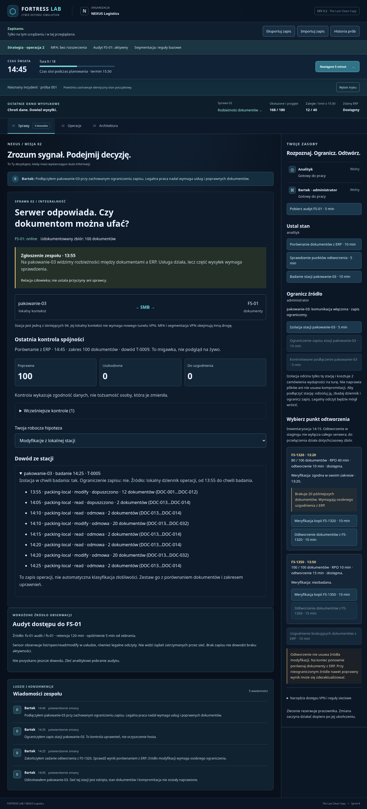
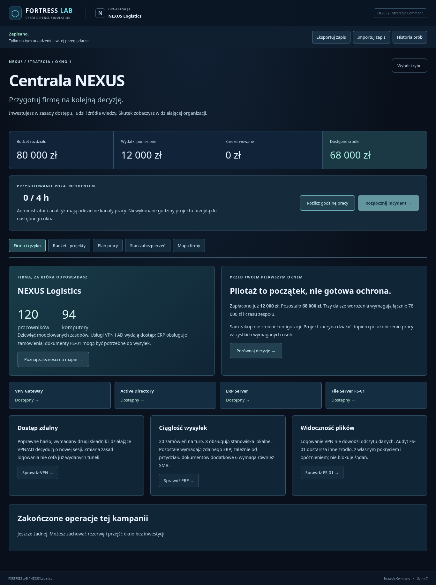
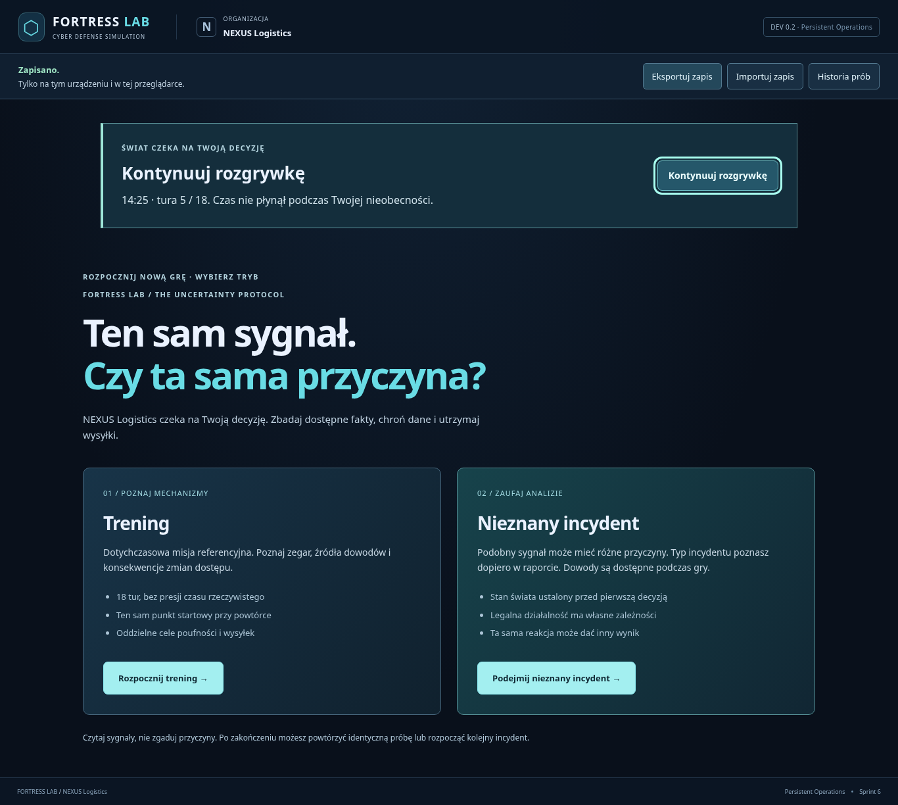
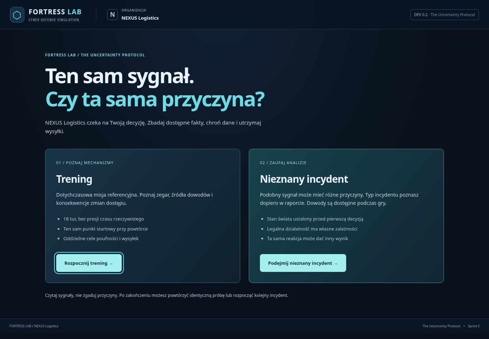

# cyber-fortress

FORTRESS LAB - A cybersecurity strategy game and IT infrastructure simulator. Build defenses, investigate incidents, manage risks, and learn through gameplay.

## FORTRESS LAB — After Action Review (Sprint 10)

Po zakończeniu każdej misji pobierzesz **raport JSON do analizy AI** oraz
**czytelny raport Markdown**. Pokazują wiedzę dostępną przed decyzją,
rzeczywisty stan i późniejsze skutki. Dotyczy to także porażki, częściowej
reakcji i legalnego incydentu. Gra nie ocenia automatycznie gracza.

Wybierz **Kopiuj instrukcję analizy**, a następnie dołącz JSON w wybranej
rozmowie z ChatGPT. Pliki powstają lokalnie, również offline; gra niczego
nie wysyła i nie wymaga klucza API. Raporty AAR są odrębne od pełnego zapisu
gry. Prywatna prawda AAR jest dostępna dopiero po 18. turze.

W Centrali można odtworzyć raport wcześniejszej misji z pełnego dziennika
kampanii. Samodzielna historia udostępnia raport dla próby z zachowanym
pełnym dziennikiem; przy samym podsumowaniu uczciwie informuje o braku
chronologii. Nie zmieniono mechanik ani zapisu V4.

[Kontrakt i rekonstrukcja wiedzy](docs/after-action-review.md) ·
[Trzy prawdziwe raporty do analizy](docs/aar-examples/README.md) ·
[Walidacja, scenariusze A–H i screenshoty](docs/after-action-review-validation.md).

### Defense Investment Program (Sprint 9)

Po ukończeniu Misji 02 i powrocie do Centrali pojawia się **Przegląd odporności
— Etap II**. Jawnie przyjmij jednorazowe **25 000 zł**: łączna pula rośnie do
105 000 zł, a wydatki i rezerwacje pozostają zachowane. To finansowanie przeglądu
ryzyka, również po nieudanej misji.

| Nowy projekt | Koszt | Praca administratora / analityka | Efekt |
| --- | ---: | --- | --- |
| EDR — Pilotaż | 24 000 zł | 2 h / 2 h | Agent tylko na pakowanie-03 (1/94), detekcja obserwowanych modify, pobranie dowodu w 5 min |
| Backup Resilience | 28 000 zł | 3 h / 2 h | Weryfikacja i test istniejącej FS-1350; zgodna dostępna kopia: restore 10 zamiast 15 min, RPO nadal 10 min |

Zaplanuj i zarezerwuj projekt, przydziel pracowników i rozlicz godziny.
Zabezpieczenie działa dopiero po pełnym wdrożeniu. Oba projekty wymagają 5 h
administratora, więc część pracy przejdzie do następnego okna bez ponownej
płatności. Możesz zachować rezerwę i powtórzyć Misję 02 bez kolejnej Misji 01.
EDR nie izoluje stacji, a backup nie zatrzymuje źródła zmian. Raport pokazuje
faktyczne wykorzystanie dowodów i odzyskiwania.

[Mechaniki, finansowanie i diagram](docs/resilience-investments.md) ·
[Strategie A–G, wyniki i screenshoty](docs/resilience-validation.md) ·
[FortressSaveV4 oraz zachowane V1/V2/V3](docs/game-save-v4.md).

### Misja 02 — Ostatnia czysta kopia

Po jednym ukończonym incydencie Misji 01 w centrali odblokowuje się
**Misja 02 — Ostatnia czysta kopia**. Rozlicz następne cztery godziny i wybierz
jej kartę. FS-01 odpowiada, lecz dokumenty nie zgadzają się z ERP. Zbadaj
dane i lokalną stację, ogranicz źródło modyfikacji, wybierz kopię, odtwórz
brakujące dokumenty i sprawdź rezultat. Sama izolacja nie naprawia danych;
samo odtworzenie nie usuwa przyczyny. MFA i segmentacja VPN nie kontrolują
automatycznie lokalnego SMB.

Masz 100 dokumentów, dwie kopie o różnym wieku i czasie odtworzenia,
czasowe zadania obu pracowników oraz rzeczywisty bilans 360 zamówień.
Kontrolowane podłączenie stacji wymaga izolacji, badania i ograniczenia zapisu;
nie oznacza oczyszczenia hosta. Audyt FS-01 daje dodatkowy dowód tylko po
wdrożeniu projektu. Bez nowych inwestycji przebieg odpowiada Sprintowi 8. Nie ma backendu.

[Modele, parametry i diagramy Misji 02](docs/mission-02-integrity.md) ·
[Wyniki strategii i screenshoty](docs/mission-02-validation.md) ·
[Zapis V3 i bezpieczna obsługa V1/V2](docs/game-save-v3.md).



### Misja 01 — stabilne dotychczasowe warianty

Trzy warianty misji **„Ostatnie okno wysyłkowe”** w NEXUS Logistics.
Jako Security Engineer otrzymujesz sygnał nietypowych logowań VPN, pozyskujesz
dowody i decydujesz, jak chronić dane, zachowując obsługę zamówień do 15:30.
Bez backendu, kluczy API, timerów czasu rzeczywistego i nowych zależności.

### Strategia — Centrala NEXUS

Odpowiadasz za przygotowanie firmy: **120 pracowników, 94 komputery**, modelowane
usługi VPN/AD, ERP i FS-01. Budżet rozdziału to **80 000 zł**, z czego pilotaż
MFA pochłonął już **12 000 zł**. Masz **68 000 zł** i czterogodzinne okno pracy
administratora oraz analityka.

| Inwestycja | Do zapłaty | Praca | Rzeczywisty skutek |
| --- | ---: | --- | --- |
| Uporządkowanie dostępu zdalnego | 20 000 zł | Administrator 4 h | Wymóg drugiego składnika i usunięcie SMB bez dokumentowanego zadania. |
| Widoczność dostępu do plików | 28 000 zł | Analityk 4 h + administrator 2 h | Audyt FS-01 z opóźnieniem, dostępny jako dowód. Nie zatrzymuje odczytu. |
| Rozdzielenie ruchu VPN | 30 000 zł | Administrator 4 h | Reguły dla konkretnych kont, osobno HTTPS i SMB. Wybrana grupa może wykluczyć legalną pracę. |

Wybierz **Rozpocznij strategię**, poznaj firmę i porównaj projekty. Zaplanuj projekt,
potwierdź rezerwację i przydziel pracownika w **Planie pracy**. Płatność następuje
przy pierwszej pracy, a zabezpieczenie aktywuje się dopiero po wykonaniu wszystkich
godzin. Dwie osoby mogą pracować równolegle. Niewykonana część przechodzi dalej.
Możesz też nie inwestować i zachować środki.

Rozlicz cztery godziny i rozpocznij incydent. Po 18 turach raport pokaże wpływ
przygotowania, a **Wróć do centrali** otworzy kolejne okno z zachowanymi inwestycjami,
budżetem oraz faktycznie zmienionymi regułami, kontami i dostępnością. Sesje,
alerty, wiedza i liczniki wycieku należą do pojedynczego incydentu. Kampania
wykorzystuje istniejące warianty; **Trening** i **Nieznany incydent** nadal działają
samodzielnie, bez przygotowania.

[Dokumentacja kampanii](docs/campaign.md) · [Silnik i źródła dowodów](docs/strategic-engine.md) ·
[Zapis V2 oraz aktualizacja z V1](docs/game-save-v2.md) ·
[Wyniki i ograniczenia Sprintu 7](docs/strategic-command-validation.md).



[Projekty](docs/screenshots/strategy-02-projects.png),
[harmonogram](docs/screenshots/strategy-03-schedule.png),
[aktywne zabezpieczenia](docs/screenshots/strategy-04-active-controls.png),
[raport](docs/screenshots/strategy-05-report.png) i
[dowód FS-01](docs/screenshots/strategy-06-file-evidence.png).

### Zapis, powrót i porównanie prób

Gra automatycznie zapisuje pełny stan po komendach oraz zmianie kontekstu/mapy.
Po ponownym otwarciu wybierz **Kontynuuj rozgrywkę** lub rozpocznij nową grę.
Zegar świata stoi również po zamknięciu karty. Wznowienie zachowuje zadania w toku,
sesje, dowody, kolejkę zamówień i prywatny stan symulacji.

- **Eksportuj zapis** pobiera kompletny JSON. **Importuj zapis** sprawdza wersje,
  strukturę i spójność z historią komend przed potwierdzeniem zastąpienia gry.
  Błędny plik nie zmienia bieżącego świata ani lokalnego zapisu. Nowe zapisy mają
  format V4; poprzednie oryginały V1/V2/V3 pozostają zachowane i możliwe do wyeksportowania.
- **Historia prób** porównuje ostatnie 50 zakończonych operacji: ujawnione dane,
  działalność, ograniczenie dostępu i działania samodzielnych misji. Wyniki strategii
  znajdziesz w Centrali w historii bieżącej kampanii. Powtórka tworzy nową próbę tego
  samego wariantu i seedu. Historia ma osobne potwierdzenie czyszczenia.
- Wskaźnik informuje o powodzeniu zapisu. Przy braku miejsca lub zablokowanej
  pamięci gra działa dalej; wyeksportuj plik, aby zachować postęp.
- Zapis jest lokalny dla przeglądarki i originu. Nie ma synchronizacji ani kont.
  Eksport zawiera fikcyjną ukrytą prawdę incydentu; nie jest zabezpieczeniem przed
  oszukiwaniem. Po załadowaniu zasobów rozgrywka działa bez sieci.

[Format i architektura zapisu](docs/persistence.md) ·
[Raport deterministyczności i Chromium](docs/persistence-validation.md) ·
[Konfiguracja publikacji GitHub Pages](docs/github-pages.md).



[Historia wyników](docs/screenshots/persistence-02-history.png) i
[widok 375 px](docs/screenshots/persistence-03-history-mobile.png).

### Wersja przeglądarkowa

Docelowy adres: **https://bsir9011-aew.github.io/cyber-fortress/**.
Repozytorium ma Pages w trybie GitHub Actions. Sprint 9 jest scalony na main.
Sprint 10 wymaga review PR i nie jest publikowany z gałęzi funkcjonalnej.
Workflow nadal wdraża wyłącznie `main`, po testach i produkcyjnym buildzie.

### Rozpoczęcie misji

1. Wybierz **Trening** (dotychczasowy wariant referencyjny) lub **Nieznany incydent**. Przeczytaj briefing Ewy i wybierz **Rozpocznij dochodzenie**.
2. W kontekście **Sprawy** obejrzyj alert. To sygnał do zbadania, nie potwierdzenie przejęcia konta.
3. Zleć analitykowi badanie logów, odczyt sesji lub rozmowę z Martą. Możesz też od razu zlecić administratorowi zmianę dostępu. Każda osoba ma jeden kanał pracy.
4. Wybierz **Następne 5 minut**, aby rozliczyć działalność, ukończyć zadania i rozstrzygnąć działania przeciwnika. Czytanie dowodów oraz oznaczanie hipotezy nie przesuwa zegara.
5. Porównuj dowody z ich źródłem i czasem pozyskania. Odczyty nie odświeżają się automatycznie. Ponowne badanie może ujawnić nowe zdarzenia.
6. W **Operacjach** obserwuj firmę i komunikaty zespołu; w **Architekturze** zbadaj mapę dziewięciu zasobów oraz jawne reguły.
7. Po 18 turach raport ujawni wariant i osobno pokaże poufność, ciągłość oraz możliwości dostępu. **Powtórz ten sam incydent** zachowuje wariant i seed; **Nowy incydent** rozpoczyna kolejny z czystą wiedzą i stanem firmy.

Cel danych: **0 ujawnionych rekordów z 2000**. Cel biznesowy: **najwyżej 40
zaległych zamówień o 15:30**. Nie sumujemy ich do jednej punktacji.

### Warianty i wiedza

Ten sam alert może oznaczać różne sytuacje. W nieznanym incydencie typ wariantu
pozostaje ukryty do raportu; źródła logów, tunele, rozmowa i jawne zależności
biznesowe pozwalają odkryć istotne różnice wcześniej.

Nowe warianty mają legalną zależność od dokumentów FS-01. Jej 6 zamówień na turę
wymaga rzeczywistej sesji, HTTPS, SMB i uprawnień. Zablokowanie SMB może zmienić
wydajność z 22 na 16, zachowując HTTPS do ERP. Sprawdź dokumentację zależności
w Operacjach i opis wybranej reguły.

### Źródła i granice wiedzy

- **VPN Authentication:** historia zależy od wariantu. W treningu: 52 nieudane próby konta `magazyn-07` przed 14:00, sukces 13:58 tworzący S-19 oraz legalne logowanie B-01 o 14:00. Retencja 120 minut, opóźnienie 0. Rejestrowane są także późniejsze rzeczywiste próby obu aktorów.
- **VPN Active Sessions:** odczyt aktywnych tuneli podczas badania; retencja 0, opóźnienie 0. Lista zachowuje czas obserwacji.
- **Marta:** osobny dowód typu relacja człowieka. Rozmowa zajmuje 5 minut i pozostaje możliwa bez VPN.
- Reguła detekcji: co najmniej 20 nieudanych logowań konta w 20 minut z tego samego sensora. Alert nie odczytuje stanu przeciwnika.

Badanie obu źródeł bramy zajmuje analitykowi 5 minut i wymaga dostępnego VPN.
Nie modelujemy adresów źródłowych, przepływów ani audytu plików. Błędy i późniejszy
sukces nie dowodzą, że hasło odgadnięto podczas tych prób. Brak danych nie dowodzi
braku ataku. Prywatny plan i licznik transferu są ujawniane wyłącznie w raporcie
po zakończeniu misji, nie w bieżącym widoku ani publicznym dzienniku.



Zrzuty po zakończeniu, ujawniające wariant: [raport referencyjny](docs/screenshots/variants-02-reference-report.png),
[legalna sesja i koszt blokady](docs/screenshots/variants-03-legitimate-report.png),
[zatrzymane nowe logowanie](docs/screenshots/variants-04-credential-report.png),
[wpływ SMB na firmę](docs/screenshots/variants-05-smb-business-cost.png).

### Porównanie wariantów

```bash
npm test
npm test -- src/simulation/scenarioVariants.test.ts --reporter=verbose --disableConsoleIntercept
```

Poniżej wyniki 18 tur z tego samego punktu startowego danego wariantu.
**Tabela ujawnia rozwiązania**. Komórki: ujawnione rekordy / obsłużone zamówienia / zaległe.

| Strategia | A: przejęty tunel | B: legalna sesja | C: nowe logowanie |
| --- | --- | --- | --- |
| Bez ograniczeń | 2000 / 360 / 0 | 0 / 360 / 0 | 2000 / 360 / 0 |
| Zawsze SMB deny gotowe 14:10 | 0 / 360 / 0 | 0 / 296 / 64 | 0 / 296 / 64 |
| Tylko blokada nowych logowań 14:05 | 2000 / 360 / 0 | 0 / 360 / 0 | 0 / 360 / 0 |
| Logi + rozmowa, decyzja zależna od dowodów | 0 / 360 / 0 | 0 / 360 / 0 | 0 / 360 / 0 |

Stała blokada SMB w B/C kosztuje **64 zaległe zamówienia** i przekracza limit 40.
Nie naliczamy sztucznych kar. Wydajność przez 16 przedziałów spada do 16 zamiast 22.
W B nie ma przeciwnika; raport nie przedstawia braku ataku jako jego pokonania.

[Konfiguracja i granice wiedzy](docs/scenario-configuration.md) oraz
[porównanie, pełna walidacja i ograniczenia grywalności](docs/scenario-variants-validation.md).
Wybór jest deterministyczny: trening zawsze uruchamia A, a nieznany incydent
przechodzi przez katalog według numeru próby. Trzy stałe warianty nie stanowią
generatora proceduralnego.

### Regresja pięciu strategii wariantu referencyjnego

```bash
npm test
# Rzeczywiste liczby oraz nazwy nowych przypadków:
npm test -- src/simulation/incident.test.ts --reporter=verbose --disableConsoleIntercept
```

Poniżej wyniki testów pełnych 18 tur; **to informacje dla programisty, ujawniające rozwiązania**.

| Ścieżka | Decyzje | Ujawnione rekordy | Obsłużone zamówienia | Zaległe |
| --- | --- | ---: | ---: | ---: |
| A | Zignorowanie ostrzeżenia | 2000 | 360 | 0 |
| B | Logi, sesje, Marta; SMB deny gotowe 14:20 | 0 | 360 | 0 |
| C | Wyłączenie VPN 14:05 bez przywrócenia | 0 | 156 | 204 |
| D | Zakończenie tylko S-19 o 14:10 | 2000 | 360 | 0 |
| E | SMB deny gotowe 14:25 po pierwszej porcji | 400 | 360 | 0 |

W B i E udział jest odcięty, lecz konto i istniejący tunel nadal wymagają uwagi.
Raport sprawdza aktualne możliwości niezależnie od wyczerpania limitu ponowień.
[Raport Sprintu 4B](docs/incident-gameplay-validation.md) opisuje testy,
Chromium, przegląd pierwszych minut i ograniczenia. Zachowano wyniki silnika
ze [Sprintu 4A](docs/threat-simulation-validation.md).

### Mapa i dostępność

- Kliknij zasób lub relację, aby otworzyć inspektor. Warstwy rozdzielają sieć, tożsamość, biznes i pokrycie sensorów.
- `Tab`, `Enter` i `Spacja` obsługują decyzje oraz elementy mapy. Widoczny fokus nie zależy od koloru statusu.
- Na telefonie skróty **Sprawa i dowody / Zleć zadanie** prowadzą do odpowiednich sekcji. Mapę i logi można przewijać w ich panelach.
- Krótkie przejścia respektują `prefers-reduced-motion`.

### Wymagania i uruchomienie

- Node.js **24 LTS** (wersja główna zapisana w `.nvmrc`).
- npm dostarczany z Node.js; zależności utrwala `package-lock.json`.

W katalogu głównym repozytorium:

```bash
# Jeśli korzystasz z nvm:
nvm install
nvm use

npm ci
npm run dev
```

Otwórz adres wypisany przez Vite (domyślny port: 5173).
W środowisku chmurowym można uruchomić `npm run dev -- --host 0.0.0.0`.
Nie są potrzebne usługi zewnętrzne ani zmienne środowiskowe.
Projektowy cache npm znajduje się w ignorowanym katalogu `.npm/`, aby instalacja
działała również w środowiskach z niezapisywalnym katalogiem domowym.

### Polecenia

| Polecenie            | Działanie                                                        |
| -------------------- | ---------------------------------------------------------------- |
| `npm run dev`        | Serwer deweloperski Vite z odświeżaniem zmian.                   |
| `npm run typecheck`  | Typy aplikacji, testów i konfiguracji oraz silnik bez typów DOM. |
| `npm test`           | Jednorazowe uruchomienie testów Vitest w Node.                   |
| `npm run test:watch` | Testy w trybie obserwowania zmian.                               |
| `npm run build`      | Sprawdzenie typów i produkcyjny build do `dist/`.                |
| `npm run preview`    | Podgląd `dist/` pod `/cyber-fortress/` (domyślny port: 4173). |

Walidacja przed commitem:

```bash
npm test
npm run typecheck
npm run build
```

### Struktura i dokumentacja

```text
src/
  domain/       # typy i kontrakty świata
  simulation/   # czas, dostęp, biznes, zadania, przeciwnik, sensory, narracja i przejścia stanu
  application/  # inicjalizacja, reducer misji/kampanii, sesje gry, projekcje i raporty
  content/      # infrastruktura, trzy stabilne warianty VPN, odrębna Misja 02 i projekty
  ui/           # React, style i SVG
  persistence/  # zapis V4, zgodność V1/V2/V3, walidacja, localStorage i historia prób
docs/           # architektura i GDD
prototype/      # archiwalny prototyp HTML 0.1
```

- [Kampania i budżet](docs/campaign.md)
- [Misja 02: lokalny dostęp, integralność i recovery](docs/mission-02-integrity.md)
- [After Action Review i eksport AI](docs/after-action-review.md)
- [Prawdziwe raporty JSON/Markdown](docs/aar-examples/README.md)
- [Walidacja AAR](docs/after-action-review-validation.md)
- [Inwestycje Etapu II i diagram](docs/resilience-investments.md)
- [Walidacja strategii A–G](docs/resilience-validation.md)
- [Zapis V4 i zgodność V1–V4](docs/game-save-v4.md)
- [Zapis V3 i zachowane oryginały](docs/game-save-v3.md)
- [Walidacja i strategie Sprintu 8](docs/mission-02-validation.md)
- [Semantyka silnika Sprintu 7](docs/strategic-engine.md)
- [Zapis V2 i ochrona V1](docs/game-save-v2.md)
- [Raport Sprintu 7](docs/strategic-command-validation.md)
- [Archiwalny format V1](docs/persistence.md)
- [Walidacja Sprintu 6](docs/persistence-validation.md)
- [Publikacja przez GitHub Pages](docs/github-pages.md)
- [Konfiguracja scenariuszy](docs/scenario-configuration.md)
- [Raport porównawczy i walidacja Sprintu 5](docs/scenario-variants-validation.md)
- [Architektura i granice modułów](docs/architecture.md)
- [GDD v1.0 — kierunek przyszłego rozwoju](docs/FORTRESS_LAB_GDD_v1.0.md)
- [Prototyp referencyjny](prototype/README.md)

Licencja: [MIT](LICENSE).

### Granice etapu

Jedna organizacja, trzy stałe warianty Misji 01 i osobna Misja 02 z jednym lokalnym źródłem zmian. Kopiowanie i modyfikacje zmieniają wyłącznie
abstrakcyjny stan rekordów i dokumentów w TypeScript. Działania symulacji nie wykonują
operacji w prawdziwej sieci ani na plikach. Nie ma pełnego SOC/SIEM, sensorów ruchu,
generatywnych dialogów, wielowątkowej kampanii, gospodarki rynkowej, kont ani
chmurowych zapisów. Audyt obejmuje tylko jawnie modelowaną usługę FS-01. Odświeżenie strony proponuje wznowienie lokalnej próby.

Prosty planer nadal kończy próby po 3 kolejnych porażkach; raport odróżnia ten limit
od odcięcia technicznych możliwości. Wyłączenie VPN nie zmienia ważności
przejętego poświadczenia. W Operacjach → Konto i poświadczenie administrator
może przywrócić nowe logowania wskazanego zablokowanego konta zadaniem trwającym
5 minut. Nie przywraca to zakończonych tuneli, nie zmienia hasła ani MFA.
Nadal ważne przejęte poświadczenie może znów umożliwić dostęp. Legalna praca
wymaga poprawnego nowego logowania i dostępnych usług; stan konta przechodzi do
następnych misji. Dowolne edytowanie nadań pozostaje poza dostępnymi komendami.
Projekt A porządkuje tylko jawnie określony
zakres SMB.

Przegląd techniczny pierwszych minut nie zastępuje testów grywalności z ludźmi.
