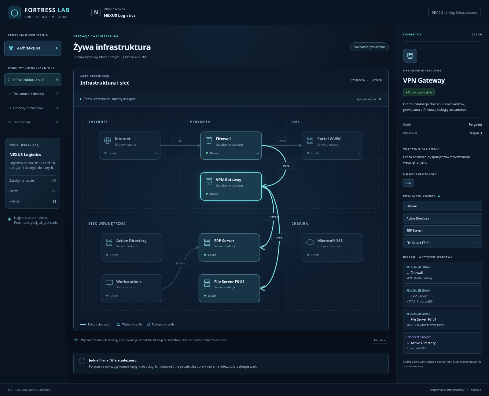

# cyber-fortress

FORTRESS LAB - A cybersecurity strategy game and IT infrastructure simulator. Build defenses, investigate incidents, manage risks, and learn through gameplay.

## FORTRESS LAB — Living Infrastructure (Sprint 2)

Strategiczno-techniczna gra o cyberbezpieczeństwie fikcyjnej firmy **NEXUS
Logistics**. Uczymy poprzez decyzje i ich konsekwencje dla działalności firmy.

Obecny etap to interaktywna mapa dziewięciu zasobów NEXUS Logistics, strefy,
kierunkowe relacje i inspektor. Wszystkie systemy i powiązania pochodzą z jednego
modelu świata. **Nie zawiera jeszcze silnika, incydentów, pierwszej misji ani
zapisu gry.** Bez backendu i wymaganych kluczy API.

### Poznawanie infrastruktury

- Kliknij zasób, aby poznać jego funkcję, właściciela, usługi i powiązania.
- Kliknij strzałkę lub jej etykietę, aby zobaczyć źródło, cel, protokół i znaczenie.
- Przełączaj warstwy: sieć, tożsamość i dostęp, procesy biznesowe oraz telemetria.
- Wybór relacji z inspektora automatycznie otwiera jej warstwę.
- `Tab` i `Enter`/`Spacja` obsługują węzły i relacje; „Wyczyść wybór” usuwa zaznaczenie.
- Na małym ekranie mapę można przewijać poziomo wewnątrz jej panelu.

Telemetria jest celowo pusta: scenariusz nie definiuje jeszcze źródeł obserwacji.
Nie ma fikcyjnych audytów, napraw ani niepotwierdzonych ocen bezpieczeństwa.
Relacja sieciowa nie oznacza uprawnienia do usługi, a zależność biznesowa wskazuje
usługę potrzebną do pracy, nie trasę pakietów.



### Wymagania i uruchomienie

- Node.js **24 LTS** (wersja główna zapisana w `.nvmrc`).
- npm dostarczany z Node.js; zależności utrwala `package-lock.json`.

W katalogu głównym repozytorium:

```bash
# Jeśli korzystasz z nvm:
nvm install
nvm use

npm ci
npm run dev
```

Otwórz adres wypisany przez Vite (domyślny port: 5173).
W środowisku chmurowym można uruchomić `npm run dev -- --host 0.0.0.0`.
Nie są potrzebne usługi zewnętrzne ani zmienne środowiskowe.
Projektowy cache npm znajduje się w ignorowanym katalogu `.npm/`, aby instalacja
działała również w środowiskach z niezapisywalnym katalogiem domowym.

### Polecenia

| Polecenie            | Działanie                                                  |
| -------------------- | ---------------------------------------------------------- |
| `npm run dev`        | Serwer deweloperski Vite z odświeżaniem zmian.             |
| `npm run typecheck`  | Ścisłe sprawdzanie typów aplikacji, testów i konfiguracji. |
| `npm test`           | Jednorazowe uruchomienie testów Vitest w Node.             |
| `npm run test:watch` | Testy w trybie obserwowania zmian.                         |
| `npm run build`      | Sprawdzenie typów i produkcyjny build do `dist/`.          |
| `npm run preview`    | Lokalny podgląd zbudowanego `dist/` (domyślny port: 4173). |

Walidacja przed commitem:

```bash
npm test
npm run typecheck
npm run build
```

### Struktura i dokumentacja

```text
src/
  domain/       # typy i kontrakty świata
  simulation/   # miejsce na przyszły silnik niezależny od Reacta
  application/  # inicjalizacja świata i selektory warstw/powiązań
  content/      # dane organizacji oraz scenariusz NEXUS Logistics
  ui/           # React, style i SVG
  persistence/  # miejsce na przyszłe adaptery zapisu
docs/           # architektura i GDD
prototype/      # archiwalny prototyp HTML 0.1
```

- [Architektura i granice modułów](docs/architecture.md)
- [GDD v1.0 — kierunek przyszłego rozwoju](docs/FORTRESS_LAB_GDD_v1.0.md)
- [Prototyp referencyjny](prototype/README.md)

Licencja: [MIT](LICENSE).
