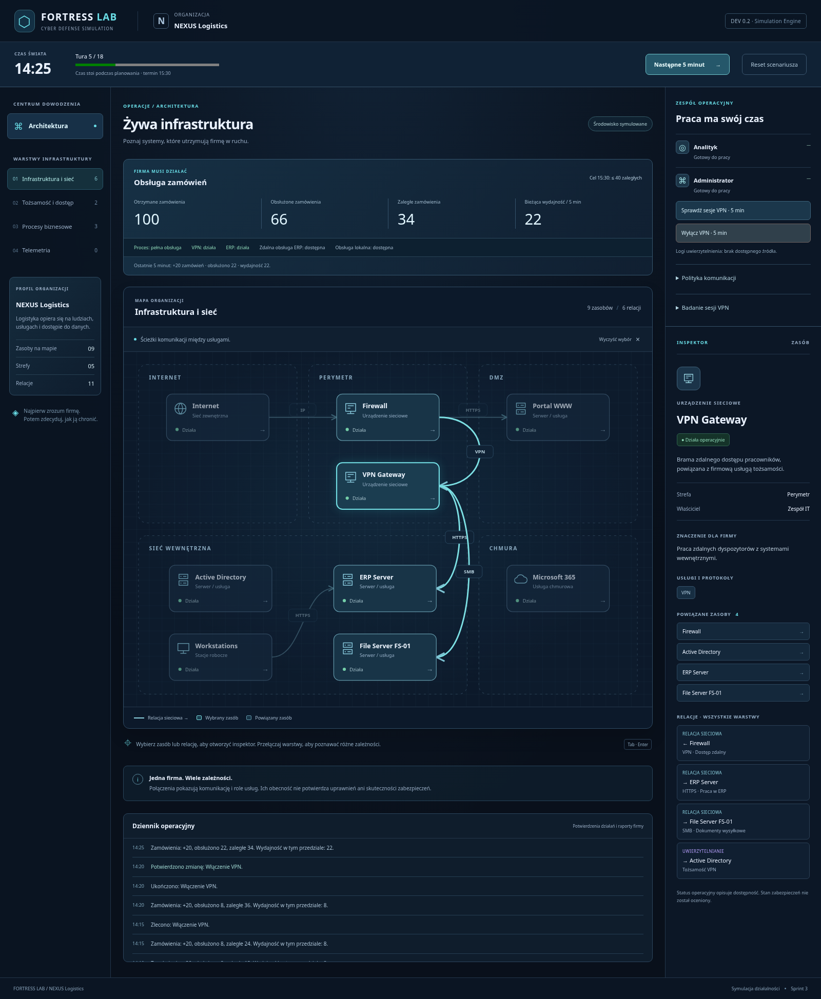

# cyber-fortress

FORTRESS LAB - A cybersecurity strategy game and IT infrastructure simulator. Build defenses, investigate incidents, manage risks, and learn through gameplay.

## FORTRESS LAB — Threat Simulation Engine (Sprint 4A)

Strategiczno-techniczna gra o cyberbezpieczeństwie fikcyjnej firmy **NEXUS
Logistics**. Uczymy poprzez decyzje i ich konsekwencje dla działalności firmy.

Interaktywna mapa dziewięciu zasobów jest połączona z deterministycznym silnikiem
działalności firmy. Czas, zadania, stan VPN, sesje i reguły sieciowe wpływają na
rzeczywistą kolejkę zamówień. Jeden stan symulacji zasila mapę i wszystkie panele.
Bez backendu i wymaganych kluczy API.

Silnik zawiera też pierwszego symulowanego przeciwnika. Rekonesans, logowanie i
każda porcja kopiowanych rekordów podlegają rzeczywistym warunkom dostępu. Jego
plan i wyniki są prywatne: bieżący interfejs zachowuje dotychczasową wiedzę gracza,
a podsumowanie na ekranie nadal dotyczy wyłącznie działalności firmy. Brak sensorów
oznacza brak alertów SOC i automatycznej informacji o wycieku.

### Walidacja przeciwnika

```bash
npm test
# Szczegółowy raport ścieżek z rzeczywistymi liczbami:
npm test -- src/simulation/attacker.test.ts --reporter=verbose --disableConsoleIntercept
```

Wyniki referencyjnych przebiegów 18 tur przy tym samym stanie początkowym:

| Decyzja gracza                                    | Ujawnione rekordy | Obsłużone zamówienia | Zaległe |
| ------------------------------------------------- | ----------------: | -------------------: | ------: |
| A: brak reakcji                                   |              2000 |                  360 |       0 |
| B: blokada SMB zlecona o 14:00, ukończona o 14:10 |                 0 |                  360 |       0 |
| C: blokada SMB zlecona o 14:15, ukończona o 14:25 |               400 |                  360 |       0 |

[Pełny raport i wykaz testów](docs/threat-simulation-validation.md) oraz
[architektura i diagram przejść](docs/architecture.md#przeciwnik-sprint-4a)
opisują backoff, ponowne logowanie i granice wiedzy. Liczby w tabeli są wynikami
testów; nie są komunikatami dostępnymi graczowi podczas rozgrywki.

### Pierwsza próba symulacji

1. Zleć administratorowi **Wyłącz VPN**. Zadanie trwa 5 minut; samo kliknięcie nie zmienia infrastruktury.
2. Kliknij **Następne 5 minut**. Firma rozliczy poprzedni przedział przy sprawnym VPN, a następnie brama zostanie wyłączona.
3. Przesuń kolejne tury: zamiast maksymalnie 22 firma obsługuje 8 zamówień na turę przy popycie 20. Kolejka rośnie o 12.
4. Zleć **Włącz VPN** i zakończ jego zadanie. Wydajność wróci w następnym przedziale, o ile pozostałe zależności działają. Nadwyżka 2 zamówień pozwala stopniowo zmniejszać zaległości.
5. O 15:30, po 18 turach, sprawdź podsumowanie. Cel: maksymalnie 40 zaległych zleceń. **Reset scenariusza** odtwarza stan początkowy.

Czas nie płynie podczas oglądania mapy i planowania. Raport „Ostatnie 5 minut”
dotyczy zakończonego przedziału; bieżąca wydajność uwzględnia już ukończone zmiany.
Sześć początkowych tur bez VPN daje 72 zaległości. Po dalszych 12 sprawnych turach
końcowa zaległość wynosi 48 — firma nie bankuje niewykorzystanej wydajności.

Analityk może zbadać aktywne sesje VPN. Dopiero ukończone badanie udostępnia cele
zakończenia sesji, blokady logowania lub resetu poświadczenia. To odrębne działania.
Lista sesji zachowuje czas odczytu i wymaga ponownego badania, aby ją odświeżyć.
Administrator może też zmieniać konkretne reguły, np. blokować SMB bez blokowania HTTPS.



### Poznawanie infrastruktury

- Kliknij zasób, aby poznać jego funkcję, właściciela, usługi i powiązania.
- Kliknij strzałkę lub jej etykietę, aby zobaczyć źródło, cel, protokół i znaczenie.
- Przełączaj warstwy: sieć, tożsamość i dostęp, procesy biznesowe oraz telemetria.
- Wybór relacji z inspektora automatycznie otwiera jej warstwę.
- `Tab` i `Enter`/`Spacja` obsługują węzły i relacje; „Wyczyść wybór” usuwa zaznaczenie.
- Na małym ekranie mapę można przewijać poziomo wewnątrz jej panelu.

Telemetria jest celowo pusta: scenariusz nie definiuje jeszcze źródeł obserwacji.
Nie ma fikcyjnych audytów, napraw ani niepotwierdzonych ocen bezpieczeństwa.
Relacja sieciowa nie oznacza uprawnienia do usługi, a zależność biznesowa wskazuje
usługę potrzebną do pracy, nie trasę pakietów.

Zachowano mapę, warstwy, inspektor i obsługę klawiatury ze Sprintu 2.

### Wymagania i uruchomienie

- Node.js **24 LTS** (wersja główna zapisana w `.nvmrc`).
- npm dostarczany z Node.js; zależności utrwala `package-lock.json`.

W katalogu głównym repozytorium:

```bash
# Jeśli korzystasz z nvm:
nvm install
nvm use

npm ci
npm run dev
```

Otwórz adres wypisany przez Vite (domyślny port: 5173).
W środowisku chmurowym można uruchomić `npm run dev -- --host 0.0.0.0`.
Nie są potrzebne usługi zewnętrzne ani zmienne środowiskowe.
Projektowy cache npm znajduje się w ignorowanym katalogu `.npm/`, aby instalacja
działała również w środowiskach z niezapisywalnym katalogiem domowym.

### Polecenia

| Polecenie            | Działanie                                                        |
| -------------------- | ---------------------------------------------------------------- |
| `npm run dev`        | Serwer deweloperski Vite z odświeżaniem zmian.                   |
| `npm run typecheck`  | Typy aplikacji, testów i konfiguracji oraz silnik bez typów DOM. |
| `npm test`           | Jednorazowe uruchomienie testów Vitest w Node.                   |
| `npm run test:watch` | Testy w trybie obserwowania zmian.                               |
| `npm run build`      | Sprawdzenie typów i produkcyjny build do `dist/`.                |
| `npm run preview`    | Lokalny podgląd zbudowanego `dist/` (domyślny port: 4173).       |

Walidacja przed commitem:

```bash
npm test
npm run typecheck
npm run build
```

### Struktura i dokumentacja

```text
src/
  domain/       # typy i kontrakty świata
  simulation/   # czas, dostęp, biznes, zadania, przeciwnik i przejścia stanu
  application/  # inicjalizacja, reducer, publiczna projekcja i selektory mapy
  content/      # infrastruktura i referencyjny scenariusz symulacji NEXUS
  ui/           # React, style i SVG
  persistence/  # miejsce na przyszłe adaptery zapisu
docs/           # architektura i GDD
prototype/      # archiwalny prototyp HTML 0.1
```

- [Architektura i granice modułów](docs/architecture.md)
- [GDD v1.0 — kierunek przyszłego rozwoju](docs/FORTRESS_LAB_GDD_v1.0.md)
- [Prototyp referencyjny](prototype/README.md)

Licencja: [MIT](LICENSE).

### Granice etapu

Transfer oznacza wyłącznie zmianę liczby ujawnionych rekordów w stanie TypeScript;
nie wykonuje operacji na prawdziwych plikach ani w sieci. Nie ma jeszcze wykrywania
incydentów, SOC/SIEM, panelu dochodzenia, ekonomii ani zapisów gry. Nie ma źródła
logów uwierzytelnienia: interfejs zgłasza ich brak. Uproszczenia przeciwnika, dostępu
i zagregowanego legalnego zespołu opisano w [architekturze](docs/architecture.md).
