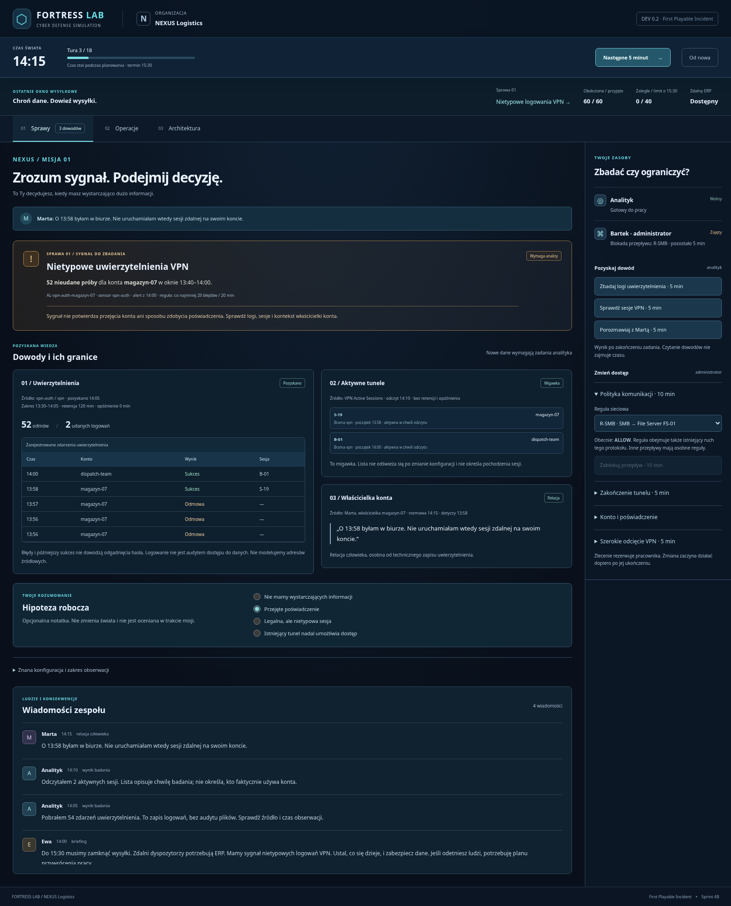

# cyber-fortress

FORTRESS LAB - A cybersecurity strategy game and IT infrastructure simulator. Build defenses, investigate incidents, manage risks, and learn through gameplay.

## FORTRESS LAB — First Playable Incident (Sprint 4B)

Pierwsza grywalna misja **„Ostatnie okno wysyłkowe”** w NEXUS Logistics.
Jako Security Engineer otrzymujesz sygnał nietypowych logowań VPN, pozyskujesz
dowody i decydujesz, jak chronić dane, zachowując obsługę zamówień do 15:30.
Bez backendu, kluczy API, timerów czasu rzeczywistego i nowych zależności.

### Rozpoczęcie misji

1. Przeczytaj briefing Ewy i wybierz **Rozpocznij dochodzenie**.
2. W kontekście **Sprawy** obejrzyj alert. To sygnał do zbadania, nie potwierdzenie przejęcia konta.
3. Zleć analitykowi badanie logów, odczyt sesji lub rozmowę z Martą. Możesz też od razu zlecić administratorowi zmianę dostępu. Każda osoba ma jeden kanał pracy.
4. Wybierz **Następne 5 minut**, aby rozliczyć działalność, ukończyć zadania i rozstrzygnąć działania przeciwnika. Czytanie dowodów oraz oznaczanie hipotezy nie przesuwa zegara.
5. Porównuj dowody z ich źródłem i czasem pozyskania. Odczyty nie odświeżają się automatycznie. Ponowne badanie może ujawnić nowe zdarzenia.
6. W **Operacjach** obserwuj firmę i komunikaty zespołu; w **Architekturze** zbadaj mapę dziewięciu zasobów oraz jawne reguły.
7. Po 18 turach raport osobno pokaże poufność, ciągłość oraz pozostałe możliwości dostępu. **Zagraj ponownie** odtwarza cały scenariusz.

Cel danych: **0 ujawnionych rekordów z 2000**. Cel biznesowy: **najwyżej 40
zaległych zamówień o 15:30**. Nie sumujemy ich do jednej punktacji.

### Źródła i granice wiedzy

- **VPN Authentication:** 52 nieudane próby konta `magazyn-07` przed 14:00, sukces 13:58 tworzący S-19 oraz legalne logowanie B-01 o 14:00. Retencja 120 minut, opóźnienie 0. Rejestrowane są także późniejsze rzeczywiste próby obu aktorów.
- **VPN Active Sessions:** odczyt aktywnych tuneli podczas badania; retencja 0, opóźnienie 0. Lista zachowuje czas obserwacji.
- **Marta:** osobny dowód typu relacja człowieka. Rozmowa zajmuje 5 minut i pozostaje możliwa bez VPN.
- Reguła detekcji: co najmniej 20 nieudanych logowań konta w 20 minut z tego samego sensora. Alert nie odczytuje stanu przeciwnika.

Badanie obu źródeł bramy zajmuje analitykowi 5 minut i wymaga dostępnego VPN.
Nie modelujemy adresów źródłowych, przepływów ani audytu plików. Błędy i późniejszy
sukces nie dowodzą, że hasło odgadnięto podczas tych prób. Brak danych nie dowodzi
braku ataku. Prywatny plan i licznik transferu są ujawniane wyłącznie w raporcie
po zakończeniu misji, nie w bieżącym widoku ani publicznym dzienniku.



Zrzuty: [briefing](docs/screenshots/incident-01-briefing.png),
[dochodzenie](docs/screenshots/incident-02-investigation.png),
[decyzja](docs/screenshots/incident-03-decision.png),
[raport końcowy](docs/screenshots/incident-04-report.png).

### Walidacja pięciu strategii

```bash
npm test
# Rzeczywiste liczby oraz nazwy nowych przypadków:
npm test -- src/simulation/incident.test.ts --reporter=verbose --disableConsoleIntercept
```

Poniżej wyniki testów pełnych 18 tur; **to informacje dla programisty, ujawniające rozwiązania**.

| Ścieżka | Decyzje | Ujawnione rekordy | Obsłużone zamówienia | Zaległe |
| --- | --- | ---: | ---: | ---: |
| A | Zignorowanie ostrzeżenia | 2000 | 360 | 0 |
| B | Logi, sesje, Marta; SMB deny gotowe 14:20 | 0 | 360 | 0 |
| C | Wyłączenie VPN 14:05 bez przywrócenia | 0 | 156 | 204 |
| D | Zakończenie tylko S-19 o 14:10 | 2000 | 360 | 0 |
| E | SMB deny gotowe 14:25 po pierwszej porcji | 400 | 360 | 0 |

W B i E udział jest odcięty, lecz konto i istniejący tunel nadal wymagają uwagi.
Raport sprawdza aktualne możliwości niezależnie od wyczerpania limitu ponowień.
[Raport Sprintu 4B](docs/incident-gameplay-validation.md) opisuje testy,
Chromium, przegląd pierwszych minut i ograniczenia. Zachowano wyniki silnika
ze [Sprintu 4A](docs/threat-simulation-validation.md).

### Mapa i dostępność

- Kliknij zasób lub relację, aby otworzyć inspektor. Warstwy rozdzielają sieć, tożsamość, biznes i pokrycie sensorów.
- `Tab`, `Enter` i `Spacja` obsługują decyzje oraz elementy mapy. Widoczny fokus nie zależy od koloru statusu.
- Na telefonie skróty **Sprawa i dowody / Zleć zadanie** prowadzą do odpowiednich sekcji. Mapę i logi można przewijać w ich panelach.
- Krótkie przejścia respektują `prefers-reduced-motion`.

### Wymagania i uruchomienie

- Node.js **24 LTS** (wersja główna zapisana w `.nvmrc`).
- npm dostarczany z Node.js; zależności utrwala `package-lock.json`.

W katalogu głównym repozytorium:

```bash
# Jeśli korzystasz z nvm:
nvm install
nvm use

npm ci
npm run dev
```

Otwórz adres wypisany przez Vite (domyślny port: 5173).
W środowisku chmurowym można uruchomić `npm run dev -- --host 0.0.0.0`.
Nie są potrzebne usługi zewnętrzne ani zmienne środowiskowe.
Projektowy cache npm znajduje się w ignorowanym katalogu `.npm/`, aby instalacja
działała również w środowiskach z niezapisywalnym katalogiem domowym.

### Polecenia

| Polecenie            | Działanie                                                        |
| -------------------- | ---------------------------------------------------------------- |
| `npm run dev`        | Serwer deweloperski Vite z odświeżaniem zmian.                   |
| `npm run typecheck`  | Typy aplikacji, testów i konfiguracji oraz silnik bez typów DOM. |
| `npm test`           | Jednorazowe uruchomienie testów Vitest w Node.                   |
| `npm run test:watch` | Testy w trybie obserwowania zmian.                               |
| `npm run build`      | Sprawdzenie typów i produkcyjny build do `dist/`.                |
| `npm run preview`    | Lokalny podgląd zbudowanego `dist/` (domyślny port: 4173).       |

Walidacja przed commitem:

```bash
npm test
npm run typecheck
npm run build
```

### Struktura i dokumentacja

```text
src/
  domain/       # typy i kontrakty świata
  simulation/   # czas, dostęp, biznes, zadania, przeciwnik, sensory, narracja i przejścia stanu
  application/  # inicjalizacja, reducer, publiczna projekcja, raport końcowy i selektory mapy
  content/      # infrastruktura i referencyjny scenariusz symulacji NEXUS
  ui/           # React, style i SVG
  persistence/  # miejsce na przyszłe adaptery zapisu
docs/           # architektura i GDD
prototype/      # archiwalny prototyp HTML 0.1
```

- [Architektura i granice modułów](docs/architecture.md)
- [GDD v1.0 — kierunek przyszłego rozwoju](docs/FORTRESS_LAB_GDD_v1.0.md)
- [Prototyp referencyjny](prototype/README.md)

Licencja: [MIT](LICENSE).

### Granice etapu

Jedna misja i jeden deterministyczny przeciwnik. Kopiowanie zmienia wyłącznie
licznik abstrakcyjnych rekordów w TypeScript. Nie ma prawdziwych operacji
sieciowych, plików, SOC/SIEM, sensorów ruchu, generatywnych dialogów, kampanii,
ekonomii ani zapisu gry. Odświeżenie strony rozpoczyna nową próbę.

Prosty planer kończy próby po 3 kolejnych porażkach; raport odróżnia ten limit
od odcięcia technicznych możliwości. Wyłączenie VPN nie zmienia ważności
przejętego poświadczenia. Pełne przywrócenie zablokowanego konta oraz usuwanie
uprawnień pozostają poza dostępnymi komendami tego sprintu.

Przegląd techniczny pierwszych minut nie zastępuje testów grywalności z ludźmi.
