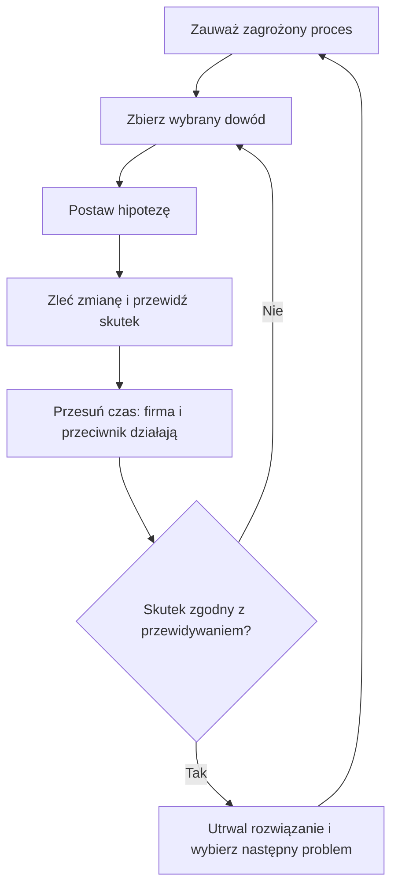
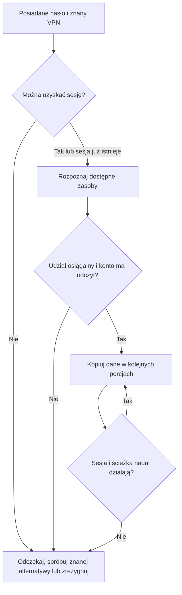
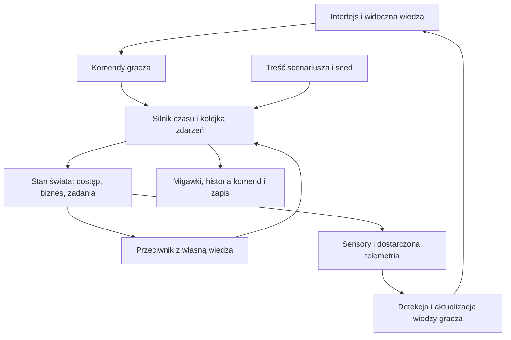

# FORTRESS LAB GAME DESIGN DOCUMENT v1.0

**Data:** 16.10.2026  
**Status:** propozycja do produkcji i testów. Parametry ekonomii, czasu i trudności są hipotezami projektowymi. Dokument nie opisuje funkcji już zaimplementowanych.  
**Punkt wyjścia:** przeanalizowany załącznik `fortress_lab_prototyp_01(1).html`.  
**Platforma:** lokalna przeglądarka, pojedynczy gracz, desktop.  
**Odbiorca:** osoba lubiąca strategie i zagadki systemowe; znajomość cyberbezpieczeństwa nie jest wymagana.  
**Zasada produkcyjna:** najpierw jeden dobry incydent i powtórka, następnie krótka kampania. Bez prawdziwego malware, maszyn wirtualnych i obowiązkowego backendu.

## 1. Creative Vision

**FORTRESS LAB to strategia ratowania działającej firmy przez rozumienie i zmienianie jej zależności.** Gracz odziedziczył organizację, której dokumentacja jest niepełna. Musi utrzymać pracę ludzi, jednocześnie odbierając przeciwnikowi możliwości działania.

Podstawowa przyjemność: „Wiem już, którędy to przechodzi. Mogę zatrzymać ten ruch, zachowując działanie reszty firmy”. Zamiast kolekcji narzędzi otrzymujemy problemy mające kilka racjonalnych rozwiązań.

### Trzy filary

| Filar | Obietnica dla gracza | Konsekwencja projektowa |
|---|---|---|
| Firma musi działać | Bronisz czegoś, co ma sens poza samą obroną | Każda istotna usługa obsługuje proces, kolejkę lub kontrakt |
| Przyczyny można odkryć | Sukces wynika z rozumowania | Logi, konfiguracja i skutki pochodzą z jednego stanu świata |
| Możesz zagrać inaczej | Porażka podsuwa nowy plan | Krótkie misje, zapis, powtórka tego samego wariantu i nowe warianty |

**Format docelowy:** misje po 15-25 minut, połączone krótką kampanią. Pierwsza zamknięta kampania może mieć sześć misji w jednej organizacji. Rozbudowa liczby firm następuje dopiero po sprawdzeniu tej kampanii.

**Dwa rytmy:** podczas incydentu podejmujesz decyzje na najbliższe minuty; pomiędzy misjami wybierasz inwestycje na kolejne dni. W obu trybach istnieją te same konta, sesje, usługi i reguły.

### Co adaptujemy z inspiracji

Poniższe propozycje są interpretacją projektową inspiracji wskazanych w briefie, nie analizą ich kodu ani obietnicą skopiowania całych systemów.

| Inspiracja | Mechanizm do adaptacji | Zastosowanie w FORTRESS LAB |
|---|---|---|
| Game Dev Tycoon | Przywiązanie do rozwijającej się organizacji | Zmiany firmy i konsekwencje inwestycji powracają w następnych misjach |
| Two Point Hospital | Czytelne wąskie gardła i ludzki kontekst | Zaległe zlecenia, zajęty administrator i konkretni pracownicy |
| Factorio | Widoczne przepływy i satysfakcja z poprawy układu | Obserwowanie, jak zmiana jednej reguły przywraca właściwy ruch |
| Hacknet | Składanie historii ze śladów | Sesje, logi i krótka korespondencja; terminal tylko opcjonalnie później |
| Into the Breach | Przewidywalność skutków własnej decyzji | Znane zależności biznesowe widoczne przed zatwierdzeniem zmiany |
| Papers, Please | Dylematy pod presją i niepełne informacje | Podejrzane konto należy do osoby, której praca jest pilnie potrzebna |

### Wyróżniki

1. **Ten sam przepływ służy pracownikowi i napastnikowi.** Zablokowanie SMB może uratować pliki, ale odciąć legalną pracę na udziale.
2. **Mapa wiedzy ma historię.** Każda informacja zawiera źródło, czas i status: dokumentacja, obserwacja albo hipoteza. Nowa konfiguracja może unieważnić poprzednie ustalenie.
3. **Powtórka przyczynowa.** Po misji widzisz, co zrobiłeś, co było wtedy obserwowalne i co naprawdę zaszło. Możesz wrócić do wybranego momentu i zmienić jedną decyzję.
4. **Wyjątki mają właściciela.** Tymczasowe dopuszczenie dostawcy pozostaje konkretną regułą z terminem i zależnościami, a nie abstrakcyjnym „długiem bezpieczeństwa”. Ten system wchodzi po MVP.

## 2. Krytyczna analiza koncepcji

Największe zagrożenie: zbudowanie szerokiego pulpitu administratora bez interesujących decyzji. Więcej technologii nie naprawi braku konfliktu, informacji i konsekwencji.

### Co rzeczywiście jest w prototypie

Załączony HTML zawiera osiem węzłów mapy, w tym Internet, siedem audytowalnych elementów, trzy widoki, budżet, licznik dni oraz sekwencję analizy i unieważnienia sesji VPN. Zmiany opierają się głównie na zbiorach `audited`, `fixed` i flagach incydentu.

| Obecne rozwiązanie | Problem dla gry | Decyzja do następnej wersji |
|---|---|---|
| Cel: wykonaj trzy audyty | Liczy czynności zamiast efektu | Cel: ochronić dane i dotrzymać okna wysyłkowego |
| Siedem napraw i audyty kosztują 74 000 zł przy budżecie 80 000 zł | Można kupić wszystkie poprawki; nie ma trwałego konfliktu wydatków | Ograniczona przepustowość zespołu, konkurencyjne projekty i późniejsze zobowiązania |
| Kliknięcie audytu dodaje dzień | Czas nie uruchamia działania przeciwnika ani biznesu | Wspólny zegar symulacji |
| „Wzmocniony” oznacza flagę | Firewall nie egzekwuje przepływów, MFA nie sprawdza logowania | Zmiany konkretnych reguł, kont i sesji |
| Analiza prowadzi do jednego przycisku reakcji | Po poznaniu rozwiązania znika zagadka | Kilka sposobów ograniczenia ataku i różne koszty biznesowe |
| Licznik incydentów spada do zera po unieważnieniu sesji | Interfejs sugeruje zamknięcie, chociaż opis mówi o dalszej analizie | Osobne stany: triage, badanie, ograniczenie, odtworzenie, zamknięcie |
| Mapa jest ilustracją relacji | Nie można sprawdzić konkretnej decyzji sieciowej | Klikalne przepływy z protokołem, kierunkiem i wynikiem decyzji |

Zachowujemy język „co wiemy / czego nie wiemy”, klimat kolorystyczny, nazwę firmy i układ mapa + inspektor. Rozdzielamy przy tym stan wiedzy od bezpieczeństwa: potwierdzona luka również jest „sprawdzona”.

### Ryzyka projektu

| Ryzyko | Objaw w testach | Odpowiedź |
|---|---|---|
| Nadmiar realizmu | Gracz uzupełnia konfigurację zamiast podejmować decyzje | Modelujemy tylko właściwości mające konsekwencje w scenariuszu |
| Uczenie się kolejności kliknięć | Ten sam plan wygrywa każdy wariant | Warianty różnią się przyczyną, uprawnieniami lub zależnościami |
| „Wyłącz wszystko” zawsze wygrywa | Dochodzenie nie ma wartości | Rzeczywiste zaległości biznesowe; krótkie odcięcie nadal bywa dobrym rozwiązaniem |
| Przeciwnik wszechwiedzący | Omija nową regułę, zanim ją sprawdzi | Replanuje na podstawie własnych obserwacji |
| Porażka wygląda na losową | Gracz nie umie wskazać przyczyny | Determinizm po ustaleniu wariantu, jawne reguły zmian i powtórka |
| Interfejs staje się SIEM-em | Większość czasu zajmuje przewijanie | Małe paczki dowodów, korelacja w sprawy, filtry i surowy widok na żądanie |
| Zbyt szeroki zakres | Miesiące pracy bez zamkniętej misji | Każdy etap kończy się grywalnym przebiegiem |

**Świadoma rezygnacja:** tryb atakującego, multiplayer, pełny edytor infrastruktury, swobodne polecenia terminala, wielki katalog produktów i sterowanie prawdziwą siecią nie należą do MVP.

## 3. Core Gameplay Loop



**Pętla taktyczna, zwykle 30-90 sekund czasu gracza:** wybierz istotny sygnał, kup informację czasem pracownika albo od razu ogranicz ryzyko, zatwierdź turę i porównaj zmianę z przewidywaniem.

**Pętla misji, 15-25 minut:** ustabilizuj sytuację, potwierdź zasięg problemu, przywróć działalność i zobacz podsumowanie. Misję można zakończyć częściowym sukcesem.

**Pętla kampanii:** wykorzystaj budżet, zaplanuj okno zmian i przyjmij następne zobowiązanie biznesowe. Organizacja pamięta wybrane inwestycje, zaległości i wyjątki.

Nagrodą jest obserwowalny skutek: legalne zlecenia znowu przechodzą, podejrzane żądania przestają docierać do udziału, analityk ma mniej niepotrzebnych spraw. Nie przyznajemy punktów za sam zakup technologii ani liczbę blokad.

Strategia i technika mają wspólną kartę decyzji: **dlaczego / zakres / wykonawca / czas / koszt / znane zależności / wycofanie**. Polecenie strategiczne „ogranicz zdalny dostęp do plików” otwiera dokładnie te reguły, które gracz może edytować technicznie.

## 4. Najważniejsze mechaniki

### 4.1. Czas i przepustowość zespołu

Pierwsza misja obejmuje 14:00-15:30 czasu świata: **18 tur po 5 minut**. Zegar stoi podczas czytania i planowania. „Następne 5 minut” uruchamia zaplanowane zadania, działanie firmy i próby przeciwnika. Zamknięcie przeglądarki zatrzymuje świat; nie ma obowiązku wracania o określonej godzinie.

Gracz ma dwa kanały pracy: **analityk** i **administrator**. Każdy wykonuje jedno zadanie naraz. Przegląd już uzyskanych dowodów i układanie planu są bezpłatne. Zebranie nowego dowodu wymaga czasu odpowiedniej osoby.

| Działanie w pierwszej misji | Wykonawca | Czas świata | Wydatek z budżetu bezpieczeństwa | Dokładny skutek |
|---|---|---:|---:|---|
| Pobierz logi uwierzytelniania VPN | Analityk | 5 min | 0 zł | Ujawnia zachowane zdarzenia logowania, nie historię plików |
| Pobierz listę aktywnych sesji | Analityk | 5 min | 0 zł | Ujawnia identyfikator, konto, początek i adres przydzielony sesji |
| Skontaktuj się z właścicielem konta | Analityk | 5 min | 0 zł | Dostarcza relację człowieka, z własnym poziomem wiarygodności |
| Odczytaj reguły i logi ruchu | Analityk | 5 min | 0 zł | Ujawnia aktualny zakres reguł i dostępne metadane połączeń |
| Zakończ wskazaną sesję VPN | Administrator | 5 min | 0 zł | Usuwa konkretny tunel; hasło pozostaje ważne |
| Zablokuj logowanie konta | Administrator | 5 min | 0 zł | Uniemożliwia nowe uwierzytelnienie; w modelowanej bramie nie kończy istniejącego tunelu |
| Zresetuj hasło konta | Administrator | 10 min | 0 zł | Unieważnia posiadane hasło; nie usuwa automatycznie wszystkich sesji usług |
| Zmień regułę między VPN i serwerami | Administrator | 10 min | 0 zł | Egzekwuje konkretny protokół, cel i zakres źródeł |
| Wyłącz/włącz usługę VPN | Administrator | 5 min | 0 zł | Zamyka wszystkie tunele / umożliwia nowe połączenia |
| Włącz MFA dla przygotowanej grupy pilotażowej | Administrator | 30 min | 12 000 zł | Zmienia wymagania nowych logowań tej grupy; nie usuwa istniejących sesji |

Wydatki projektowe są fikcyjnymi pakietami prac, integracji i wdrożenia, nie cennikiem rynkowym. Czas MFA dotyczy przygotowanej grupy; pełne wdrożenie na 120 osób trwa dłużej i należy do planowania między misjami.

Jedno kliknięcie nie gwarantuje wykonania. Zadanie musi mieć wykonawcę, spełnione warunki oraz termin ukończenia. Budżet projektu rezerwujemy przy przyjęciu zadania. Anulowanie przed startem zwalnia całość rezerwacji; po rozpoczęciu zwraca tylko część oznaczoną na karcie jako jeszcze niewydaną. Cofnięcie konfiguracji jest kolejnym zadaniem, a nie bezkosztowym przewinięciem czasu.

Po opanowaniu sprawy można wybrać „do następnego istotnego zdarzenia”. Gra przerywa przy nowym dowodzie, problemie biznesowym lub ukończeniu pracy wymagającej decyzji. Nie zmuszamy do przeklikiwania pustych tur.

### 4.2. Warunki dostępu zamiast punktów obrony

Uproszczony kontrakt dostępu:

`możliwe działanie = osiągalna usługa AND dozwolony przepływ AND ważna sesja/uwierzytelnienie AND wymagane uprawnienie AND spełnione warunki konkretnej techniki`.

Nie każda technika wymaga wszystkich składników w identycznej formie. Dostęp publiczny i exploit mają inne warunki niż odczyt udziału przez ważne konto. Silnik musi mieć jawne predykaty dla każdego działania.

| Zabezpieczenie | Zmieniany stan | Ograniczenie i koszt uboczny | Etap |
|---|---|---|---|
| MFA | Predykat wydania nowej sesji | Nie usuwa już wydanego dostępu; wdrożenie obciąża pomoc użytkownikom | Pierwszy scenariusz, ograniczony zakres |
| Segmentacja i ACL/firewall | Osiągalność celu i decyzja dla przepływu | Sam numer VLAN nie blokuje routingu; reguła może odciąć pracę | MVP |
| IAM/RBAC | Uprawnienia konkretnego podmiotu do zasobu | Odebranie roli może zatrzymać usługę lub zadanie użytkownika | MVP: proste grupy i uprawnienie odczytu |
| EDR | Zbieranie określonych zdarzeń i dostępność akcji izolacji hosta | Brak agenta oznacza brak tej telemetrii; legalny odczyt nie jest automatycznie blokowany | Alpha |
| WAF/IPS | Reguła dla obsługiwanego żądania w określonym miejscu ścieżki | Szyfrowanie, pokrycie i błędne dopasowania mają znaczenie | Po MVP, po jednym scenariuszu |
| NDR | Obserwacja wybranych odcinków i metadanych ruchu | Nie widzi automatycznie zawartości szyfrowanej komunikacji | Alpha lub później |
| SIEM/detekcja | Źródła, opóźnienie, retencja, warunki korelacji | Brak źródła oznacza brak wejścia dla reguły; SIEM sam nie zatrzymuje ataku | MVP: minimalna korelacja |
| SOAR | Jawny wyzwalacz i sekwencja komend | Wadliwa detekcja może automatycznie odciąć legalną usługę | Po sprawdzeniu ręcznej reakcji |
| Backup/DR | Dostępne kopie, zakres, wiek i czas odtworzenia | Kopia może być niedostępna; odtworzenie nie cofa wycieku | Alpha |

MVP nie reklamuje pełnych modeli AD, Entra, Zero Trust ani XDR. Symuluje wybrane ich mechanizmy.

### 4.3. Wiedza, hipotezy i eksperymenty

Karta informacji zawiera: stwierdzenie, źródło, czas pozyskania, zakres i status. „Nie ma nowych logów” nie znaczy „nic się nie wydarzyło”. „MFA włączone” nie znaczy „żadna stara sesja nie działa”.

Gracz może przypiąć hipotezę „stara sesja nadal działa” i wskazać, co ją potwierdzi lub osłabi. To narzędzie planowania, nie obowiązkowy formularz. Przed wybraną zmianą może zaznaczyć przewidywanie: który przepływ zniknie i który pozostanie.

Podgląd zmiany sprawdza znane konfiguracje i zależności. Nie ujawnia ukrytej tożsamości napastnika. Gdy wiedza jest niepełna, mówi „nie potwierdzono innych odbiorców tej reguły”, a nie podaje gwarancję bezpieczeństwa.

### 4.4. Ekonomia i konsekwencje

Początkowe 80 000 zł jest budżetem bezpieczeństwa na pierwszy rozdział. Nie jest obrotem firmy. Osobno śledzimy koszty projektów, skutki przestoju i zobowiązania operacyjne.

W czasie pierwszego incydentu najrzadszy zasób stanowi czas administratora. Pomiędzy misjami budżet zaczyna rozstrzygać między pokryciem EDR, pracą nad IAM, monitoringiem i odtwarzaniem. Każdy wydatek musi zmieniać wykorzystany później mechanizm. Nie sprzedajemy technologii, której efekt istnieje tylko w opisie.

W MVP wystarczą trzy zamknięte projekty przygotowania następnego okna operacyjnego. Ich ceny są celowo zestawione tak, by nie dało się wybrać wszystkich: 32 000 + 28 000 + 30 000 = 90 000 zł. Gracz może też niczego nie kupować i zachować rezerwę. Nie losujemy przyrostu „siły obrony”.

| Projekt MVP | Cena i czas wdrożenia | Konkretny skutek po ukończeniu | Kompromis |
|---|---|---|---|
| Uporządkowanie dostępu zdalnego | 32 000 zł, 4 godziny administratora poza aktywną misją | Wymóg MFA dla wskazanych 61 kont oraz usunięcie wyszczególnionych nadmiarowych uprawnień | Nie usuwa samoistnie aktywnych sesji ani innego niezinwentaryzowanego dostępu |
| Widoczność dostępu do plików | 28 000 zł, 4 godziny analityka i 2 administratora | Audyt określonego udziału FS-01, kolektor i dostarczenie zdarzeń w jednej turze | Daje dowody; nie blokuje odczytu i zwiększa ilość danych do analizy |
| Rozdzielenie ruchu VPN | 30 000 zł, 4 godziny administratora z oknem zmiany | Jawne grupy dostępu i reguły dla ERP oraz udziału, zweryfikowane testem legalnych przepływów | Ogranicza zakres, ale nie leczy przejętego konta ani sesji w innym serwisie |

To szersze wdrożenia z dokumentacją, testami i objęciem grup, więc nie mają ceny zerowej pojedynczej awaryjnej zmiany. Ukończony pilotaż MFA za 12 000 zł jest częścią pierwszego projektu: do zapłaty pozostaje 20 000 zł, bez podwójnej opłaty. Ręcznie wykonana i przetestowana konfiguracja zachowuje swoje skutki; projekt nie jest obowiązkowym zakupem tej samej reguły po raz drugi.

Między oknami operacyjnymi gracz planuje jedno czterogodzinne okno pracy zespołu; równoległe zadania respektują zajętość obu wykonawców. Niewykonane prace przechodzą do kolejnego okna. Wariant kolejnej misji jest inicjalizowany na odziedziczonym stanie: nie wolno automatycznie wygenerować sesji uzyskanej samym hasłem, jeśli wcześniej skutecznie włączono dla niej MFA. Powstrzymane wejście jest rzeczywistym efektem inwestycji, nie pretekstem do magicznego obejścia.

Celowe pozyskanie większej liczby informacji nie zawsze jest najlepsze: dodatkowe pięć minut może pozwolić na rozpoczęcie kopiowania danych. Z drugiej strony natychmiastowa szeroka blokada może być uzasadniona, gdy ryzyko jest duże, a zależności nieznane. Gra ocenia skutki i jakość decyzji przy dostępnej wiedzy, nie zgodność z jedną wzorcową procedurą.

## 5. Model świata

### 5.1. NEXUS Logistics

Firma zatrudnia 120 osób, używa 94 komputerów i środowiska hybrydowego. Przenosimy z prototypu jako początkowe fakty świata: 72 komputery z aktywnym EDR, 61 kont VPN bez wymogu MFA oraz nieaktualne potwierdzenie testu odtworzenia ERP. Gracz na początku nie zna tych wszystkich szczegółów.

Pierwsza misja używa dziewięciu węzłów mapy: Internet, firewall, VPN, AD/tożsamość, portal WWW, ERP, stacje robocze, Microsoft 365 i dodany serwer plików FS-01. Tylko elementy związane z incydentem mają rozwinięte interakcje. Pozostałe budują kontekst i nie udają gotowych mechanik.

Ludzi grupujemy w zespoły. Indywidualne postacie opisujemy tylko wtedy, gdy mają znaczenie dla decyzji. Pierwsze trzy: Marta, właścicielka konta `magazyn-07`; Bartek, administrator; Ewa, kierowniczka operacji. Nie symulujemy godzinowego życia wszystkich 120 pracowników.

### 5.2. Minimalne encje

| Encja | Istotne pola | Rola w symulacji |
|---|---|---|
| Zasób/usługa | ID, strefa, działanie, właściciel, oferowane protokoły | Cel komunikacji i zależność biznesowa |
| Tożsamość | ID, role, stan logowania, wersja poświadczenia, grupa MFA | Uprawnienia i możliwość uzyskania sesji |
| Sesja | ID, właściciel, wystawca, zakres, ważność, powiązany tunel | Dostęp utrzymujący się według zasad danej usługi |
| Przepływ/polityka | Źródło, cel, protokół, kierunek, kolejność reguły | Wynik konkretnej próby komunikacji |
| Proces biznesowy | Popyt, wydajność, zależności, kolejka, termin | Wymierny skutek przestoju |
| Człowiek/zespół | Funkcja, dostęp, plan pracy, dostępność | Zachowanie legalne i koszt odcięcia |
| Sensor | Źródło, pokrycie, zakres pól, opóźnienie, retencja | Granica tego, co można zobaczyć |
| Zadanie | Zlecenie, wykonawca, start, koniec, rezerwacje | Wykonanie decyzji w czasie |
| Dowód/sprawa | Treść, pochodzenie, czas, powiązania, status | Wiedza gracza i dochodzenie |
| Przeciwnik | Cel, wiedza, dostęp, budżet działań, plan | Próby zmiany świata z ograniczoną wiedzą |

Rozdzielamy pięć rodzajów relacji: **sieć, uwierzytelnienie, uprawnienie, zależność biznesowa i obserwacja sensora**. Linia między AD a VPN nie oznacza bezwarunkowego połączenia między dowolnymi usługami.

Przykładowa ścieżka legalna: zdalny dyspozytor zestawia tunel VPN, następnie używa ERP przez HTTPS. Oddzielna ścieżka daje mu dostęp do udziału plikowego przez SMB. Odebranie SMB nie musi przerywać HTTPS. To pierwsza niewielka zagadka architektoniczna.

### 5.3. Życie organizacji

W każdej turze wykonywane są: legalne zadania ludzi, zaplanowane prace IT, obsługa zleceń i działania przeciwnika. Wybór ekranu przez gracza nie ma wpływu na działanie tych systemów.

Zdarzenia dzielą się na kalendarzowe, wynikające ze stanu i losowane przy generowaniu wariantu. Z góry zaplanowana dostawa nie jest karą za dobry ruch gracza. Awaria musi mieć przyczynę albo parametr scenariusza, a nie pojawiać się dlatego, że gracz chwilowo wygrywa.

Po MVP dochodzą: nowy oddział wymagający nowych reguł, integracja dostawcy z terminowym wyjątkiem, zmiana uprawnień po reorganizacji i automatyzacja biznesowa wyglądająca podejrzanie w logach. Każde rozszerzenie wykorzystuje istniejące encje.

Nie każda nieprawidłowość jest pilna. Niskie ryzyko można odłożyć, pod warunkiem wskazania konkretnej ekspozycji i terminu ponownego przeglądu. Dobrze uzasadnione odroczenie jest pełnoprawną strategią.

## 6. Atak i obrona

### 6.1. Przeciwnik ma własną wiedzę

Pierwszy napastnik jest złodziejem danych, który zna hasło jednego konta i adres bramy VPN. Nie zna konfiguracji firewalla, wszystkich hostów ani planów gracza. Nie potrzebuje malware: nadużycie ważnego konta i usługi zdalnego dostępu jest wystarczającym punktem wejścia. Odpowiada to klasom T1078 i T1133 w MITRE ATT&CK [S1-S2].

Model przeciwnika:

`cel + posiadany dostęp + odkryte fakty + budżet działań → lista wykonalnych prób → wybór próby → wynik → aktualizacja własnej wiedzy`.

Każda technika ma warunki wejścia, czas, efekt w świecie, koszt zasobów i możliwe ślady. Przeciwnik nie odczytuje pełnego `WorldState`, aby wybrać idealną drogę. Wykonalność planuje na podstawie `AttackerKnowledge`; silnik świata rozstrzyga dopiero rzeczywisty wynik próby.

Pierwsza implementacja to mała maszyna stanów z kilkoma alternatywami, nie ogólny planner całej macierzy ATT&CK. Po MVP można wybierać ścieżkę w grafie działań. Ocena ścieżki bierze pod uwagę znany koszt, spodziewany zysk, ryzyko zauważenia i limit czasu.



**Adaptacja:** zakończenie tunelu jest dostrzegalne jako utrata połączenia, więc napastnik może spróbować zalogować się ponownie. Zmiana MFA nie jest dla niego automatycznie widoczna; dowiaduje się o wymaganiu przy kolejnym logowaniu. Gdy zna tylko jedną drogę i traci dostęp, może przegrać. Nie dostaje ukrytego drugiego wejścia dla podtrzymania dramaturgii.

### 6.2. Rozdzielenie prawdy od telemetrii

| Warstwa | Co zawiera | Kto z niej korzysta |
|---|---|---|
| Fakty świata | Wszystkie faktycznie wykonane działania i ich skutki | Silnik, testy, podsumowanie po misji |
| Sensory | Zdarzenia dostępne przy istniejącym pokryciu, polach i retencji | Generowanie telemetrii |
| Kolektor | Opóźnienie, utrata danych, przechowywanie | Dostarczenie obserwowalnych zdarzeń |
| Detekcja | Warunki korelacji na dostarczonych danych | Alerty i sprawy SOC |
| Wiedza gracza | Dostarczone dowody, dokumenty, relacje, hipotezy | Interfejs i decyzje gracza |

Aktywność złośliwa nie powoduje alertu tylko dlatego, że jest złośliwa w kodzie. Najpierw musi wygenerować dostępny ślad, a potem spełnić warunek detekcji. Prawdziwy alert może dotyczyć próby, która została zablokowana. Alert nie dowodzi udanego włamania.

Przykład: odczyt przez SMB tworzy metadane ruchu na monitorowanej bramie. Dla wskazania nazwy pliku potrzebny jest odpowiedni audyt serwera. EDR na losowej stacji biurowej nie dostarcza zdarzeń z niezarządzanego klienta napastnika.

Wszystkie logi gry są opisane jako **telemetria symulowana**. Nazwy pól i formaty mogą być realistyczne, ale nie przedstawiamy ich jako eksportu z prawdziwego produktu. Szczegółowe identyfikatory zdarzeń systemowych dodajemy dopiero po wdrożeniu poprawnego adaptera konkretnego źródła.

### 6.3. Normalne, złośliwe i niejednoznaczne

| Obserwacja | Możliwa przyczyna legalna | Możliwa przyczyna złośliwa | Dowód pomagający rozstrzygnąć |
|---|---|---|---|
| Logowanie z nowego IP | Podróż, sieć mobilna, nowy operator | Skradzione hasło | Kontekst właściciela, sesja, urządzenie, następujące działania |
| Duży odczyt plików | Zaplanowany eksport dla kontrahenta | Zbieranie danych | Rola, harmonogram, zlecenie, zakres plików |
| Wiele błędów hasła | Stary zapis hasła w kliencie | Password spraying | Rozkład kont, źródeł i wyników w czasie |
| Nietypowy proces | Narzędzie administratora | Wykonanie złośliwego kodu | Łańcuch procesu, podpis, kontekst zadania; po MVP |

False positive powstaje, gdy prawdziwe legalne zachowanie spełnia zbyt szeroką regułę. False negative powstaje, gdy działania napastnika nie są rejestrowane, dane przychodzą zbyt późno albo reguła ich nie obejmuje. Nie rzucamy osobną kostką „wygeneruj fałszywy alert”.

W MVP wystarczą trzy szablony zachowań legalnych i dwa warunki detekcji. Sprawy są grupowane według konta/sesji i okna czasu, aby pięćdziesiąt zdarzeń nie stało się pięćdziesięcioma identycznymi zadaniami.

### 6.4. Sesje i ograniczenia realizmu

W pierwszej misji jawnie ustalamy zachowanie fikcyjnej bramy: blokada konta i nowy wymóg MFA działają przy uwierzytelnieniu; istniejący tunel trwa do zakończenia, wygaśnięcia albo wyłączenia VPN. Jest to kontrakt tej modelowanej usługi, nie uniwersalna własność wszystkich VPN.

Zakończenie sesji VPN nie jest tym samym co unieważnienie sesji aplikacyjnej lub tokenu chmurowego. Microsoft opisuje niezależną kontrolę sesji aplikacyjnych i zależny od aplikacji moment utraty dostępu [S5]. Dlatego późniejsze scenariusze mają osobnych wystawców sesji, zakresy i zasady unieważniania.

Zmiana reguły sieciowej również musi określać, co dzieje się z już ustanowionymi połączeniami. W pierwszym scenariuszu brama ponownie ocenia także istniejący ruch po zastosowaniu polityki; inspektor to pokazuje. Późniejsze urządzenia mogą wymagać osobnego zakończenia stanów połączeń. Nie uczymy milcząco jednego zachowania wszystkich firewalli.

Odczyt plików z udziału modelujemy jako T1039 [S3]. Nie nazywamy każdego połączenia SMB „lateral movement” ani „zdalnym wykonaniem”. Scenariusz z ruchem bocznym musi osobno modelować dostęp do innego hosta i wykorzystane uprawnienie. Ransomware w późniejszych etapach zmienia stan dostępności danych i wykorzystuje model odtwarzania; samo dodanie etykiety T1486 nie jest mechaniką [S4].

## 7. System progresji

Nie odblokowujemy mocniejszych kont za punkty doświadczenia. Rosną zakres odpowiedzialności, złożoność firmy i liczba współzależnych decyzji.

| Poziom | Nowy problem | Co gracz już umie | Dowód transferu |
|---|---|---|---|
| 1. Dostęp | Konto, nowe logowanie i istniejąca sesja | Rozróżnia mechanizmy kontroli dostępu | Ogranicza inny przypadek bez tej samej kolejności przycisków |
| 2. Przepływy | Oddzielenie potrzebnej i zbędnej komunikacji | Czyta źródło, cel, protokół i kierunek | Zachowuje aplikację, blokując niepotrzebny udział |
| 3. Obserwacja | Sygnał, źródło i brak danych | Łączy zdarzenia po koncie/sesji | Wybiera źródło, które może rozstrzygnąć konkretną hipotezę |
| 4. Detekcja | Reguła pomija atak albo generuje szum | Rozumie korelację i zakres reguły | Poprawia wynik na niewidzianym zestawie zachowań |
| 5. Odporność | Utrzymanie lub odtworzenie usług | Zna zależności i skutki przestoju | Dobiera kolejność odtwarzania do procesów |
| 6. Architektura | Nowy oddział, dostawca i ograniczony budżet | Łączy wcześniejsze mechanizmy | Samodzielnie uzasadnia projekt i rozpoznaje pozostawione ryzyko |

Pierwsza kampania może odpowiadać tym sześciu problemom. Są to etapy zawartości, nie konieczność budowy sześciu osobnych silników.

### Pomoc bez przymusowego samouczka

Każde pojęcie ma krótkie objaśnienie w miejscu użycia. „MFA” rozwija się do „dodatkowe potwierdzenie przy logowaniu”. Kliknięcie pokazuje konkretny etap przepływu. Doświadczony gracz może od razu otworzyć konfigurację i surowe dane. Domyślny widok pokazuje tylko informacje istotne dla bieżącej sprawy.

Pomoc ma trzy poziomy na żądanie: przypomnienie pytania, wskazanie właściwego rodzaju dowodu, demonstracja jednego kroku. Rezygnacja z pomocy nie daje premii ekonomicznej. Poziom wsparcia jest zapisywany tylko do oceny samodzielności.

### Co mierzymy

| Kompetencja | Wskaźnik zachowania | Czego nie uznajemy za dowód |
|---|---|---|
| Rozumienie przyczyny | Trafne przewidywanie skutku zmiany i wyjaśnienie po obserwacji | Samo kliknięcie poprawnego przycisku |
| Analiza | Pozyskanie dowodu odpowiadającego hipotezie | Otwarcie wszystkich logów |
| Projektowanie | Zachowanie potrzebnego przepływu przy ograniczeniu zbędnego | Wyłączenie całej infrastruktury |
| Transfer | Rozwiązanie innego wariantu z tym samym mechanizmem | Powtórzenie poznanej sekwencji |
| Samodzielność | Rozwiązanie bez kolejnej podpowiedzi | Liczba godzin w grze |
| Kalibracja | Adekwatna pewność przy niepełnych danych, opcjonalnie deklarowana | Zawsze maksymalna pewność |

Nie wnioskujemy z tego o gotowości zawodowej. Gra może dostarczyć dowód opanowania modelowanych mechanizmów; rzeczywista konfiguracja produktu wymaga osobnej praktyki.

Powtórki są wbudowane w nowe zobowiązania biznesowe: wcześniej poznany mechanizm pojawia się w innym kontekście. Nie ma obowiązkowych serii dziennych, grindów ani kar za nieobecność.

## 8. Pierwsze 30 minut gry

### 8.1. Misja „Ostatnie okno wysyłkowe”

**Brief Ewy:** „Do 15:30 mamy zamknąć wysyłki. Zdalni dyspozytorzy potrzebują ERP. Dostaliśmy alert z VPN. Ustal, czy ktoś uzyskał dostęp, i zabezpiecz dane. Jeśli odetniesz ludzi, potrzebuję planu przywrócenia pracy”.

To pierwsza misja nowego Security Engineer. Motywacja wynika z bliskiego, czytelnego celu: firma ma wysłać towar. Na ekranie są ludzie i konkretna kolejka, a nie zadanie wykonania trzech audytów.

### 8.2. Warunki startowe i model biznesu

| Parametr | Wartość scenariusza referencyjnego |
|---|---|
| Początek i termin | 14:00-15:30, 18 tur |
| Pracownicy i komputery | 120 osób, 94 komputery |
| Budżet bezpieczeństwa | 80 000 zł na rozdział |
| Zespół operacyjny | Jeden analityk i jeden administrator |
| Legalna praca zdalna | 24 dyspozytorów korzysta z ERP przez VPN i HTTPS |
| Popyt | 20 nowych zleceń na turę, łącznie 360 |
| Sprawna obsługa | Do 22 zleceń na turę, nie więcej niż dostępna kolejka |
| Wyłączony VPN | Do 8 zleceń na turę; zdalny zespół obsługuje krytyczny etap |
| Kolejka początkowa | 0 |
| Próg operacyjnego powodzenia | Maksymalnie 40 zaległych zleceń o 15:30, czyli co najmniej 320 obsłużonych |
| Cel danych | Powstrzymać ujawnienie 2 000 rekordów z udziału FS-01 |

Przychodzące zlecenia docierają przez niezależny portal. Wyłączenie VPN spowalnia ich obsługę, nie usuwa popytu. Kolejka ma jednoznaczny bilans:

`zaległość po turze = max(0, zaległość przed turą + nowe zlecenia - faktycznie obsłużone)`.

Maksymalna wydajność jest uproszczonym modelem zależności procesu, a nie procentem zatrudnienia. Dlatego odcięcie 24 osób może zmniejszyć przepustowość znacznie bardziej niż o 20%.

### 8.3. Prawda scenariusza, ukryta podczas gry

O 13:58 napastnik użył wcześniej zdobytego hasła `magazyn-07` i uzyskał sesję `S-19`. Seria 52 błędów logowania jest sygnałem do zbadania, ale nie dowodzi, że właśnie te próby doprowadziły do poznania hasła. Nie uczymy automatycznej interpretacji „błędy, potem sukces = odgadnięto hasło”.

Marta pracuje w biurze i nie uruchamiała tej sesji. Jej konto ma niepotrzebne uprawnienie odczytu udziału. Reguła z puli VPN do strefy serwerowej dopuszcza SMB. ERP używa osobnego przepływu HTTPS.

Bazowy plan napastnika, jeśli nikt nie przeszkodzi:

| Czas świata | Zdarzenie ukryte | Możliwy ślad |
|---|---|---|
| 13:58 | Powstaje S-19 | Zachowany log uwierzytelnienia i sesja w bramie |
| 14:10 | Rozpoznanie dostępnego udziału | Metadane połączenia; szczegóły zależą od audytu serwera |
| 14:15 | Rozpoczęcie kopiowania | Przepływ SMB do klienta VPN |
| 14:20 | Pierwsze 400 rekordów dociera do klienta | Metadane wolumenu; konkretne pliki tylko przy właściwym audycie |
| 14:25 | Kolejne 800 rekordów | Następny etap tego samego transferu |
| 14:30 | Ostatnie 800 rekordów | Łącznie ujawniono 2 000 rekordów |

Te czasy służą testom scenariusza referencyjnego; gracz nie otrzymuje magicznego odliczania do sekretnej akcji. Wariant może mieć inny plan, ustalony przed rozpoczęciem.

Przesłanie plików do zewnętrznego klienta przez tunel VPN jest już utratą poufności. Nie dokładamy później sztucznego etapu „teraz dane muszą wyjść jeszcze przez firmowy Internet”. Zamknięcie niezwiązanego ruchu WWW nie cofnie tej kopii.

### 8.4. Doświadczenie gracza w czasie rzeczywistym

| Minuty gry | Co gracz widzi i robi | Decyzja i możliwe odkrycie |
|---|---|---|
| 0-2 | Krótki brief, mapa, godzina 14:00, kolejka wysyłek i jeden alert | Od razu rozumie, czego firma potrzebuje; może pominąć objaśnienia |
| 2-5 | Wybiera pierwszy dowód albo ograniczenie; poznaje dwa kanały pracy | Czy zbadać logi, sprawdzić zależności, czy czasowo odciąć VPN? |
| 5-9 | Otrzymuje wyniki pierwszych zadań, porównuje sesje i logowania | Sukces logowania oraz działająca sesja są różnymi informacjami |
| 9-14 | Zmienia dostęp lub regułę; obserwuje skutki po turze | AHA: można zachować HTTPS do ERP, odcinając SMB; albo blokada nowych logowań nie zakończyła starej sesji |
| 14-20 | Sprawdza efekt, reaguje na ponowną próbę lub wzrost kolejki | Jednorazowe zakończenie sesji pozostawia ważne hasło; szeroka blokada wymaga przywrócenia pracy |
| 20-25 | Potwierdza zakres incydentu, przywraca pracę, przewija spokojny czas | Sprawdza, czy problem rzeczywiście ograniczono, zamiast tylko wyciszyć alert |
| 25-30 | Ogląda krótką powtórkę, porównuje wynik z zamiarem | Może natychmiast powtórzyć wariant albo przyjąć mały wariant transferowy |

To docelowe tempo testu, nie film, który wymusza kliknięcia o określonych minutach. Gracz może zareagować szybciej, wybrać inną ścieżkę albo świadomie rozpocząć od szerokiego ograniczenia.

### 8.5. Trzy znacząco różne ścieżki

#### A. Dochodzenie i precyzyjne ograniczenie

Przykładowy wykonalny przebieg: analityk pobiera logi do 14:05, uzyskując konto i ID S-19. Administrator kończy S-19 do 14:10, podczas gdy analityk kontaktuje się z Martą. Do 14:15 administrator blokuje nowe logowania konta. Ponowna próba napastnika o 14:15 nie przechodzi. Później następuje reset hasła i kontrolowane przywrócenie konta po weryfikacji.

**Skutek:** zero ujawnionych rekordów, działający ERP i brak szerokiego przestoju. Kontrola plików/telemetrii potwierdza dostępny zakres zdarzeń; przy brakach audytu wynik jest opisany jako ograniczony stopień pewności.

Równie prawidłowy wariant zaczyna od odcięcia SMB między pulą VPN i FS-01, zachowuje HTTPS, następnie usuwa niepotrzebne uprawnienie i dopiero porządkuje dostęp konta. Sama segmentacja chroni ten udział, ale nie wystarcza do ogłoszenia pełnego opanowania konta.

**Odkrycie:** precyzja pozwala zachować działalność, a usunięcie pojedynczej sesji i zamknięcie możliwości powrotu są dwiema pracami.

#### B. Szerokie odcięcie i odtwarzanie

Administrator wyłącza VPN do 14:05. Tunele znikają; napastnik traci dostęp, a zdalni dyspozytorzy zgłaszają przestój. Analityk ustala źródło problemu, administrator zabezpiecza konto i przywraca VPN. Ta ścieżka jest uzasadnioną reakcją na niepewność, jeśli czas odcięcia pozostaje kontrolowany.

**Skutek zależy od wykonania:** każda pełna tura niedostępności zwiększa kolejkę o 12 zleceń, a sprawna tura może usunąć 2 zaległe. Dwie tury niedostępności można nadrobić. Jeżeli po pierwszej sprawnej turze VPN pozostaje wyłączony od 14:05 do 14:35, sześć tur przestoju tworzy 72 zaległe zlecenia, a jedenaście późniejszych sprawnych tur usuwa 22. Na koniec pozostaje 50, więc cel operacyjny nie zostaje osiągnięty. Niewykorzystana wydajność przed powstaniem kolejki nie jest magazynowana. Dane mogą pozostać bezpieczne przy obu długościach odcięcia.

**Odkrycie:** odcięcie kupuje czas, ale trzeba mieć plan wyjścia. Gra nie karze za samą szeroką reakcję, tylko symuluje jej koszt.

#### C. Dobra inwestycja zastosowana do niewłaściwego etapu

Gracz uruchamia 30-minutowe wdrożenie MFA i zakłada, że to rozwiąże aktywny incydent. Karta wyraźnie wskazuje „nowe logowania”, a lista sesji pozostaje dostępna do sprawdzenia. S-19 działa nadal. Jeśli nie nastąpi inna reakcja, o 14:20 zaczyna się mierzalna utrata danych, a do 14:30 napastnik kończy transfer.

**Skutek:** firma może dowieźć wysyłki, a jednocześnie przegrać cel poufności. Późne zakończenie tunelu zatrzyma tylko pozostałe porcje. Odtworzenie plików z kopii nie usuwa kopii u napastnika.

**Odzyskanie kontroli:** gracz może nadal usunąć dostęp, określić dostępny zakres naruszenia i poprawić architekturę. Misja nie kończy się natychmiast planszą porażki. W kampanii konsekwencją będzie praca naprawcza i trudniejsza rozmowa z zarządem, nie konieczność zaczynania całej gry od nowa.

**Odkrycie:** prewencja następnego logowania i przerwanie aktualnego dostępu rozwiązują różne problemy.

### 8.6. Sukces, porażka i powód powrotu

Pełny sukces wymaga jednocześnie: nieujawnienia danych, ograniczenia potwierdzonego dostępu napastnika oraz nieprzekroczenia 40 zaległych zleceń. Stopień potwierdzenia zasięgu incydentu jest raportowany osobno. Nie udajemy, że brak telemetrii daje pewność bezpieczeństwa.

Raport ma oddzielne osie: rekordy ujawnione, zaległe zlecenia, czas przerwy, wydatki i potwierdzone/nierozstrzygnięte fakty. Nie sumujemy ich do jednej oceny „bezpieczeństwo 83%”. Gracz widzi też informację o swoim rozumowaniu przy ówczesnych danych; wynik uzyskany przypadkiem nie staje się dowodem kompetencji.

Na końcu pokazujemy najwyżej trzy momenty, które realnie zmieniły przebieg. Przycisk „sprawdź inną decyzję od 14:10” tworzy osobną próbę z identycznym stanem losowania. To eksperyment porównawczy; nie zastępuje nowego wariantu do sprawdzenia transferu.

Kolejne warianty MVP: legalna sesja pracownika na zastępczym urządzeniu oraz atak, którego głównym problemem jest możliwość ponownego logowania. Dowody rozróżniają warianty. Gra nie podmienia prawdy po decyzji gracza. Dobry plan powinien wymagać rozpoznania sytuacji, a nie każdorazowego blokowania tego samego konta.

## 9. Interfejs

### 9.1. Jeden pulpit, trzy konteksty

Główne konteksty to **Operacje, Sprawy i Organizacja**. Zakup technologii, konfiguracja i postęp nie potrzebują osobnych stale otwartych ekranów. Są kartami właściwego zasobu, projektu albo celu firmy.

| Obszar ekranu | Zawartość | Interakcje |
|---|---|---|
| Górny pasek | Godzina, termin, stan wysyłek, budżet, dostępność zespołu | Przejście do ograniczającego zasobu; kontrola tempa |
| Lewa wąska kolumna | Bieżący cel i lista spraw wymagających decyzji | Wybór sprawy, bez listy wszystkich produktów IT |
| Środek | Mapa usług i aktualnie wybrana warstwa | Kliknięcie zasobu/przepływu, wybór zakresu, powiększenie |
| Prawy inspektor | Fakty, niepewności, dostępne zmiany i ich skutki | Zlecenie badania, podgląd i zatwierdzenie konfiguracji |
| Dolna oś czasu | Kolejka prac, nadejście dowodów, historia decyzji | Przeskok do zdarzenia, podgląd zajętości zespołu |

Mapa ma cztery nakładki: **proces biznesowy, dostęp sieciowy, tożsamość i telemetria**. Domyślnie aktywna jest jedna. Zaznaczenie przepływu może chwilowo pokazać potrzebną relację z innej warstwy.

Nie rysujemy ciągłego ruchu na wszystkich liniach. Podświetlenie dotyczy sprawdzanego żądania lub zagrożonego procesu. Strzałki mają krótkie etykiety, np. „HTTPS / ERP / dozwolone przez R-04”. Przy blokadzie widać punkt i regułę, która rozstrzygnęła decyzję.

### 9.2. Główny przepływ użytkownika

Alert wskazuje konto i dostępny fakt. Kliknięcie otwiera sprawę z sekcjami: **obserwacje, hipotezy, brakujące dane, działania**. Wybranie sesji pokazuje jej drogę na mapie. Kliknięcie przepływu otwiera politykę. Przed zatwierdzeniem gracz widzi wykonawcę, czas, zakres oraz znane zależności biznesowe. Po turze dostaje zmianę: „SMB odrzucone; HTTPS ERP działa; kolejka zleceń bez pogorszenia”.

Stan incydentu nie jest automatycznie zamykany po jednej akcji. Zakończenie sesji może zmienić status na „dostęp ograniczony; trwa ustalanie zakresu”. Zamknięcie wymaga spełnienia właściwych warunków scenariusza lub świadomego zaakceptowania nierozstrzygniętych kwestii.

### 9.3. Czytelność i dostępność

Kolor nigdy nie jest jedynym nośnikiem informacji. Każdy stan ma etykietę i ikonę. Wiedza „potwierdzona” nie jest automatycznie zielona. Czerwony oznacza aktualne zakłócenie lub istotne zagrożenie, nie wszystkie niewiadome naraz.

Założenie projektowe: desktop od 1280 × 720. Inspektor można zwinąć, tekst powiększyć, animacje ograniczyć. Obsługa klawiaturą obejmuje wybór zasobu, przejście między dowodami i zatwierdzenie tury. Pełny tryb telefoniczny nie należy do MVP.

Profesjonalny klimat tworzą spójne dane, ostrożny język i realistyczne zależności. Humor wynika z sytuacji organizacyjnych: zadanie „tymczasowo do piątku” ma trzy lata. Nie wyśmiewamy pracowników, których zachowania gracz ma zrozumieć.

## 10. Architektura techniczna

### 10.1. Rekomendowany stos

**TypeScript + Vite + React + SVG**, bez serwera aplikacyjnego na początku. Silnik to niezależne funkcje TypeScript bez zależności od DOM i Reacta. Vite służy do budowania i lokalnego uruchamiania; pojedynczy pakiet HTML można potraktować jako późniejszy format dystrybucji.

Pierwszą mapę z dziewięcioma węzłami można zachować jako ręcznie rozmieszczone elementy HTML i SVG. To najmniejszy koszt przejścia od prototypu. React Flow warto dołączyć, gdy potrzebne staną się swobodne przesuwanie, porty i wygodna edycja grafu; jego własne krawędzie również korzystają z SVG [S6]. Nie piszemy od razu własnego edytora grafowego.

| Wybór | Kiedy ma sens | Koszt/ograniczenie |
|---|---|---|
| Modułowy TS i prosty DOM | Jeden mały eksperyment, bez rozbudowanego interfejsu | Przy wielu zależnych panelach rośnie ręczna synchronizacja |
| React i SVG | Rekomendacja dla pionowego wycinka i dalszej gry | Niewielki narzut narzędziowy, za to wspólne komponenty i przewidywalny widok |
| React Flow | Faktyczna potrzeba edytowania lub rozbudowanej nawigacji po grafie | Nowa zależność; biblioteka nie zastępuje modelu dostępu |
| Canvas | Gdy pomiary wykażą problem dużej liczby obiektów | Trudniejsza dostępność, interakcje i testy; zbędne dla pierwszych misji |
| FastAPI | Opcjonalny most do osobnej platformy detekcyjnej | Dodatkowy proces, kontrakt API i obsługa błędów; niepotrzebne do gry solo |

Uruchomienie na `localhost` daje stabilny origin dla zapisu. Gra nie potrzebuje dostępu do Internetu podczas misji. Po zbudowaniu zasoby mogą być dostarczone w lokalnym pakiecie; brak sieci nie zmienia rozgrywki.

### 10.2. Granice modułów



| Moduł | Odpowiedzialność | Czego nie robi |
|---|---|---|
| `domain` | Typy encji, identyfikatory, kontrakty | Nie renderuje i nie wczytuje plików |
| `simulation/clock` | Czas dyskretny, porządek i harmonogram | Nie uzależnia świata od liczby klatek |
| `simulation/access` | Sesje, uprawnienia, osiągalność, reguły | Nie interpretuje kolorów mapy |
| `simulation/business` | Popyt, wydajność, kolejki, terminy | Nie nalicza fikcyjnych punktów bezpieczeństwa |
| `simulation/actors` | Legalne działania i decyzje napastnika | Nie przekazuje prawdy o ataku do alertów |
| `simulation/telemetry` | Sensory, opóźnienia i retencja | Nie tworzy wiedzy poza pokryciem |
| `simulation/detection` | Filtry i korelacje na dostarczonych zdarzeniach | Nie czyta ukrytych etykiet złośliwości |
| `application` | Walidacja komend, rezerwacje i selektory | Nie przechowuje drugiej kopii reguł w komponentach |
| `content` | Firmy, techniki, zachowania, cele, dialogi | Nie wykonuje dowolnego JavaScriptu z JSON-a |
| `persistence` | Zapis, wersje, migracja, eksport/import | Nie zmienia wyniku symulacji |
| `ui` | Mapa, inspektor, sprawy, podsumowanie | Nie ustala powodzenia ataku |

To mogą być katalogi jednego projektu, nie osobne usługi i pakiety. Nie budujemy mikroserwisów, frameworka ECS ani bazy grafowej dla kilkunastu encji.

### 10.3. Kontrakt tury i deterministyczności

Silnik rozstrzyga zdarzenia w porządku: czas zdarzenia, priorytet klasy, stabilny identyfikator. Komendy są walidowane i rezerwują zasoby przy przyjęciu. W granicy tury:

1. Rozliczamy działalność w zakończonym przedziale pięciu minut według konfiguracji, która w nim obowiązywała.
2. Kończymy zadania obrony, których termin właśnie nadszedł, i stosujemy ich efekty.
3. Rozstrzygamy zaplanowane próby aktorów oraz porcje transferów danych, sprawdzając aktualne warunki dostępu.
4. Tworzymy ślady, dostarczamy dane zgodnie z opóźnieniami, uruchamiamy detekcję.
5. Aktualizujemy wiedzę gracza i stan celów; zapisujemy migawkę.

**Reguła remisu:** zakończenie reakcji obrońcy o 14:15 poprzedza próbę ponownego logowania o 14:15. Zmiana nie cofa jednak przestoju, który trwał przed jej ukończeniem. Reguła ma być opisana i testowana.

Ten sam seed, wersja silnika, wersja treści i historia komend dają ten sam wynik. Zapisy obejmują stan generatora losowego, kolejkę zdarzeń, zadania w toku i wiedzę obu stron. Osobne strumienie losowania dla świata i kosmetyki zapobiegają zmianie przebiegu wskutek dodatkowego renderowania.

W pierwszej misji warunki techniczne rozstrzygają wynik deterministycznie. Losowanie wybiera wariant i harmonogram legalnych zachowań przed grą. Nie używamy ukrytego rzutu, który sprawia, że prawidłowo zastosowana blokada raz działa, a raz nie.

### 10.4. Definicje danych i treści

Przykład kontraktu treści, a nie gotowego kodu gry:

```json
{
  "scenarioId": "nexus_dispatch_01",
  "contentVersion": "1.0.0",
  "clock": { "start": "14:00", "turnMinutes": 5, "turnLimit": 18 },
  "initialSecurityBudgetPLN": 80000,
  "business": {
    "ordersPerTurn": 20,
    "healthyCapacityPerTurn": 22,
    "vpnDownCapacityPerTurn": 8,
    "maxFinalBacklog": 40
  },
  "initialAccess": { "identityId": "magazyn-07", "sessionId": "S-19" },
  "target": { "assetId": "FS-01", "recordCount": 2000 },
  "variants": ["active_session", "legitimate_session", "reconnect"]
}
```

Warunki technik i celów używają małego zestawu znanych predykatów, np. `sessionActive`, `canReachService`, `hasPermission`. JSON zawiera ich nazwy i parametry; nie ma `eval`. Definicje są walidowane przed startem pod względem typów, referencji i kompletności.

Treść oddzielamy od tłumaczeń. UI odwołuje się do kluczy tekstowych i polskich objaśnień skrótów, nie do zdań na sztywno w silniku.

### 10.5. Zapis i powtórki

Prototype: prosty snapshot i ręczny eksport JSON. MVP: IndexedDB dla migawek, historii i telemetrii; LocalStorage tylko dla małych ustawień. IndexedDB jest przeznaczone do większych zbiorów danych strukturalnych i operacji transakcyjnych [S7].

Zapis zawiera `saveSchemaVersion`, `engineVersion`, `contentVersion`, `seed`, bieżący czas, stan świata, kolejkę zdarzeń, wiedzę gracza i przeciwnika, zadania, historię komend oraz stan PRNG. Nowa wersja treści nie modyfikuje po cichu starej rozgrywki: migrujemy ją jawnie albo otwieramy zgodną wersją.

Automatyczny zapis następuje po turze. Gracz może też eksportować plik i tworzyć gałąź powtórki. Pełne odtwarzanie przez event sourcing nie jest wymagane: na początek wystarczą migawki z małą historią komend. Ponieważ gra jest lokalna, nie udajemy zabezpieczenia ukrytego stanu przed osobą analizującą pliki. Ważne jest, by normalny interfejs nie ujawniał niedostępnej wiedzy.

### 10.6. Integracja z Detection Engineering Platform

Pierwszy most to **eksport JSONL**, bez połączenia czasu rzeczywistego. Widoczna telemetria zawiera: wersję schematu, ID przebiegu i zdarzenia, czas zdarzenia i dostarczenia, typ źródła, konto, zasób, sesję, działanie oraz dostępne pola. Każdy rekord ma `simulation: true`.

Osobny plik etykiet do ewaluacji wiąże ID zdarzenia lub epizodu z prawdą symulacji. Tych etykiet nie przekazujemy regule detekcyjnej ani do standardowego widoku analityka. Dzięki temu mierzymy wynik reguły, a nie zdolność odczytania pola „malicious”.

Następny etap: adapter normalizuje JSONL do modelu Detection Engineering Platform, platforma uruchamia obsługiwany język reguł i zwraca dopasowania. Nie obiecujemy zgodności z dowolnym KQL lub Sigma bez implementacji odpowiedniej semantyki. Wyniki zawierają ID reguły, wersję i powiązane zdarzenia.

Połączenie HTTP/FastAPI pojawia się dopiero, gdy eksport/import nie wystarcza. Reakcje wracające z platformy przechodzą przez tę samą walidację komend co akcje gracza. Awaria opcjonalnej integracji nie zatrzymuje lokalnej symulacji. Importowana telemetria rzeczywista i syntetyczna zawsze ma osobne oznaczenie pochodzenia; MVP obsługuje wyłącznie syntetyczną.

## 11. Roadmapa

Kolejne etapy są bramkami jakości, nie zobowiązaniem do rozbudowy w każdej sytuacji. Gdy podstawowa misja nie daje frajdy, poprawiamy ją lub zmniejszamy zakres. Nie dodajemy następnej firmy jako lekarstwa na nudę.

| Etap | Cel i zakres mechanik | Świadomie poza zakresem | Kryterium ukończenia | Największe ryzyko i test FUN |
|---|---|---|---|---|
| Prototype | Jeden wariant incydentu; czas, sesja, konto, dwa przepływy, kolejka biznesowa i finał | Rozbudowana ekonomia, edytor, reguły użytkownika, kampania | Ten sam stan startowy pozwala odtworzyć trzy ścieżki z różnymi wynikami | Ryzyko: rozwiązanie jest oczywiste; 3-4 osoby podejmują decyzję bez prowadzenia |
| Vertical Slice | Jedna dopracowana misja, pełny pulpit, czytelne dowody, zapis i prosta powtórka | Nowe firmy, ransomware, integracja platformy | 5 osób kończy bez pomocy autora; przynajmniej dwie strategie są świadomie wybierane | Ryzyko: ładny interfejs zasłania brak mechaniki; obserwujemy zrozumienie skutków i chęć powtórki |
| MVP | NEXUS, rodzina jednej misji w trzech wariantach; legalne zachowania, dwie detekcje, proste IAM, trzy konkurencyjne projekty, raport i eksport | Pełny SOC, własny język reguł, proceduralna kampania, multiplayer | Działa lokalnie, zapis/import działa, warianty są rozróżnialne dowodami; spełniona bramka Test FUN | Ryzyko: jedna dominująca sekwencja; testy na niewidzianym wariancie |
| Alpha | Krótka kampania około sześciu misji w NEXUS; backup, hosty i EDR, dostawca, podstawowa edycja detekcji | Druga rozbudowana branża, dowolne technologie, pełny red-team | Każda misja daje nowy typ decyzji; stan firmy przechodzi między nimi i nie blokuje odzyskania kontroli | Ryzyko: ilość treści i powtarzalność; sprawdzamy, gdzie gracze przestają eksperymentować |
| Beta | Balans kampanii, dostępność, zgodność zapisów, wydajność, opcjonalny adapter platformy | Duże nowe mechaniki | Brak błędów uniemożliwiających ukończenie w zadanym zestawie testów; gracze rozumieją przyczyny porażek | Ryzyko: regresje i nadmiar szumu; większa grupa przechodzi bez autora |
| Full Game | Mała kompletna kampania, zakończenie, tryb powtórek i wariantów, stabilny lokalny pakiet | „Symulacja całego cyberbezpieczeństwa” | Uczciwy zakres produktu, przewidywalny zapis i powody do powrotu po kampanii | Ryzyko: rozszerzanie bez końca; test powrotu graczy po przerwie, bez nagród za powrót |

**Orientacyjne, łączne nakłady pracy solo z AI:** Prototype 20-40 godzin; Vertical Slice 80-140; MVP 180-320; Alpha 350-550; Beta 450-700; małe Full Game 550-850 godzin. To szacunek rzędu wielkości przy powyższym ograniczonym zakresie, bez walidacji na wykonanym sprincie, nie harmonogram gwarantowany.

Przy 8-10 godzinach tygodniowo MVP oznacza około 18-40 tygodni, a mała pełna gra około 55-106 tygodni. Nowy tryb, firma lub język zapytań zwiększą te wartości. Na potrzeby portfolio MVP jest samodzielnym, wartościowym wynikiem; nie trzeba czekać na Full Game.

## 12. Backlog MVP

P0 tworzy grywalność. P1 tworzy MVP, które można oddać do samodzielnego testu. P2 jest listą możliwości po sprawdzeniu pętli, nie zobowiązaniem.

| ID | Priorytet | Zadanie | Zależności | Warunek odbioru |
|---|---|---|---|---|
| B01 | P0 | Typy świata, scenariusz NEXUS i walidacja referencji | Brak | Start bez nieistniejących kont, zasobów i reguł |
| B02 | P0 | Zegar, kolejka zdarzeń, dwa wykonawcze kanały pracy | B01 | Zadania kończą się w poprawnych turach; brak podwójnego przydziału |
| B03 | P0 | Wydanie i zakończenie sesji, blokada konta, reset hasła | B01-B02 | Możliwość nowego logowania jest oddzielona od istniejącej sesji |
| B04 | P0 | Ewaluacja dwóch przepływów: HTTPS i SMB | B01 | Zmiana SMB nie blokuje automatycznie ERP |
| B05 | P0 | Popyt, wydajność i kolejka wysyłek | B02-B04 | Bilans zleceń zgadza się po każdej turze |
| B06 | P0 | Napastnik: sesja, rozpoznanie, porcjowany odczyt i ponowne logowanie | B02-B04 | Napastnik traci możliwości po właściwej zmianie; nie zna nowych reguł przed obserwacją |
| B07 | P0 | Sensory, dostarczenie dowodów i minimalna detekcja | B03-B06 | Brak sensora usuwa obserwację, nie faktyczne działanie |
| B08 | P0 | Komendy gracza, podgląd skutków i kolejka prac | B02-B07 | Każda akcja ma zakres, koszt czasu i widoczny wynik |
| B09 | P0 | Mapa, inspektor, sprawa i przycisk tury | B08 | Da się ukończyć misję bez narzędzi developerskich |
| B10 | P0 | Cele i podsumowanie trzech ścieżek | B05-B09 | Możliwe są różne wyniki danych i działalności |
| B11 | P1 | Snapshot, import/eksport i obsługa wersji zapisu | B10 | Wczytanie w trakcie zadania nie zmienia dalszego wyniku |
| B12 | P1 | Wariant legalny i wariant ponownego dostępu | B10 | Warianty mają dowody pozwalające je rozróżnić przed finałem |
| B13 | P1 | Trzy zachowania legalne i druga reguła korelacji | B07 | Da się wskazać źródło konkretnego false positive i false negative |
| B14 | P1 | Grupa MFA, proste grupy dostępu, rezerwacje budżetu | B03-B08 | Warunki dotyczą odpowiednich kont; anulowanie nie tworzy pieniędzy |
| B15 | P1 | Trzy konkurencyjne projekty i jeden przyszły termin | B12-B14 | Każdy projekt zmienia stan wykorzystany przez wariant; suma potrzeb przekracza dostępny budżet |
| B16 | P1 | Powtórka, rozgałęzienie i trzy kluczowe momenty | B11 | Ten sam wariant można porównać po jednej zmienionej decyzji |
| B17 | P1 | Objaśnienia pojęć, klawiatura, skalowanie tekstu | B09 | Nowy gracz dochodzi do pierwszej sensownej decyzji bez znajomości skrótów |
| B18 | P1 | Eksport JSONL z pochodzeniem i osobne etykiety ewaluacyjne | B13 | Reguła otrzymuje wyłącznie obserwowalną telemetrię |
| B19 | P1 | Niezależne sesje Test FUN i usunięcie dominujących strategii | B11-B18 | Spełniona bramka z części 13 lub świadoma iteracja zakresu |
| B20 | P2 | Backup/odtworzenie, scenariusz hostowy, prosty edytor detekcji | Stabilne MVP | Każda funkcja ma osobną nową decyzję i test transferu |

### Minimalny zestaw testów mechanizmu

1. Włączenie MFA nie usuwa istniejącej sesji modelowanej bramy.
2. Zakończenie sesji bez zabezpieczenia konta pozwala na nową sesję, jeśli napastnik nadal spełnia warunki.
3. Blokada konta przed ponowną próbą ją odrzuca; remis czasu rozstrzygany jest zgodnie z kontraktem tury.
4. Odrzucenie SMB nie odrzuca HTTPS przy niezależnej regule.
5. Przy 18 turach, popycie 20 i wydajności 22/8 sześć początkowych tur przestoju daje kolejkę 48. Jedna sprawna tura, potem sześć tur przestoju i jedenaście sprawnych daje 50: nie magazynujemy wolnej wydajności.
6. Zamknięcie tunelu zatrzymuje następne porcje transferu, ale nie usuwa już ujawnionych rekordów.
7. Wyłączenie sensora nie usuwa działania z prawdy świata; detekcja nie ma dostępu do ukrytej etykiety.
8. Wczytanie zapisu, ponowne odtworzenie komend i dodatkowe otwarcie panelu nie zmieniają wyniku.
9. Kolejka nie jest ujemna, obsłużone zlecenia nie przekraczają przyjętych, wydatki i rezerwacje zachowują bilans.
10. Treść jest sprawdzana pod kątem osiągalności celu oraz istnienia przynajmniej dwóch racjonalnych strategii w rodzinie scenariuszy. Nie wszystkie warianty muszą mieć identyczny optymalny plan.

Testy interfejsu ograniczamy do krytycznego przejścia: rozpoczęcie, dowód, zmiana, tura, zapis, finał. Nie tworzymy osobnego testu dla każdego ozdobnego komponentu.

## 13. Test FUN

**Hipoteza:** gracz chce ponowić próbę, ponieważ zrozumiał zależność i ma konkretny nowy pomysł. To sprawdzamy przed rozbudową katalogu technologii.

Pierwsza grupa: osiem osób, orientacyjnie cztery bez doświadczenia w cyberbezpieczeństwie i cztery techniczne. To mała próba jakościowa, nie podstawa wniosków o całym rynku. Autor nie prowadzi graczy i nie mówi im, którą strategię wybrać.

### Przebieg testu

1. Dajemy krótki brief i 25 minut na pierwszą próbę; zapisujemy istotne akcje, chwile zacięcia i pytania.
2. Po finale pokazujemy krótką powtórkę. Nie podsuwamy rozwiązania przed możliwością własnej interpretacji.
3. Dajemy swobodny wybór zakończenia albo dalszej gry. Bez premii za drugą próbę, pochwał za pozostanie i nagrody dziennej.
4. Jeśli gracz kontynuuje, obserwujemy, co zmienia i dlaczego. Osobno sprawdzamy nowy wariant bez zapamiętanej kolejności.

### Robocza bramka MVP

| Kryterium | Cel dla pierwszych ośmiu osób | Co oznacza niepowodzenie |
|---|---|---|
| Wejście w decyzję | Co najmniej 6/8 podejmuje sensowną decyzję w pierwszych 3 minutach | Brief albo interfejs nie wskazuje problemu |
| Poczucie sprawczości | Co najmniej 6/8 umie wskazać konkretny skutek swojej zmiany | Przyczyny nie są czytelne lub wynik jest zbyt odległy |
| Chęć powtórki | Co najmniej 5/8 dobrowolnie wybiera kolejną próbę | Pętla jest za długa, zbyt oczywista albo ciekawa tylko raz |
| Nowy plan | Co najmniej 5/8 potrafi nazwać zmianę, którą chce sprawdzić | Powtórka nie daje użytecznego feedbacku |
| Transfer | Co najmniej 5/8 zachowuje potrzebny przepływ w nowym wariancie bez wskazania rozwiązania | Uczymy skryptu kliknięć zamiast mechanizmu |
| Różnorodność | W grupie pojawiają się co najmniej dwie świadomie uzasadnione strategie | Dominująca akcja usuwa dylemat |

To progi decyzyjne projektu, nie wartości potwierdzone badaniami ani obietnica sukcesu komercyjnego. Ważniejsze od samego wyniku jest wyjaśnienie zachowania graczy. Osoba może chcieć powtórzyć próbę z frustracji interfejsem; nie liczymy tego jako satysfakcji z rozumowania.

Pytania po sesji: „W którym momencie zmieniłeś zdanie?”, „Co próbujesz sprawdzić następnym razem?”, „Którego skutku nie dało się przewidzieć z dostępnych danych?”. Nie pytamy wyłącznie, czy podobała się grafika albo czy temat jest pożyteczny.

### Sygnały, które blokują dalszą rozbudowę

- Gracze wygrywają przez kupowanie wszystkiego lub wykonywanie wszystkich badań.
- Każdy wariant rozwiązuje ta sama sekwencja, niezależnie od dowodów.
- Najlepszą decyzją jest stale wyłączenie całej firmy bez istotnego kosztu.
- Pierwsza przyczyna porażki okazuje się niemożliwa do zaobserwowania lub rozważenia.
- Większość czasu zajmują puste tury, przewijanie lub powtarzalne czynności.
- Gracze mówią „dużo się dowiedziałem”, ale nie chcą sprawdzić nowego planu.

Przed MVP testujemy także kontrolowany zbiór co najmniej 20 wariantów/seedów: każdy ma spełnialne cele i dane umożliwiające sensowne rozróżnienie. Nie wymagamy jednego idealnego planu dla wszystkich. Sprawdzamy, czy rozwaga daje lepsze rezultaty niż stała skrajna polityka.

Nie zwiększamy liczby alertów dla samego napięcia. Jeśli gracz szybko rozumie prostą misję, skracamy ją lub zwiększamy konflikt zależności, zamiast dokładać szum.

## 14. Pierwszy krok produkcyjny

**Następnie budujemy Prototype 0.2: „Ostatnie okno wysyłkowe”.** Nie przebudowujemy całego interfejsu i nie implementujemy pozostałych produktów z mapy. Zostawiamy oprawę, podmieniamy mechanikę.

### Konkretny zakres następnego wydania

Jeden referencyjny wariant, 18 tur, dwie kolejki prac, sesja S-19, konto `magazyn-07`, polityki HTTPS/SMB, cel danych i kolejka 360 zleceń. Napastnik rozpoznaje udział, kopiuje porcjami i może spróbować ponownego logowania. Gracz może zbadać logi/sesje, porozmawiać z właścicielką konta, zakończyć tunel, zablokować logowanie, zresetować hasło, zmienić przepływ albo wyłączyć VPN. MFA pozostaje małą funkcją tej samej sesji/uwierzytelnienia; nie budujemy systemu wszystkich metod MFA.

Finał pokazuje osobno dane i działalność oraz trzy ważne zdarzenia. Do pierwszego testu wystarcza restart identycznego wariantu i ręczny eksport snapshotu; rozbudowana gałąź powtórki może poczekać do Vertical Slice/MVP.

### Kolejność pracy w pierwszym sprincie

| Kolejność | Dostarczany wynik | Sprawdzenie |
|---|---|---|
| 1 | Papierowy przebieg i scenariusz danych | Ręcznie przechodzimy ścieżki A, B i C; bilans czasu i zleceń się zgadza |
| 2 | Silnik bez rozbudowanej grafiki | Te same komendy dają te same końcowe skutki |
| 3 | Podpięcie mapy i inspektora | Gracz widzi przepływ, zakres zmiany i jej wynik |
| 4 | Telemetria, sprawa i finał | Nie ma przecieku ukrytej wiedzy do podpowiedzi ani alertów |
| 5 | Test z 3-4 osobami | Każda próba kończy się decyzją o poprawie pętli, nie automatycznym dodaniu funkcji |

Warunek zakończenia tego kroku: nowy gracz potrafi przeprowadzić misję bez instrukcji autora, wynik wynika ze stanu i komend, a przynajmniej część testujących chce od razu sprawdzić inny plan. Samo pojawienie się nowych przycisków nie spełnia kryterium.

### Odpowiedź na najważniejsze pytanie

**Gdybym budował FORTRESS LAB jako niezależną grę z bardzo małym zespołem, zrobiłbym jedną krótką misję, którą można sensownie rozegrać na kilka sposobów, i wyjątkowo czytelne podsumowanie jej przyczyn.**

Pierwsza próba daje doświadczenie: zatrzymałem atak, ale odciąłem dyspozytorów. Powtórka daje pomysł: następnym razem zachowam HTTPS i zablokuję SMB. Kolejny wariant sprawdza rozumienie: tym razem podejrzana sesja jest legalna, więc muszę potwierdzić hipotezę, zanim zareaguję.

„Jeszcze jedna runda” ma wynikać ze zdania: **„Teraz rozumiem, co się stało. Chcę sprawdzić, czy potrafię zrobić to lepiej”.** Dopiero gdy ta pętla działa, opłaca się budować większą firmę.

## Źródła techniczne i zakres ich użycia

Własne decyzje projektowe, parametry ekonomii, progi testów i szacunki nakładów są propozycjami autora GDD. Poniższe materiały służą weryfikacji ograniczonych faktów technicznych, nie potwierdzają grywalności projektu. Dostęp: 16.10.2026.

- **S1:** MITRE ATT&CK, Valid Accounts, T1078: https://attack.mitre.org/techniques/T1078/
- **S2:** MITRE ATT&CK, External Remote Services, T1133: https://attack.mitre.org/techniques/T1133/
- **S3:** MITRE ATT&CK, Data from Network Shared Drive, T1039: https://attack.mitre.org/techniques/T1039/
- **S4:** MITRE ATT&CK, Data Encrypted for Impact, T1486: https://attack.mitre.org/techniques/T1486/
- **S5:** Microsoft Learn, Revoke user access in an emergency: https://learn.microsoft.com/en-us/entra/identity/users/users-revoke-access
- **S6:** React Flow, Custom Edges: https://reactflow.dev/learn/customization/custom-edges
- **S7:** MDN, IndexedDB API: https://developer.mozilla.org/en-US/docs/Web/API/IndexedDB_API

## Rejestr decyzji v1.0

| ID | Decyzja | Kiedy ją ponownie oceniamy |
|---|---|---|
| D01 | Gra turowa z pauzą podczas czytania | Gdy testy wykażą brak napięcia mimo realnych konfliktów |
| D02 | Jedna organizacja i krótka rodzina misji przed kampanią | Po osiągnięciu bramki Test FUN |
| D03 | Odrębne konta, sesje, przepływy i telemetria | Stały fundament; rozszerzamy semantykę konkretnych usług |
| D04 | Dwa wykonawcze kanały pracy | Gdy obciążenie przestaje tworzyć decyzje albo staje się samą przeszkodą |
| D05 | Brak sumarycznego paska bezpieczeństwa | Stała zasada; można dodawać jawne metryki konkretnych ryzyk |
| D06 | Eksport JSONL przed backendem | Gdy rzeczywisty przypadek wymaga sprzężenia w czasie rzeczywistym |
| D07 | Brak LLM jako sędziego świata lub silnika przeciwnika | Do ewentualnego eksperymentu narracyjnego po stabilnym MVP |
| D08 | Parametry i nakłady są hipotezami | Po pierwszym sprincie i każdej rundzie testów |
