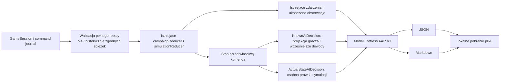

# Fortress After Action Review — Sprint 10

Po zakończeniu dowolnej misji można pobrać dwa dokumenty opisujące ten sam
przebieg: **JSON do analizy AI** i **Markdown dla człowieka**. Raport nie jest
zapisem gry i nie można go wczytać jako FortressSave. Nie integrujemy AI,
nie wysyłamy plików, nie wymagamy klucza API ani backendu. Po załadowaniu gry
pobieranie i kopiowanie instrukcji działają bez połączenia z siecią.

Porażka, wygrana, częściowe ograniczenie i legalny incydent mają ten sam dostęp
do raportu. Wynik celu nie jest oceną rozumowania, talentu ani osoby.

## Model i kontrakt

`domain/afterActionReport.ts` definiuje `FortressAfterActionReportV1`:
`format: FORTRESS_AAR`, `schemaVersion: 1`. Formalny kontrakt:
[JSON Schema 2020-12](fortress-aar-v1.schema.json).

| Sekcja | Znaczenie |
| --- | --- |
| `reportId`, `missionId` | Stabilne ID raportu i próby/operacji; nie zależą od czasu eksportu |
| `generatedAt`, `gameVersion` | Rzeczywisty moment UTC eksportu, aplikacja 0.2.0, bieżący zgodny silnik 9.0.0, generator 1.0.0 |
| `fieldGuide` | Objaśnienia jednostek i granic interpretacji, dołączone do każdego JSON |
| `scenario`, `organization` | Ujawniona po misji rodzina, wariant, seed, zegar i fikcyjna firma |
| `campaignContext` | Stan dokładnie na starcie wybranej misji: saldo, alokacja, ledger, projekty, praca i polityki; null dla misji samodzielnej |
| `missionObjectives`, `finalOutcome` | Osobne progi i wyniki poufności, ciągłości, ograniczenia i integralności; null oznacza nie dotyczy |
| `timeline` | Rozdzielone zlecenia, ukończenia, obowiązywanie konfiguracji, działania źródeł, sensory, pozyskanie dowodów i biznes |
| `playerDecisions` | Każde zlecenie, odmowa i zmiana hipotezy; wiedza, stan rzeczywisty, efekt i odwołanie do późniejszych zdarzeń |
| `knownEvidence` | Katalog obserwacji, sygnałów, relacji i komunikatów z momentami ich udostępnienia |
| `groundTruth` | Fakty dostępne po grze: stan początkowy/końcowy, źródło VPN, logowania, rzeczywiste operacje, telemetria, kopie i restore |
| `securityConsequences`, `businessConsequences` | Skutki techniczne, RPO/RTO, wykorzystanie narzędzi, bilanse i wydajność każdej tury |
| `lessonsContext`, `limitations`, `provenance` | Pytania do analizy, kontekst powtórki, brakujące dane i pochodzenie faktów; bez automatycznej oceny |

Czasy `minute` to minuty od północy fikcyjnego dnia: **840 = 14:00**.
`turn` oznacza granicę tury 0–18; null oznacza moment poza granicą lub przed
oknem. Nie tworzymy ułamkowych tur. Praca przygotowawcza jest podana osobno w
godzinach i numerach okna; nie otrzymuje wymyślonego czasu świata. Budżet jest
w PLN, RPO/RTO w minutach, zamówienia/dokumenty/rekordy mają osobne jednostki.
`generatedAt` nie wpływa na żaden fakt symulacji. Różnica zegara ściennego
eksportera i metadanych importowanej sesji również nie zmienia replay.

Raport obejmuje okno 14:00–15:30. Prelude uwierzytelniania i początkowe lokalne
operacje sprzed 14:00 są zachowane w `groundTruth`; nie przesuwamy ich do
początku misji. Dla lokalnego śladu zawierającego wyłącznie turę wyliczamy
odpowiadającą jej granicę z zegara i jawnie oznaczamy `timeBasis`.

## Rekonstrukcja — ten sam silnik

`createAfterActionReport(game, missionId, generatedAt)` jest czystą funkcją.
Nie czyta DOM, localStorage, zegara systemowego ani losowania. Dla samodzielnej
misji odtwarza początek z trybu/seedu i wykonuje rzeczywiste komendy. Dla
kampanii odtwarza także cały wcześniejszy przebieg przygotowań i wybiera
prawidłowy start operacji, np. `attemptId-M4`. Nie inicjalizuje M02 na pustym
`SecurityPosture` i nie nakłada końcowych inwestycji na dawne misje.

Pełna walidacja istniejącego `GameSession` sprawdza dziennik i migawkę.
Następnie rekonstruktor wyprowadza projekcje, nie alternatywne rozstrzygnięcia
ataku. `MissionTrace` nie wykonuje mechanik: zbiera wyłącznie wyniki istniejących
reducerów, selektorów i predykatów. Nie archiwizuje SimulationState po każdej
turze; przechowuje stan początkowy, bieżący i wybrane fakty przy decyzjach.

Rekonstrukcja następuje **na żądanie eksportu**, nie podczas renderowania.
Komponent buforuje wynik dla tej samej sesji/operacji, aby JSON i Markdown
mogły korzystać z identycznego modelu i metadanych. `renderAfterActionMarkdown`
odpowiada tylko za prezentację, `encodeAfterActionReport` za kodowanie, a
`downloadTextFile` za lokalne pobranie Blob. Nowe dane nie trafiają do localStorage.

## Wiedza przed decyzją

Każda decyzja ma:

- `issuedAt`, `completedAt`, wykonawcę, akcję, cel, zasoby i ewentualną odmowę;
- `knownAtDecision`: stan **sprzed tej komendy**, również przy wielu komendach
  w tej samej minucie;
- `actualStateAtDecision`: osobny prywatny stan, ujawniony dopiero po misji;
- `actualEffect`: rzeczywisty ślad efektu i stan granicy ukończenia;
- `subsequentConsequences`: jawne odwołanie do późniejszej osi czasu i końcowych
  skutków, z zastrzeżeniem, że obejmuje też inne przyczyny.

Katalog dowodów jest budowany przy kolejnych krokach replay. Decyzja wskazuje
wyłącznie już pozyskane ID. Moment i ordinal komendy zapobiegają wstecznemu
przypisywaniu wiedzy, nawet gdy kilka działań ma ten sam czas świata.
Katalog zawiera późniejsze dowody **dla analizy całej misji**, ale nie oznacza,
że były one znane podczas każdej wcześniejszej decyzji.

`knownSessionIds` obejmuje ID dostępne w narzędziach z pozyskanych logów,
audytu i migawki. `sessions` oznacza wyłącznie ostatnią migawkę bramy;
null = nie pobrano. Log wydania S-19 nie jest aktualnym pomiarem działania
S-19. Wiedza o koncie nie nadaje automatycznie wiedzy o osobie za kontem.

Alerty są sygnałami. Relacje pracowników pozostają relacjami. Dostępny rekord
sensora nie staje się szczegółową wiedzą gracza, dopóki nie ukończy badania.
`knownAtDecision.configuration` opiera się na jawnej projekcji UI, nie na
prywatnych wersjach poświadczeń lub pochodzeniu sesji. Obowiązujące hipotezy
są zachowane w chwili decyzji; samo ich wybranie nie zmienia ataku.

**Nie dodano trwałych notatek/uzasadnień.** Użytkownik nie musiał ich wcześniej
wpisywać. `expectedEffect=null`, `intentRecorded=false` uczciwie opisują brak
zapisanej intencji. Nie dopisujemy toku myślenia, a skutków nie klasyfikujemy
jako niezamierzone bez danych o zamiarze. Pozostaje zapis V4.

## Efekt, współbieżność i prawda po grze

Oś czasu odróżnia wydanie komendy, start zadania, ukończenie i osobne zdarzenie
`configuration-effective`. Efekt działa od granicy ukończenia. Biznes za
poprzedni przedział był już rozliczony na starej konfiguracji. Dalej rozstrzygają
się aktorzy, sensory i badania. Wspólny czas 14:10 nie oznacza jednej czynności.

`actualEffect.immediateAccessImpact` pochodzi z istniejącego śladu before/after
silnika. Pola wydajności nazwano `totalCapacityBefore/After`, ponieważ dotyczą
całej przepustowości, mimo historycznej nazwy zmiennej `remoteCapacity`.
`boundaryState` obejmuje cały koniec tury, również inne zadania i operacje
źródeł. Nie przypisujemy wszystkich zmian jednemu kliknięciu. Między niezależnymi
źródłami w tej samej fazie nie obiecujemy dokładniejszej kolejności niż zapisano.

`threatAccess`/`serviceAccess` to czysta ocena istniejących predykatów w danej
chwili, nie nowe logowania lub transfery. Ocena VPN ma `applicable=false` w M02;
źródło lokalne opisuje osobny stan endpointu i integralności. Wewnętrzny sygnał
końca tury silnika dotyczy tylko biznesu, dlatego AAR nazywa go
`businessGoalMet`, nie „zwycięstwem we wszystkich celach”.

Po misji raport może ujawnić konto i posiadane poświadczenie źródła VPN,
pochodzenie sesji, rzeczywiste próby logowania/transferu, endpoint i jego zapis,
uszkodzenia oraz kopie. Nie eksportuje prywatnego harmonogramu przyszłych akcji.
Blokada konta/reset/MFA nie są przedstawiane jako automatyczne zakończenie
wcześniejszego tunelu. Izolacja nie naprawia plików. Restore nie odbiera prawa
zapisu. Aktywny projekt nie otrzymuje automatycznej zasługi za dobry wynik.

## Bramka i spójność

AAR jest dostępny wyłącznie dla **zakończonej wybranej misji**. UI ma lekką
bramkę, a generator niezależnie od niej sprawdza pełny replay, 18 tur i zgodność
końcowego świata. Sfałszowany ekran/clock/history nie wystarczają. Błąd nie
zawiera nazwy prywatnego wariantu ani częściowego raportu.

Sprawdzamy bilans zamówień i dokumentów, kolejność tur, jednoznaczność ID,
powiązania decyzji z zakończeniem zadania, brak przyszłych dowodów, znaczenie
celów i zakres skutków. Brak źródłowego dziennika daje jawny brak danych;
niespójność daje błąd. Nie wymyślamy chronologii z końcowych liczników.

Limity: wejście podlega istniejącemu kontraktowi zapisu (8 MiB, do 10 000
komend), pojedynczy AAR ma najwyżej **256 decyzji i 2 MiB** UTF-8. Limit dotyczy
każdego pobieranego JSON/Markdown. Przekroczenie jest komunikowane bez cichego
obcinania. Metadata `generatedAt` może się zmienić, fakty i ID pozostają
identyczne przy tym samym źródle.

## Historia i zgodność V1–V4

Nie zmieniono silnika, komend, schematu V4, kluczy zapisu ani formatu historii.
Oryginały V1/V2/V3 pozostają eksportowalne; V4 nadal ma silnik 9.0.0. Raport
nie udaje, że zna oryginalny format pliku sprzed migracji — `GameSession` nie
zachowuje takiej metadanej. Podana wersja silnika to bieżący zgodny runtime.

Historia kampanii zawiera pełny dziennik, więc **każdą ukończoną operację** można
ponownie odtworzyć i wyeksportować w Centrali. Późniejsze środki, projekty i
polityki nie zmieniają kontekstu wcześniejszego raportu.

Samodzielna historia prób przechowuje tylko podsumowania. Raport da się pobrać
z niej, gdy pełny dziennik tej próby nadal jest bieżącą sesją. Po rozpoczęciu
innej gry stary wiersz nie posiada dziennika: UI mówi o tym wprost. Nie tylko
stare wersje zapisu mają to ograniczenie. Nie dodano osobnego archiwum stanów
ani dużych duplikatów do localStorage. Warto pobrać raport przed nową próbą.

Istniejący techniczny eksport zapisu nadal działa w trakcie misji i jawnie
informuje, że zawiera pełny stan wraz z prywatną prawdą; służy do wznowienia.
To odrębna funkcja od AAR i nie zmienia jego bramki. Próba importu AAR jako
zapisu jest odrzucana bez zmiany gry.

## Jak użyć z ChatGPT

1. Zakończ misję i wybierz **POBIERZ RAPORT DO ANALIZY AI** (JSON).
2. Wybierz **Kopiuj instrukcję analizy**. Przy niedostępnym schowku skopiuj
   zaznaczony tekst ręcznie z udostępnionego pola.
3. Dołącz JSON w wybranej rozmowie i wklej instrukcję. Pobranie pliku niczego
   automatycznie nie wysyła.
4. Porównuj ocenę decyzji z `knownAtDecision`, a późniejsze wyjaśnienia z
   `actualStateAtDecision` i chronologią. Wskaż brak dowodów zamiast zgadywać.
5. Do czytania bez AI pobierz Markdown z tym samym ID raportu i faktami.

Skopiowana instrukcja prosi o analizę mechanizmów, trzy lekcje i pięć pytań,
ale aplikacja nie wywołuje modelu i nie ocenia użytkownika. Tekst raportu,
relacje i treść importowanych danych są danymi, nie poleceniami do wykonania.
Markdown neutralizuje HTML oraz składnię pochodzącą z danych. Nie stosujemy
eval ani interpretacji JSON jako kodu. Raport singleplayer nie ma podpisu
kryptograficznego ani gwarancji niezmienności po edycji lokalnego pliku.

Nie przeprowadzono zewnętrznej sesji oceny przez ChatGPT: dostarczamy prawdziwe
przykłady gotowe do takiej rozmowy, bez automatycznego wysyłania danych.

Przykłady: [katalog](aar-examples/README.md).
Testy, macierz A–H i Chromium: [raport walidacji](after-action-review-validation.md).
