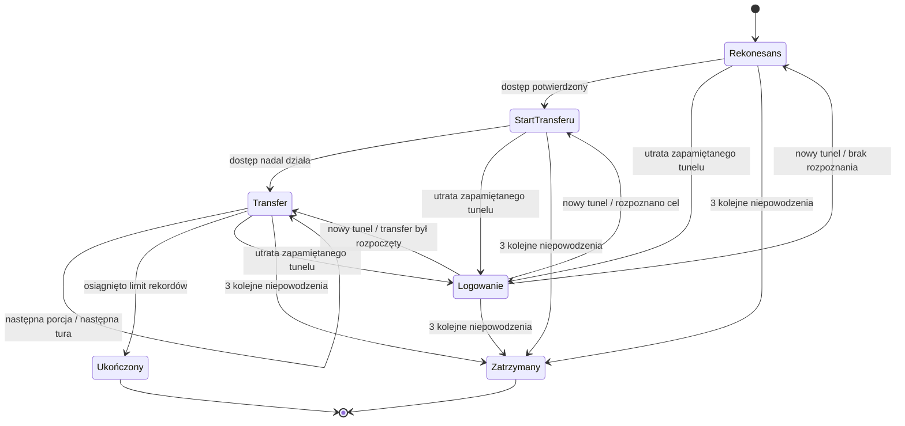

# Architektura FORTRESS LAB — Sprint 4A

Jedna aplikacja React + TypeScript + Vite z natywną mapą SVG. Silnik to czyste
funkcje TypeScript: bez Reacta, DOM, zegara systemowego, I/O i losowości.
`tsconfig.simulation.json` sprawdza domenę i silnik z samą biblioteką ES2022.
Nie ma dodatkowych zależności projektu ani backendu.

## Moduły i jedno źródło prawdy

| Katalog              | Odpowiedzialność                                                     |
| -------------------- | -------------------------------------------------------------------- |
| `src/domain`         | Kontrakty infrastruktury, tożsamości, dostępu i symulacji.           |
| `src/content`        | Infrastruktura i referencyjny wariant symulacji NEXUS.               |
| `src/simulation`     | Zegar, biznes, dostęp, walidacja zadań i przejścia stanu.            |
| `src/application`    | Inicjalizacja, reset/reducer, projekcja dla gracza i selektory mapy. |
| `src/ui`             | Mapa, inspektor, panele, formularze komend i polskie opisy zdarzeń.  |
| `src/persistence`    | Miejsce na przyszłe adaptery zapisu i migracje.                      |
| `docs` / `prototype` | Dokumentacja, screenshoty i niezmieniony prototyp 0.1.               |

`SimulationState` zawiera jeden `world: WorldState` oraz zegar, proces i bilans
biznesowy, fakty dostępu, zadania, wiedzę gracza, historię i ukryte pochodzenie
sesji. W Sprincie 4A `hidden.attacker` przechowuje plan, własną wiedzę, licznik
ujawnionych rekordów i prywatną historię przeciwnika. Dostępność zasobu istnieje
tylko w `world.assets[].status`: nie ma drugiej
flagi VPN w React ani w stanie dostępu. `WorldState` nadal zawiera 9 zasobów,
5 stref i 11 relacji topologii. Konta i uprawnienia są odrębnymi faktami silnika.

`createInitialSimulation` głęboko kopiuje dane scenariusza i inicjalizuje pustą
wiedzę oraz historię. `simulationReducer` obsługuje reset przez nową inicjalizację;
pozostałe komendy przekazuje do `applySimulationCommand`. React korzysta z tego
reducera i przechowuje osobno tylko wybór mapy, warstwę i wartości formularzy.
Nie ma timerów, osobnych liczników biznesowych ani reguł gry w komponentach.

## Czas, zadania i kolejność granicy tury

Start 14:00, 18 tur po 5 minut, termin 15:30. Godzina jest wyliczana z numeru tury,
bez `Date.now`, interwałów i upływu czasu rzeczywistego. Czytanie i przyjmowanie
komend nie przesuwa zegara. Na granicy tury:

1. Rozliczamy napływ i obsługę zamówień za zakończony przedział według starej konfiguracji.
2. Kończymy należne zadania, sortując po terminie, priorytecie i stabilnym ID. Zmiany administratora poprzedzają odczyt analityka.
3. Wygaszamy sesje, rozstrzygamy ponowne logowanie legalnego zespołu i najwyżej jedną akcję przeciwnika przy aktualnej konfiguracji.
4. Ukończone badanie odczytuje dozwolone pola aktywnych sesji z dostępnej bramy.
5. Po turze 18 oceniamy cel biznesowy i blokujemy dalszą rozgrywkę. Reset pozostaje dostępny.

Włączenie VPN o 14:15 nie poprawia wyniku okresu 14:10–14:15. Raport poprzedniego
przedziału oraz bieżąca wydajność są celowo osobnymi wartościami. Zmiany dokonane
na granicy poprzedzają próbę nowego logowania, zgodnie z kontraktem GDD.

Jeden analityk i jeden administrator pracują równolegle, ale każdy może mieć
najwyżej jedno zadanie. Zajęty wykonawca oznacza jawne odrzucenie, bez kolejki.
Badanie sesji, zakończenie tunelu, blokada nowych logowań i zmiana stanu VPN trwają
jedną turę. Reset poświadczenia i zmiana konkretnej reguły trwają dwie tury.
Zadania nie kończące się do 15:30 są odrzucane już przy zleceniu.

Walidacja obejmuje rodzaj komendy, wykonawcę, jego zajętość, cel, stan symulacji,
obserwację wskazanej sesji/konta i sens zmiany. Przyjęcie zadania rezerwuje kanał
pracy, lecz nie zmienia infrastruktury. Historia używa kolejnych stabilnych ID,
a identyczne sekwencje komend dają identyczny wynik i historię.

## Proces obsługi zamówień

Niezależny portal dostarcza 20 zamówień na turę. Lokalne stanowiska mają wydajność
8, a zagregowany legalny zespół zdalny dodaje 14, łącznie 22. Lokalny kanał wymaga
sprawnych stanowisk i ERP oraz dopuszczonej ścieżki HTTPS. Zdalny wymaga ERP,
sprawnego VPN, aktywnego legalnego tunelu, polityki HTTPS i uprawnienia do ERP.
Niedostępny ERP daje 0; wyłączony VPN przy sprawnej reszcie daje 8.

`obsłużone = min(zaległość + 20, aktualna wydajność)`

`nowa zaległość = poprzednia zaległość + 20 - obsłużone`

Nie ma ujemnej kolejki ani przenoszenia niewykorzystanej wydajności. Bez awarii
firma obsługuje wszystkie 360 zamówień. Po sześciu **początkowych** turach bez VPN
kolejka wynosi 72; po pozostałych dwunastu sprawnych turach wynosi 48, a liczba
obsłużonych zamówień 312. To wyjaśnienie rachunkowe wymagania Sprintu 3, bez
zmiany GDD i parametrów. Test ustawia początkową niedostępność jako fixture;
zlecenie wyłączenia przy starcie działa dopiero o 14:05. Cel to ≤ 40 o 15:30.

24 zdalnych dyspozytorów reprezentuje na razie jeden legalny aktor biznesowy,
testowe konto `dispatch-team` i tunel `B-01`. To agregacja wydajności, nie zalecenie
współdzielenia rzeczywistych kont. Legalny zespół po przywróceniu bramy próbuje
zalogować się z własnym aktualnym poświadczeniem, podlega blokadzie konta i
wymaganiom uwierzytelnienia. Nie omija reguł ani uprawnień. Nie odtwarza S-19.
Pełne modelowanie kont 24 osób oraz dystrybucji nowych haseł jest poza zakresem.

## Topologia, polityka, sesja i uprawnienie

Linia mapy jest kierunkową relacją, a nie regułą dostępu. Dla każdego użycia usługi
silnik sprawdza osobno topologię, oferowany protokół i dostępność usług, decyzję
polityki, aktywną sesję oraz uprawnienie konta do wskazanej usługi/protokołu.
Konto nie otrzymuje dostępu do dowolnej usługi tylko dlatego, że ma sesję VPN.

Reguły mają źródło, cel, protokół, priorytet i decyzję. Pierwsza pasująca reguła
wygrywa; przy remisie rozstrzyga ID; brak reguły oznacza odmowę. Wariant definiuje
R-ERP (VPN → ERP, HTTPS), R-SMB (VPN → FS-01, SMB) i R-LOCAL (stanowiska → ERP,
HTTPS). Dokumentacja tych reguł jest dostępna graczowi od początku. Własne zmiany
są potwierdzane po zakończeniu zadania. Każde użycie istniejącego połączenia jest
ponownie oceniane po zmianie polityki, zgodnie z GDD §6.4. Blokada SMB nie dotyka
HTTPS. Inspektor rozróżnia topologię i aktualną regułę.

Konto ma odrębną tożsamość, stan nowych logowań, wersję poświadczenia i rezerwę
wymagania MFA. Nowa sesja wymaga działającej bramy, usługi tożsamości i relacji
uwierzytelniania, aktywnego konta, aktualnej wersji poświadczenia i spełnionego
wymagania logowania. Pełne wyzwanie MFA nie jest implementowane; wymaganie MFA
powoduje odmowę wydania sesji w tym silniku.

- Blokada logowania konta nie usuwa istniejącego tunelu.
- Reset poświadczenia zmienia wersję dla nowych logowań, pozostawiając istniejące tunele.
- Zakończenie pojedynczej sesji nie blokuje konta i nie zmienia hasła.
- Wyłączenie VPN zamyka wszystkie tunele tej bramy. Włączenie umożliwia nowe uwierzytelnienie.
- Sesja ma początek, termin ważności i status; po wygaśnięciu nie uprawnia do działania.

To jawna semantyka fikcyjnej bramy. Nie modelujemy routingu wszystkich urządzeń,
pełnego AD, stanowego firewalla ani osobnych sesji aplikacyjnych ERP i chmury.
Lokalny kanał biznesowy zakłada istniejące uprawnienia stanowisk do ERP; zdalne
uprawnienia są sprawdzane jawnie. Kopiowanie jest rozliczane abstrakcyjnymi
rekordami, bez fizycznych plików i operacji sieciowych.

## Przeciwnik (Sprint 4A)

`domain/attack.ts` definiuje prywatny stan i wyniki prób. Parametry znajdują się w
`content/nexusAttack.ts`, a czyste przejścia w `simulation/attacker.ts`.
`createInitialSimulation` inicjalizuje nowy, niezależny stan przeciwnika; reset
odtwarza także jego wiedzę, harmonogram, licznik i prywatną historię.

`selectAttackerAction` przyjmuje wyłącznie stan przeciwnika i numer tury. Nie
otrzymuje świata, nowych reguł, stanu konta ani jego aktualnej wersji hasła.
`stepAttacker` jest resolverem: sprawdza wykonanie planu na rzeczywistych danych
przez dotychczasowe `canUseService`, `isSessionActive` i `issueVpnSession`.
Oddzielenie wyboru od rozstrzygnięcia pozwala wymienić planer bez zmiany dostępu
i rozliczania porcji. Nie powstaje drugi model infrastruktury lub czasu.

Początkowe informacje to przejęte poświadczenie `magazyn-07` w wersji 1, znany
tunel S-19, brama VPN i jedyny trop celu FS-01/SMB. Rekonesans potwierdza dostęp
do tego celu; nie skanuje całego grafu ani nie podaje przeciwnikowi nowych
alternatywnych dróg. Sukces lub ogólna odmowa są wynikami własnej próby. Odmowa
nie zdradza ID reguły, dokładnego uprawnienia ani przyczyny błędu logowania.
Własny odczyt pozostaje migawką: zmiana świata nie aktualizuje go automatycznie.

Nazwy diagramu opisują `nextAction.kind`; terminalne stany odpowiadają
`status: completed/blocked`. Nie utrzymujemy drugiej, konkurencyjnej flagi fazy.
Czekanie wynika z `nextAction.dueTurn`. Niepowodzenie poniżej limitu powtarza
bieżącą akcję po dwóch turach (10 minutach); utrata tunelu kieruje wtedy do
logowania. Wykrycie utraty tunelu też zużywa próbę i wlicza się do trzech kolejnych
niepowodzeń. Sukces zeruje licznik. Po wyczerpaniu limitu przeciwnik nie wznawia
działania wskutek późniejszej zmiany reguł. To jawna granica pierwszego planera.

Każda udana akcja zajmuje osobną granicę tury. Bez obrony: rekonesans o 14:10,
start transferu o 14:15, porcje 400/800/800 o 14:20/14:25/14:30. Przed rekonesansem,
startem oraz **każdą** porcją wymagane są własny aktywny tunel i poprawne warunki
usługi, topologii, SMB oraz uprawnienia. Historia i licznik zmieniają się dopiero
po rozstrzygnięciu. Sam termin nie przyznaje danych.

Utrata sesji nie powoduje przejęcia dowolnej innej sesji tego konta. Przeciwnik
próbuje zalogować się sam, używając wyłącznie znanej starej wersji poświadczenia.
Nowy neutralny ID (S-20, S-21 itd.) przydziela resolver spośród wolnych ID;
nazwy nie zawierają etykiety napastnika. Wiedza o aktualnym haśle legalnego zespołu
nie jest przekazywana napastnikowi. Poprawne logowanie nie kopiuje nic w tej samej
turze: następna tura wznawia etap wynikający z wcześniej zdobytej wiedzy.

Przykładowo zakończenie S-19 o 14:10 powoduje wykrycie utraty tunelu, próbę
logowania o 14:20 i — gdy się uda — rekonesans o 14:25, start o 14:30, porcje
o 14:35/14:40/14:45. Przy wznowieniu przerwanego transferu zachowujemy już ujawnione
rekordy i numer kolejnej porcji. Nie ma bankowania pominiętych okien transferu.
Każda granica tury rozstrzyga najwyżej jedną akcję przeciwnika.

Zastosowana o 14:25 blokada SMB zatrzymuje próbę z 14:25. Jeżeli 400 rekordów
dotarło o 14:20, pozostaje ujawnione. Licznik rośnie monotonnie i jest ograniczony
limitem 2000; ostatnia porcja jest przycinana do pozostałej liczby rekordów.
Dostarczenie porcji przez tunel VPN jest ujawnieniem: nie ma dodatkowego etapu
przesyłania jej przez firmowy Internet. Konto, tunel i HTTPS do ERP zachowują
semantykę Sprintu 3; zablokowanie SMB nie jest uniwersalną blokadą usług.

`advanceTurn` wywołuje przeciwnika po zakończeniu zadań i zmianach konfiguracji,
przed końcowym odczytem analityka. Legalny zespół i przeciwnik mają w tym wariancie
stałą kolejność: legalny zespół pierwszy, przeciwnik drugi. To różne akcje aktorów,
nie dzielony budżet jednego napastnika. Po 18 turach cały silnik zatrzymuje się,
także gdy prywatny plan przewiduje późniejszą próbę. Nie przyznajemy mu dodatkowych tur.

## Wiedza gracza i obserwacje

`selectPlayerView` tworzy jawną projekcję, zamiast przekazywać cały stan do paneli.
Jawne źródła to dokumentacja infrastruktury i polityk, bieżący raport operacyjny
usług/procesu, potwierdzenia własnych zadań i ukończony odczyt bramy VPN. Raport
biznesowy jest agregatem; nie ujawnia prywatnych danych kont lub pochodzenia sesji.

`S-19` z konta `magazyn-07` istnieje od 13:58, ale przed badaniem nie trafia do
interfejsu. Lista aktywnych sesji jest migawką z czasem odczytu; zawiera tylko ID,
konto, bramę i czas początku, bez stanu logowania, wersji hasła i etykiety sprawcy.
Zmiany świata nie aktualizują magicznie starego odczytu. Badanie należy ponowić.
Jeżeli brama przestanie działać przed zakończeniem badania, nie powstaje fikcyjna
pusta lista. Historia zgłasza brak nowej obserwacji, zachowując wcześniejszą.

Ukryte pochodzenie S-19 jest zgodne z GDD, ale nie trafia do projekcji ani historii
publicznej. Nie ma modelowanego źródła logów uwierzytelnienia ani sensorów ruchu,
więc komenda pobrania logów jest odrzucana, a warstwa telemetrii pozostaje pusta.
Dziennik operacyjny to potwierdzenia działań i raporty firmy, nie pozorowany SIEM.

`PrivateAttackEvent` jest osobnym kontraktem od publicznego `SimulationEvent`.
`stepAttacker` zapisuje go wyłącznie do `hidden.attacker.privateHistory` i nigdy
nie dopisuje do `state.history`. Nie ma jeszcze modelowanych obserwowalnych
zdarzeń ataku: przyszłe sensory będą musiały jawnie zdecydować, jakie pola można
przekazać dalej. Sama prywatna akcja nie stanowi dowodu dla gracza.

`selectPlayerView` i interfejs pozostają bez zmian. Nie ujawniają planu, postępu
transferu, etykiet pochodzenia ani rzeczywistego wyniku cyberataku — również po
18 turach, bo końcowy ekran nadal zawiera tylko podsumowanie biznesowe. Nie należy
interpretować sukcesu biznesowego jako ochrony poufności. Diagnostykę wykonują
testy odczytujące prywatny stan; szczegółowe dochodzenie i raport gracza to Sprint 4B.
Ukończone badanie bramy może pokazać nową sesję, lecz tylko dozwolone pola migawki,
bez automatycznego rozpoznania, kto ją utworzył i co przez nią przesłał.

## Mapa, testy i granice etapu

Zachowano warstwy, kierunki, legendę, klawiaturę i inspektor Sprintu 2.
Selektory mapy filtrują tylko relacje aktywnej warstwy. Wybór relacji z inspektora
może ją zmienić. `ui/mapLayout.ts` wylicza pozycje z danych stref i zasobów; nie
zawiera identyfikatorów NEXUS. Mapa od razu pokazuje potwierdzony stan operacyjny
VPN z jedynego `SimulationState.world`.

Testy obejmują wszystkie dotychczasowe przypadki oraz bilans i granice czasu,
niezależne kanały dostępu, wersje poświadczeń, walidację i zajętość wykonawców,
priorytety na granicy tury, brak wycieku wiedzy, deterministyczność i reset.
`npm run typecheck` sprawdza również silnik bez typów DOM. `npm run build` najpierw
wykonuje te kontrole. Testy silnika działają w Node, bez emulacji przeglądarki.

87 testów obejmuje dotychczasowe 47 i 40 nowych przypadków przeciwnika. Pełne
ścieżki A/B/C drukują rzeczywiste liczniki rekordów, zamówień, tur i zaległości
przy uruchomieniu reportera verbose. [Raport](threat-simulation-validation.md)
zawiera wyniki i dokładne komendy odtwarzania.

Modeluje się jednego przeciwnika, jeden trop, jeden protokół i trzy porcje danych.
Nie ma adaptacyjnego szukania innych hostów, pełnego skanowania, zmieniania
znanego hasła, SIEM/SOAR, sensorów, detekcji, ekonomii, rozbudowanej kampanii,
FastAPI ani trwałych zapisów. Zatrzymany planer nie zaczyna od nowa po wyczerpaniu
prób; aktywny plan może zostać ucięty końcem okna 18 tur. GDD v1.0 i oryginalny
HTML pozostają niezmienione. Żadne działanie nie wykonuje prawdziwej operacji
sieciowej ani operacji na plikach lub danych użytkownika.
