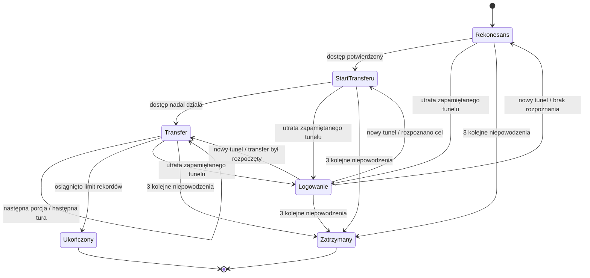
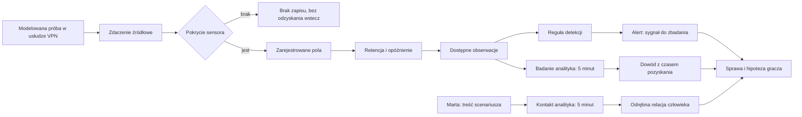

# Architektura FORTRESS LAB — Sprint 6

Jedna aplikacja React + TypeScript + Vite z natywną mapą SVG. Silnik to czyste
funkcje TypeScript: bez Reacta, DOM, zegara systemowego, I/O i losowości.
`tsconfig.simulation.json` sprawdza domenę i silnik z samą biblioteką ES2022.
Nie ma dodatkowych zależności projektu ani backendu.

## Moduły i jedno źródło prawdy

| Katalog              | Odpowiedzialność                                                     |
| -------------------- | -------------------------------------------------------------------- |
| `src/domain`         | Kontrakty infrastruktury, tożsamości, dostępu i symulacji.           |
| `src/content`        | Infrastruktura i trzy definicje wariantów NEXUS.               |
| `src/simulation`     | Zegar, biznes, dostęp, walidacja zadań i przejścia stanu.            |
| `src/application`    | Inicjalizacja, reset/reducer, projekcja dla gracza i selektory mapy. |
| `src/ui`             | Mapa, inspektor, panele, formularze komend i polskie opisy zdarzeń.  |
| `src/persistence`    | Wersjonowane migawki, walidacja, localStorage i historia prób.                      |
| `docs` / `prototype` | Dokumentacja, screenshoty i niezmieniony prototyp 0.1.               |

`SimulationState` zawiera jeden `world: WorldState` oraz zegar, proces i bilans
biznesowy, fakty dostępu, zadania, telemetrię, sprawę, wiedzę gracza, historię
i ukryte pochodzenie sesji oraz ślad decyzji. `run` zachowuje tryb i seed,
a `hidden.scenario` początkową konfigurację do powtórki. `hidden.attacker`
przechowuje plan, wiedzę, licznik i prywatną historię albo rzeczywiste `null`
w legalnym wariancie. `hidden.legitimateActors` zawiera harmonogram legalnych klientów. Dostępność zasobu istnieje
tylko w `world.assets[].status`: nie ma drugiej
flagi VPN w React ani w stanie dostępu. `WorldState` nadal zawiera 9 zasobów,
5 stref i 11 relacji topologii. Konta i uprawnienia są odrębnymi faktami silnika.

`createScenario` waliduje i głęboko kopiuje konfigurację, rozstrzyga ewentualne
próby wstępne i inicjalizuje jeden stan. `createInitialSimulation()` nadal tworzy
wariant referencyjny. `simulationReducer` resetuje bieżącą definicję i seed;
`scenarioReducer` dodaje wyłącznie komendę rozpoczęcia nowej próby. Pozostałe
komendy trafiają do dotychczasowego `applySimulationCommand`. React zachowuje
osobno tylko wybór kontekstu, mapy, briefingu i formularzy, bez reguł symulacji.

## Konfiguracje i nieznany incydent — Sprint 5

`domain/scenario.ts` definiuje infrastrukturę, dostęp, legalne zachowania, źródła,
świadków, opcjonalny plan przeciwnika i cele. Trzy konfiguracje w `content/scenarios`
korzystają ze wszystkich wspólnych mechanizmów. Walidator odrzuca brakujące
referencje i sprzeczne cele; nie dodaje zastępczych kont lub zasobów.

Trening wybiera dotychczasowe A. W nieznanym incydencie `seed % 3` wybiera A/B/C
przed pierwszą decyzją, bez losowania podczas renderowania. Nazwa, ID i typ są
prywatne do raportu. Powtórka zachowuje definicję i seed, a nowy incydent
przechodzi do kolejnej konfiguracji i odtwarza wszystkie dane.

W B `attacker` jest `null`: legalny klient Marty wytwarza 52 odmowy i sukces
z 13:58 przez istniejące `issueVpnSession`, a kolektor i detektor otrzymują zwykłe
zdarzenia. W C nie ma S-19 ani sukcesu z 13:58; plan zaczyna od uwierzytelnienia
w turze 3. Alerty wszystkich trzech wariantów są identyczne. Logi A/B także są
identyczne na starcie; różnice są dostępne w relacji i legalnych zależnościach.

[Kontrakt konfiguracji](scenario-configuration.md) opisuje pełne API, referencje,
polityki legalnych klientów i diagram. [Raport porównawczy](scenario-variants-validation.md)
podaje wyniki, zachowane regresje i ograniczenia grywalności.

## Czas, zadania i kolejność granicy tury

Start 14:00, 18 tur po 5 minut, termin 15:30. Godzina jest wyliczana z numeru tury,
bez `Date.now`, interwałów i upływu czasu rzeczywistego. Czytanie i przyjmowanie
komend nie przesuwa zegara. Na granicy tury:

1. Rozliczamy napływ i obsługę zamówień za zakończony przedział według starej konfiguracji.
2. Kończymy należne zadania, sortując po terminie, priorytecie i stabilnym ID. Zmiany administratora poprzedzają odczyt analityka.
3. Wygaszamy sesje, rozstrzygamy zaplanowane logowania legalnych klientów i najwyżej jedną akcję przeciwnika, jeśli występuje, przy aktualnej konfiguracji.
4. Rejestrujemy w sensorach wytworzone zdarzenia uwierzytelnienia i wykonujemy detekcję.
5. Ukończone badania pozyskują dozwolone obserwacje logów i sesji; rozmowa tworzy relację człowieka.
6. Oceniamy koniec misji i wyprowadzamy wiadomości z jawnych faktów. Po turze 18 blokujemy dalsze komendy; osobny selektor udostępnia raport. Reset pozostaje dostępny.

Włączenie VPN o 14:15 nie poprawia wyniku okresu 14:10–14:15. Raport poprzedniego
przedziału oraz bieżąca wydajność są celowo osobnymi wartościami. Zmiany dokonane
na granicy poprzedzają próbę nowego logowania, zgodnie z kontraktem GDD.

Jeden analityk i jeden administrator pracują równolegle, ale każdy może mieć
najwyżej jedno zadanie. Zajęty wykonawca oznacza jawne odrzucenie, bez kolejki.
Badanie logów, badanie sesji, kontakt z właścicielką konta, zakończenie tunelu,
blokada nowych logowań i zmiana stanu VPN trwają jedną turę. Reset poświadczenia i zmiana konkretnej reguły trwają dwie tury.
Zadania nie kończące się do 15:30 są odrzucane już przy zleceniu.

Walidacja obejmuje rodzaj komendy, wykonawcę, jego zajętość, cel, stan symulacji,
obserwację wskazanej sesji/konta i sens zmiany. Przyjęcie zadania rezerwuje kanał
pracy, lecz nie zmienia infrastruktury. Historia używa kolejnych stabilnych ID,
a identyczne sekwencje komend dają identyczny wynik i historię.

## Proces obsługi zamówień

W wariancie referencyjnym portal dostarcza 20 zamówień na turę. Lokalne stanowiska mają wydajność
8, a zagregowany legalny zespół zdalny dodaje 14, łącznie 22. Lokalny kanał wymaga
sprawnych stanowisk i ERP oraz dopuszczonej ścieżki HTTPS. Zdalny wymaga ERP,
sprawnego VPN, aktywnego legalnego tunelu, polityki HTTPS i uprawnienia do ERP.
Niedostępny ERP daje 0; wyłączony VPN przy sprawnej reszcie daje 8.

`obsłużone = min(zaległość + 20, aktualna wydajność)`

`nowa zaległość = poprzednia zaległość + 20 - obsłużone`

Nie ma ujemnej kolejki ani przenoszenia niewykorzystanej wydajności. Bez awarii
firma obsługuje wszystkie 360 zamówień. Po sześciu **początkowych** turach bez VPN
kolejka wynosi 72; po pozostałych dwunastu sprawnych turach wynosi 48, a liczba
obsłużonych zamówień 312. To wyjaśnienie rachunkowe wymagania Sprintu 3, bez
zmiany GDD i parametrów. Test ustawia początkową niedostępność jako fixture;
zlecenie wyłączenia przy starcie działa dopiero o 14:05. Cel to ≤ 40 o 15:30.

W B/C proces ma 8 zamówień lokalnie, 8 przez zdalny ERP i dodatkowe 6 przez
`process.additionalWork`. Ta część wymaga własnego legalnego konta, aktywnej
sesji oraz wszystkich usług ERP/HTTPS i FS-01/SMB. W B używa konta Marty, w C
odrębnego `file-team` i F-01. `canUseService` sprawdza każdą zależność. Odmowa SMB
zostawia HTTPS i zmienia wydajność 22 → 16; brak uprawnienia, sesji lub usługi
odbiera tę samą część. Nie ma kary za wybór przycisku. Raporty biznesowe zawierają
obserwowalną dostępność części procesu; narracja może opisać jej rzeczywisty koszt.

W wariancie referencyjnym 24 zdalnych dyspozytorów reprezentuje jeden aktor biznesowy,
testowe konto `dispatch-team` i tunel `B-01`. To agregacja wydajności, nie zalecenie
współdzielenia rzeczywistych kont. Legalny zespół po przywróceniu bramy próbuje
zalogować się z własnym aktualnym poświadczeniem, podlega blokadzie konta i
wymaganiom uwierzytelnienia. Nie omija reguł ani uprawnień. Nie odtwarza S-19.
`simulation/legitimateActors.ts` stosuje te same funkcje wydawania i rejestracji
sesji dla wszystkich legalnych klientów. Referencyjny zespół i file-team używają
jawnej polityki `managed-current`. Klient Marty w B ma politykę `fixed` i opóźnienie
jednej tury po utracie tunelu; nie poznaje automatycznie nowego poświadczenia po
resecie. Blokada i reset mają zwykłe skutki przy jego ponownym logowaniu.
Pełne modelowanie 24 osób i dystrybucji haseł pozostaje poza zakresem.

## Topologia, polityka, sesja i uprawnienie

Linia mapy jest kierunkową relacją, a nie regułą dostępu. Dla każdego użycia usługi
silnik sprawdza osobno topologię, oferowany protokół i dostępność usług, decyzję
polityki, aktywną sesję oraz uprawnienie konta do wskazanej usługi/protokołu.
Konto nie otrzymuje dostępu do dowolnej usługi tylko dlatego, że ma sesję VPN.

Reguły mają źródło, cel, protokół, priorytet i decyzję. Pierwsza pasująca reguła
wygrywa; przy remisie rozstrzyga ID; brak reguły oznacza odmowę. Wariant definiuje
R-ERP (VPN → ERP, HTTPS), R-SMB (VPN → FS-01, SMB) i R-LOCAL (stanowiska → ERP,
HTTPS). Dokumentacja tych reguł jest dostępna graczowi od początku. Własne zmiany
są potwierdzane po zakończeniu zadania. Każde użycie istniejącego połączenia jest
ponownie oceniane po zmianie polityki, zgodnie z GDD §6.4. Blokada SMB nie dotyka
HTTPS. Inspektor rozróżnia topologię i aktualną regułę.

Konto ma odrębną tożsamość, stan nowych logowań, wersję poświadczenia i rezerwę
wymagania MFA. Nowa sesja wymaga działającej bramy, usługi tożsamości i relacji
uwierzytelniania, aktywnego konta, aktualnej wersji poświadczenia i spełnionego
wymagania logowania. Pełne wyzwanie MFA nie jest implementowane; wymaganie MFA
powoduje odmowę wydania sesji w tym silniku.

- Blokada logowania konta nie usuwa istniejącego tunelu.
- Reset poświadczenia zmienia wersję dla nowych logowań, pozostawiając istniejące tunele.
- Zakończenie pojedynczej sesji nie blokuje konta i nie zmienia hasła.
- Wyłączenie VPN zamyka wszystkie tunele tej bramy. Włączenie umożliwia nowe uwierzytelnienie.
- Sesja ma początek, termin ważności i status; po wygaśnięciu nie uprawnia do działania.

To jawna semantyka fikcyjnej bramy. Nie modelujemy routingu wszystkich urządzeń,
pełnego AD, stanowego firewalla ani osobnych sesji aplikacyjnych ERP i chmury.
Lokalny kanał biznesowy zakłada istniejące uprawnienia stanowisk do ERP; zdalne
uprawnienia są sprawdzane jawnie. Kopiowanie jest rozliczane abstrakcyjnymi
rekordami, bez fizycznych plików i operacji sieciowych.

## Przeciwnik (Sprint 4A)

`domain/attack.ts` definiuje prywatny stan i wyniki prób. Parametry znajdują się w
`content/nexusAttack.ts`, a czyste przejścia w `simulation/attacker.ts`.
`createInitialSimulation` inicjalizuje nowy, niezależny stan przeciwnika; reset
odtwarza także jego wiedzę, harmonogram, licznik i prywatną historię.

`selectAttackerAction` przyjmuje wyłącznie stan przeciwnika i numer tury. Nie
otrzymuje świata, nowych reguł, stanu konta ani jego aktualnej wersji hasła.
`stepAttacker` jest resolverem: sprawdza wykonanie planu na rzeczywistych danych
przez dotychczasowe `canUseService`, `isSessionActive` i `issueVpnSession`.
Oddzielenie wyboru od rozstrzygnięcia pozwala wymienić planer bez zmiany dostępu
i rozliczania porcji. Nie powstaje drugi model infrastruktury lub czasu.

Początkowe informacje to przejęte poświadczenie `magazyn-07` w wersji 1, znany
tunel S-19, brama VPN i jedyny trop celu FS-01/SMB. Rekonesans potwierdza dostęp
do tego celu; nie skanuje całego grafu ani nie podaje przeciwnikowi nowych
alternatywnych dróg. Sukces lub ogólna odmowa są wynikami własnej próby. Odmowa
nie zdradza ID reguły, dokładnego uprawnienia ani przyczyny błędu logowania.
Własny odczyt pozostaje migawką: zmiana świata nie aktualizuje go automatycznie.

Nazwy diagramu opisują `nextAction.kind`; terminalne stany odpowiadają
`status: completed/blocked`. Nie utrzymujemy drugiej, konkurencyjnej flagi fazy.
Czekanie wynika z `nextAction.dueTurn`. Niepowodzenie poniżej limitu powtarza
bieżącą akcję po dwóch turach (10 minutach); utrata tunelu kieruje wtedy do
logowania. Wykrycie utraty tunelu też zużywa próbę i wlicza się do trzech kolejnych
niepowodzeń. Sukces zeruje licznik. Po wyczerpaniu limitu przeciwnik nie wznawia
działania wskutek późniejszej zmiany reguł. To jawna granica pierwszego planera.

Każda udana akcja zajmuje osobną granicę tury. Bez obrony: rekonesans o 14:10,
start transferu o 14:15, porcje 400/800/800 o 14:20/14:25/14:30. Przed rekonesansem,
startem oraz **każdą** porcją wymagane są własny aktywny tunel i poprawne warunki
usługi, topologii, SMB oraz uprawnienia. Historia i licznik zmieniają się dopiero
po rozstrzygnięciu. Sam termin nie przyznaje danych.

Utrata sesji nie powoduje przejęcia dowolnej innej sesji tego konta. Przeciwnik
próbuje zalogować się sam, używając wyłącznie znanej starej wersji poświadczenia.
Nowy neutralny ID (S-20, S-21 itd.) przydziela resolver spośród wolnych ID;
nazwy nie zawierają etykiety napastnika. Wiedza o aktualnym haśle legalnego zespołu
nie jest przekazywana napastnikowi. Poprawne logowanie nie kopiuje nic w tej samej
turze: następna tura wznawia etap wynikający z wcześniej zdobytej wiedzy.

Przykładowo zakończenie S-19 o 14:10 powoduje wykrycie utraty tunelu, próbę
logowania o 14:20 i — gdy się uda — rekonesans o 14:25, start o 14:30, porcje
o 14:35/14:40/14:45. Przy wznowieniu przerwanego transferu zachowujemy już ujawnione
rekordy i numer kolejnej porcji. Nie ma bankowania pominiętych okien transferu.
Każda granica tury rozstrzyga najwyżej jedną akcję przeciwnika.

Zastosowana o 14:25 blokada SMB zatrzymuje próbę z 14:25. Jeżeli 400 rekordów
dotarło o 14:20, pozostaje ujawnione. Licznik rośnie monotonnie i jest ograniczony
limitem 2000; ostatnia porcja jest przycinana do pozostałej liczby rekordów.
Dostarczenie porcji przez tunel VPN jest ujawnieniem: nie ma dodatkowego etapu
przesyłania jej przez firmowy Internet. Konto, tunel i HTTPS do ERP zachowują
semantykę Sprintu 3; zablokowanie SMB nie jest uniwersalną blokadą usług.

`advanceTurn` wywołuje przeciwnika po zakończeniu zadań i zmianach konfiguracji,
przed końcowym odczytem analityka. Legalny zespół i przeciwnik mają w tym wariancie
stałą kolejność: legalny zespół pierwszy, przeciwnik drugi. To różne akcje aktorów,
nie dzielony budżet jednego napastnika. Po 18 turach cały silnik zatrzymuje się,
także gdy prywatny plan przewiduje późniejszą próbę. Nie przyznajemy mu dodatkowych tur.

## Sensory, detekcja i wiedza gracza — Sprint 4B

Kontrakty `domain/telemetry.ts` rozdzielają `AuthenticationEvent` od
`AuthenticationRecord` i `AuthenticationObservation`. `content/nexusIncident.ts`
definiuje dane i parametry źródeł. Zdarzenie zawiera wyłącznie czas, źródło,
konto, wynik i ewentualne ID wydanej sesji. Nie ma adresów IP, powodu zdobycia
hasła, wersji poświadczenia, etykiety sprawcy ani informacji o kopiowaniu.

Historia wariantu referencyjnego obejmuje 52 odmowy w 13:40–13:57, sukces S-19 o 13:58
oraz legalne uwierzytelnienie B-01 o 14:00. To 53 zdarzenia sprzed startu i jedno
na początku misji. `recordAuthentication` zapisuje kolejne wyniki rzeczywistych
wywołań `issueVpnSession` obu aktorów. Niedziałająca brama nie wytwarza własnego
logu uwierzytelnienia. Ocena możliwości w raporcie nie emituje logów.
Sam `access.ts` pozostaje czystym mechanizmem decyzji, bez efektów telemetrycznych.

| Sensor | Pokrycie | Retencja | Opóźnienie | Pozyskanie przez gracza |
| --- | --- | --- | --- | --- |
| VPN Authentication | Lokalne zdarzenia bramy od 13:30; jawne pola powyżej | 120 min według czasu zdarzenia | 0 min w scenariuszu | Badanie logów, 5 min |
| VPN Active Sessions | Aktywne tunele tej bramy w chwili odczytu | 0 — migawka | 0 | Badanie sesji, 5 min |

Zegar kolekcji i detekcji jest tym samym zegarem tur. Kolektor konsumuje nowe
zdarzenia również przy braku pokrycia; późniejsze włączenie sensora nie odzyskuje
utraconych zapisów. Rejestracja ma własny czas i termin dostępności. Test wariantu
z opóźnieniem 5 minut potwierdza, że wcześniej nie powstaje alert ani dostępny
zapis. Retencja usuwa stare zapisy ze źródła odczytu, lecz nie usuwa już
pozyskanych dowodów gracza.

`detectVpnAlerts` przyjmuje tylko zarejestrowane i dostępne pola oraz czas i
istniejące alerty. Próg to ≥20 odmów konta z tego samego sensora w ostatnich
20 minutach; granice okna są włączone. Powstaje najwyżej jeden alert na konto
oraz sensor w misji. Alert zachowuje swój czas i licznik, nie aktualizuje ich
wstecz. Nie jest potwierdzeniem incydentu i nie korzysta z `hidden.attacker`,
`sessionOrigins`, transferu ani prywatnego planu.

`inspect-auth-logs` i `inspect-vpn-sessions` odczytują lokalne źródła dopiero po
ukończeniu pracy analityka; brama i właściwy sensor muszą być wtedy dostępne.
Brak źródła nie tworzy fikcyjnego pustego wyniku i nie usuwa wcześniejszego dowodu.
Odczyty sesji pozostają migawką. Kolejne badania logów tworzą nowe dowody, a
starsze można nadal czytać. Konto z alertu może być celem blokady/resetu;
zaobserwowane ID udanego logowania albo migawki może być celem zakończenia tunelu.
Nie oznacza to potwierdzenia jego aktualnej aktywności — silnik waliduje komendę.

`contact-account-owner` wymaga znanego konta i zdefiniowanej postaci. Marta
odpowiada po 5 minutach pracy analityka także bez VPN. Powstaje `human-statement`
z czasem rozmowy i odniesieniem do 13:58. Nie jest to techniczny log ani
uniwersalny system dialogów. Nieznani właściciele nie otrzymują wymyślonych relacji.

`selectPlayerView` jawnie wybiera konfigurację, biznes, zadania, potwierdzenia,
alerty i pozyskane dowody; nigdy nie rozprowadza całego stanu. Prywatna historia
przeciwnika nie trafia do `state.history`. Nie modelujemy sensora ruchu ani audytu
plików. Brak takich dowodów nie pozwala ocenić poufności podczas rozgrywki.
Oznaczenie hipotezy jest bezpłatną komendą notatki, bez wpływu na świat lub oceny
poprawności.

## Narracja, decyzje i raport po rozgrywce

`simulation/narrative.ts` wyprowadza krótkie komunikaty z jawnych faktów.
Typ wejścia `deriveNarrative` wyklucza `hidden`, stan dostępu i surową telemetrię.
Bartek potwierdza ukończone prace, analityk pozyskane dowody, Marta własną relację,
a Ewa rzeczywistą kolejkę lub przywrócenie ERP. Potwierdzenie działania ERP po
zmianie SMB wymaga rozliczonego następnego przedziału biznesowego. Stabilne ID
reguł i zadań zapobiegają duplikatom. Nie ma dialogu „atak zatrzymany”.

Przy zleceniu pracy administratora prywatny `decisionHistory` utrwala ówczesne
źródła wiedzy i hipotezę. Po ukończeniu porównuje przed/po rzeczywiste możliwości
oraz wydajność. Obejmuje czas ukończenia i już ujawnione rekordy **przed** próbą
przeciwnika na tej granicy. Nie stanowi wejścia narracji ani publicznej projekcji.
Raport wybiera do trzech pierwszych ukończonych zmian możliwości, a osobno pokazuje
wszystkie ukończone prace. Nie twierdzi, że każda zmiana lub hipoteza była poprawna.

`application/selectMissionReport` zwraca `null` do końca tury 17. Po turze 18
udostępnia osobno poufność, bilans biznesu, rzeczywisty przebieg i diagnozę
możliwości z `simulation/threatAssessment.ts`. Przedstawia aktywne tunele sprawcy,
dostęp do FS-01, aktualność skradzionej wersji, możliwość nowego logowania i
potencjalnego dostępu po takim logowaniu. Wydanie sesji jest oceniane czysto,
bez dodawania jej do świata lub źródła.

`targetAccessCutOff` wymaga braku dostępu zarówno istniejącym tunelem, jak i po
ponownym logowaniu. `accountContained` wymaga braku aktywnych tuneli oraz
odrzucenia skradzionego poświadczenia przez tożsamość: blokadę, reset, wymóg MFA
lub brak konta. Sam przestój VPN nie spełnia tego warunku. `retryBudgetExhausted`
i `stoppedOnlyByRetryBudget` są osobne: przy przywróceniu SMB po wyczerpaniu prób
raport potrafi pokazać 0 ujawnionych rekordów i nadal możliwy dostęp.
Ocena to stan o 15:30 w granicach modelu, nie gwarancja trwałego bezpieczeństwa.

Po zakończeniu raport ujawnia typ wariantu i rozdziela cel ograniczenia FS-01
od stanu konta. Dla legalnego B ocena zagrożenia ma `applicable: false`, a jej
cel `null`. Nie powstaje historia nieistniejącego napastnika ani komunikat o jego
pokonaniu. Raport wyjaśnia prawdziwy alert, relację i legalną rolę konta oraz
liczbę przedziałów obniżonej wydajności i ograniczone legalne logowania.
Nie dodajemy łącznej punktacji. Odnowione SMB po wyczerpaniu prób może pozostawić
0 rekordów, lecz nie spełnia celu aktualnego ograniczenia dostępu — granica
planera pozostaje jawna.

React przełącza lekkie konteksty Sprawy/Operacje/Architektura bez routera.
Briefing, wybór kontekstu i formularze są stanem interfejsu; reguły i narracja
pozostają w silniku. Skróty, fokus klawiatury, etykiety i oznaczenia tekstowe
uzupełniają kolor. Na telefonie stałe skróty prowadzą do dowodów i zleceń.
Reset inicjalizuje na nowo telemetrię, alert, wiedzę, hipotezę, zadania, narrację,
przeciwnika i ślad decyzji oraz przywraca briefing i formularze.

## Mapa, testy i granice etapu

Zachowano warstwy, kierunki, legendę, klawiaturę i inspektor Sprintu 2.
Selektory mapy filtrują tylko relacje aktywnej warstwy. Wybór relacji z inspektora
może ją zmienić. `ui/mapLayout.ts` wylicza pozycje z danych stref i zasobów; nie
zawiera identyfikatorów NEXUS. Mapa od razu pokazuje potwierdzony stan operacyjny
VPN z jedynego `SimulationState.world`.

Testy obejmują wszystkie dotychczasowe przypadki oraz bilans i granice czasu,
niezależne kanały dostępu, wersje poświadczeń, walidację i zajętość wykonawców,
priorytety na granicy tury, brak wycieku wiedzy, deterministyczność i reset.
`npm run typecheck` sprawdza również silnik bez typów DOM. `npm run build` najpierw
wykonuje te kontrole. Testy silnika działają w Node, bez emulacji przeglądarki.

192 testy poprzednich sprintów obejmują zachowane 123 i 69 przypadków wariantów.
Sprint 6 dodaje 57 przypadków zapisu (łącznie 249). W Sprincie 5 w trzech
starszych plikach doprecyzowano tylko typ referencyjnego fixture'a i jeden parametr
typu redukcji; asercje i wyniki nie zmieniły się. Testy walidują referencje,
brak przeciwnika, rzeczywiste legalne logowania, prywatność, reset i 12 pełnych
przebiegów strategia × wariant. Osobny test ujawnia ograniczenie budżetu prób
po ponownym otwarciu SMB. [Raport Sprintu 5](scenario-variants-validation.md)
zawiera liczbowe porównanie i Chromium. Historyczne wyniki zachowują
[raport 4B](incident-gameplay-validation.md) oraz [raport 4A](threat-simulation-validation.md).

Trzy stałe definicje obejmują co najwyżej jednego przeciwnika, jeden trop, jeden protokół i trzy porcje danych.
Nie ma adaptacyjnego szukania innych hostów, pełnego skanowania, zmieniania
znanego hasła, pełnego SIEM/SOAR, sensorów ruchu, audytu plików, ekonomii, rozbudowanej kampanii,
FastAPI ani chmurowych zapisów. Zatrzymany planer nie zaczyna od nowa po wyczerpaniu
prób; aktywny plan może zostać ucięty końcem okna 18 tur. GDD v1.0 i oryginalny
HTML pozostają niezmienione. Żadna akcja symulacji nie wykonuje prawdziwej
operacji sieciowej. Warstwa persistence korzysta z localStorage i plików JSON
wybranych przez gracza.

## Trwałość operacji i publikacja — Sprint 6

`application/operationSession.ts` otacza jeden `SimulationState` metadanymi próby,
dziennikiem komend i małym stanem widoku. Nie utrzymuje drugiego świata. Czas
rzeczywisty oraz UUID pochodzą z adaptera UI i dotyczą wyłącznie identyfikacji
próby, zapisu i zakończenia. Silnik oraz jego kolejność zdarzeń nie zmieniły się.

`persistence/saveFormat.ts` definiuje `FortressSaveV1`. Pełna migawka zawiera
infrastrukturę, dostęp, biznes, zadania, sensory, pozyskane dowody, narrację,
ukrytych aktorów i pierwotną definicję scenariusza. Walidator ogranicza rozmiar,
wersje, strukturę i komendy, następnie używa istniejącego reducera do odtworzenia
kontrolnego stanu. Porównuje wszystkie pola migawki, bez pomijania ukrytej prawdy.
To sprawdzenie spójności, a nie podpis kryptograficzny i nie drugi silnik.
Dopiero sprawdzona migawka zastępuje bieżącą sesję, bez dodatkowej tury.

`usePersistentOperations` odczytuje pamięć w leniwej inicjalizacji i blokuje
pierwszy zapis do świadomego wznowienia, startu lub importu. Efekty reagują na
zmianę sesji, nie na każdy render. Kontekst/mapa/briefing są zapisywane bez
przesuwania czasu. Niezaakceptowane formularze i rozwinięte sekcje nie są
nieodzownymi informacjami świata i nie są utrwalane.

Adapter localStorage zapisuje osobno bieżącą próbę i maksymalnie 50 podsumowań.
Podsumowanie pochodzi z istniejącego raportu po turze 18. Wariant B zachowuje
`containmentMet: null` i nie otrzymuje fikcyjnego wyniku pokonania napastnika.
ID chroni przed duplikacją, a ponowne zakończenie zaimportowanej wcześniejszej
kopii aktualizuje ten sam wiersz. Jawna powtórka dostaje nowy UUID. Znacznik
czyszczenia zapobiega powracaniu dawnych raportów po odświeżeniu, zachowując
możliwość zapisania przyszłego wyniku aktywnej próby.

Vite używa `/` w dev oraz `/cyber-fortress/` w buildzie i preview. CI sprawdza PR;
workflow Pages sprawdza `main`, publikuje tylko `dist/` i dopiero potem wdraża
artifact w środowisku `github-pages`. Ani PR, ani ręczne uruchomienie na innej
gałęzi nie ma ścieżki do wdrożenia produkcyjnego.

Szczegóły: [format, limity i błędy](persistence.md),
[raport regresyjny](persistence-validation.md), [publikacja](github-pages.md).
