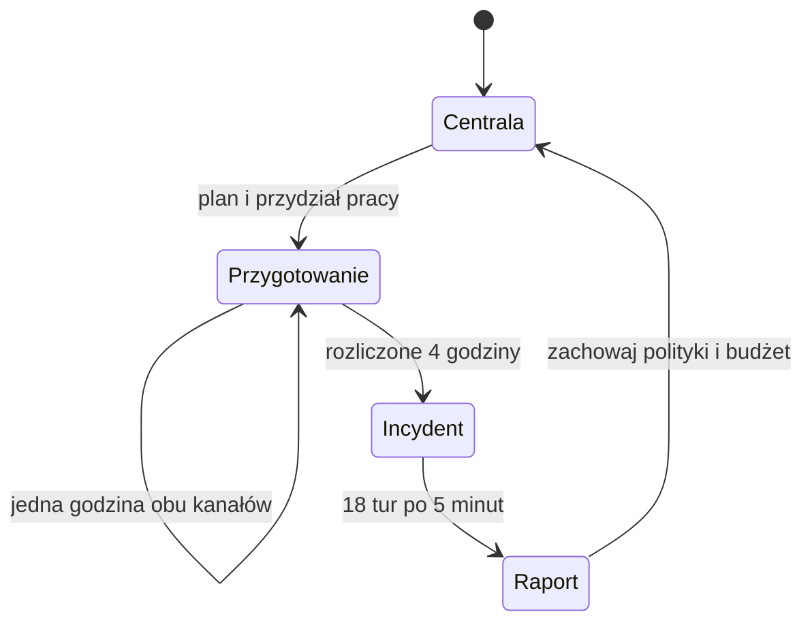

# Strategia — Centrala NEXUS

## Pętla i własność stanu

Wybór trybu **Strategia** tworzy nowy rozdział. Trening i Nieznany incydent
pozostają samodzielnymi misjami, bez obowiązkowych zakupów. Kampania korzysta
z tych samych trzech definicji oraz tego samego silnika incydentu.

`CampaignState` przechowuje etap, rejestr budżetu, projekty i pozostałe godziny,
okno przygotowania, historię pracy/decyzji, trwałe polityki, seed kolejnego
wariantu i najwyżej jeden `incident: SimulationState | null`. Nie przechowuje
równoległego aktywnego świata. Centrala renderuje dokumentację firmy i trwałe
zmiany, a `currentOperation` wskazuje ten sam obiekt incydentu dla starego UI.

Pierwszy seed to 0; po każdej misji przechodzimy do następnego wariantu katalogu.
Nie podmieniamy jego typu po inwestycji. Publiczny selektor centrali nie ujawnia
wyboru ani planu przeciwnika; raport ujawnia tylko zakończone misje.

## Rejestr i bilans

| Pozycja                       |     Kwota |
| ----------------------------- | --------: |
| Budżet rozdziału              | 80 000 zł |
| Pilotaż MFA już opłacony      | 12 000 zł |
| Początkowa rezerwa            | 68 000 zł |
| Dopłata A (łącznie 32 000 zł) | 20 000 zł |
| B                             | 28 000 zł |
| C                             | 30 000 zł |
| Wszystkie pozostałe koszty    | 78 000 zł |

Nie można pokryć 78 000 zł rezerwą 68 000 zł. Budżet nie odnawia się po misji.
Saldo wynika z ledgeru, nie z oddzielnego licznika React:

- `prior-expense` zwiększa wydatki poniesione; pilotaż występuje dokładnie raz.
- `reserve` zmniejsza dostępne i zwiększa zarezerwowane środki.
- `payment` przenosi rezerwację do poniesionego wydatku przy pierwszej pracy.
- `release` zwalnia rezerwację projektu, którego jeszcze nie rozpoczęto.
- `result: rejected` zapisuje odrzuconą operację, bez zmiany bilansu.

Każda pozycja ma stabilne ID, projekt, kwotę, rodzaj, etap przygotowania, numer
okna i wynik. `available = total - spent - reserved`. Ponowny zakup jest
odrzucany. Drugi pracownik projektu B nie powoduje drugiej płatności. Nie ma
zwrotu za rozpoczęte lub zakończone wdrożenie. Można anulować plan/rezerwację
przed rozpoczęciem albo w ogóle nie inwestować.

## Projekt i harmonogram

Stany projektu: dostępny → zaplanowany → środki zarezerwowane → w realizacji →
zakończony/aktywny. Planowanie samo nie rezerwuje; rezerwacja nie płaci ani nie
aktywuje; zapłata nie oznacza zakończenia. Obowiązuje rzeczywisty postęp:

| Projekt          | Administrator | Analityk |
| ---------------- | ------------: | -------: |
| A: dostęp zdalny |           4 h |      0 h |
| B: audyt plików  |           2 h |      4 h |
| C: segmentacja   |           4 h |      0 h |

Okno ma cztery **względne godziny przygotowania** przed modelowanymi próbami
uwierzytelnienia; nie jest zegarem 00:00–04:00 ani zegarem świata incydentu.
`advance-preparation` przesuwa oba kanały o jedną godzinę. Każdy wykonawca ma
najwyżej jedną pracę naraz. Godziny bez przydziału mijają bez postępu projektu.
Po czwartej godzinie niedokończone przydziały pauzują, a pozostała praca nie ginie.
Następne okno ma świeże cztery godziny obu osób i wymaga ponownego przydziału.

Przykład zweryfikowany w Chromium:

1. Rezerwacja A+B: 48 000 zł, oprócz pilotażu 12 000 zł.
2. Okno 1: administrator A przez 4 h, analityk B przez 4 h równolegle.
3. Wydano 60 000 zł, pozostało 20 000 zł. Aktywne A; B ma jeszcze 2 h administratora.
4. Incydent 1 korzysta z MFA, bez audytu B.
5. Okno 2: administrator kończy B w 2 h, bez dodatkowej płatności.
6. Incydent 2 korzysta już z obu inwestycji. C za 30 000 zł nie mieści się w rezerwie.

Przed ukończeniem C można wybrać grupę w ramach jego planu. Po wdrożeniu zmiana
zakresu wymaga wolnego administratora przez **1 h**, przesuwa też równoległą
pracę analityka i nie pobiera ponownie ceny projektu.

## Co dziedziczymy

`SecurityPosture` zawiera aktywację trzech projektów, zakres grupy SMB oraz jawne
ręczne nadpisania reguł, stanu logowania/wersji kont i dostępności zasobów.
Przy powrocie z raportu faktycznie wykonane zmiany są utrzymywane, bez ponownego
kupowania projektu. Nie przenosimy sesji, alertów, zadań incydentu, pozyskanych
obserwacji, przeciwnika ani jego licznika wycieku. To są fakty poprzedniego okna.

Nowy incydent pochodzi z `ScenarioDefinition + SecurityPosture`, rozstrzygniętych
prób logowania i świeżego stanu operacyjnego. Trwała polityka porządkowania
uprawnień respektuje udokumentowaną rolę plikową danego przydziału pracy;
nie identyfikuje napastnika na podstawie ukrytego wariantu.

## Trzy decyzje

**A — dostęp zdalny:** wskazane modelowane konta reprezentujące grupę 61 kont
wymagają zarejestrowanego drugiego składnika. Legalne profile mają własny
składnik; przeciwnik posiada tylko znane hasło. Usuwany jest SMB konta
`magazyn-07`, jeżeli nie jest wymagany przez jego udokumentowany proces pracy.
MFA nie zamyka istniejących sesji. Wcześniejsza skuteczna odmowa logowania nie
może być pominięta przez skopiowanie starego S-19.

**B — audyt:** FS-01 rejestruje docierające do usługi list/open/read oraz
wyniki uprawnień, z pomiarem odczytanych rekordów, gdy usługa go posiada.
Retencja 120 minut, dostarczenie 5 minut po zebraniu. Analityk pozyskuje migawkę
zadaniem trwającym 5 minut. Monitoring nie blokuje ataku i nie nadaje dostępu.

**C — segmentacja:** oddzielne reguły ERP/HTTPS i FS-01/SMB mają zakres kont.
Węższa grupa `file-team` odcina SMB Marty także wtedy, gdy pracuje legalnie.
Szersza grupa `file-team + magazyn-07` zachowuje jej dokumenty, ale również
wpuszcza osobę używającą przejętego konta. Polityka nie rozpoznaje człowieka.
Reguły są oceniane ponownie przy każdej operacji, także istniejącym tunelem.

## Granice rozdziału

Nie ma nowych firm/ataków, wynagrodzeń, rynku, automatycznych przychodów,
rekrutacji, wielu budżetów ani wielowątkowej kampanii. Zakup nie przyznaje
punktów bezpieczeństwa. Budżet, praca i polityki przechodzą przez zapis V2.
Historia tej kampanii znajduje się w centrali; wcześniejsza historia 50
samodzielnych prób pozostaje oddzielna i zachowana.

Obecny katalog premiuje A jako tanią prewencję przed trzema znanymi przypadkami.
C uczy zakresu i kosztu legalnego dostępu, B daje odrębne dowody i zajmuje inny
układ pracy zespołu. To nie jest potwierdzony pełny balans: zobacz uczciwą
[analizę grywalności i wyniki](strategic-command-validation.md).
