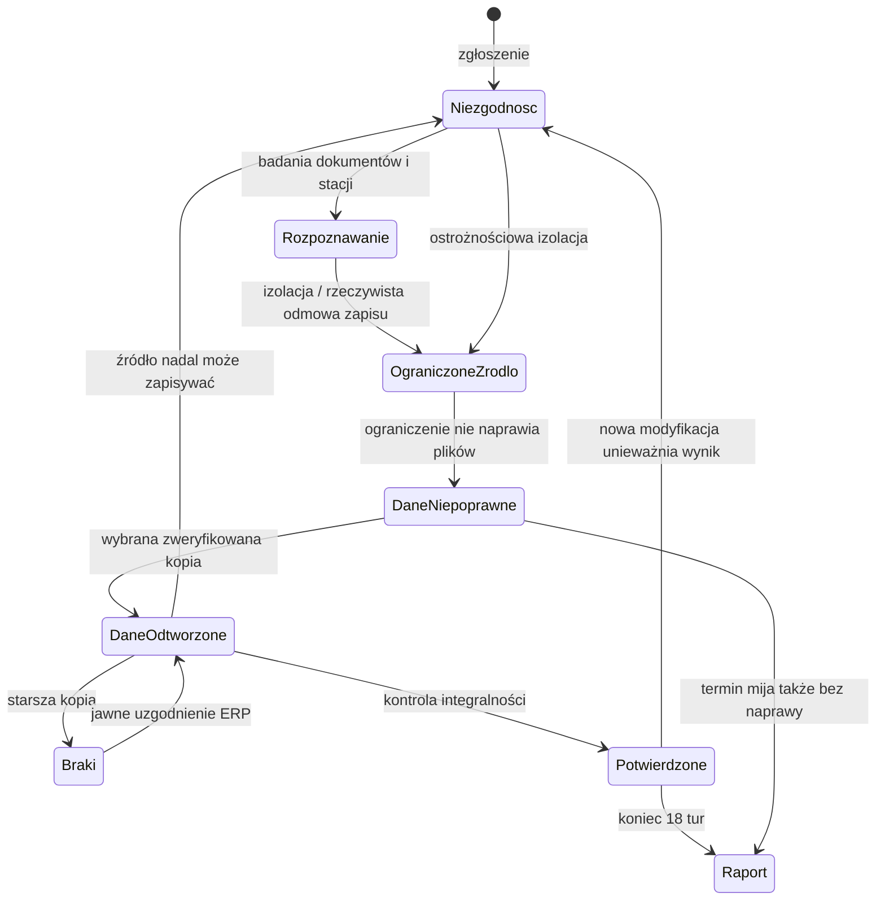
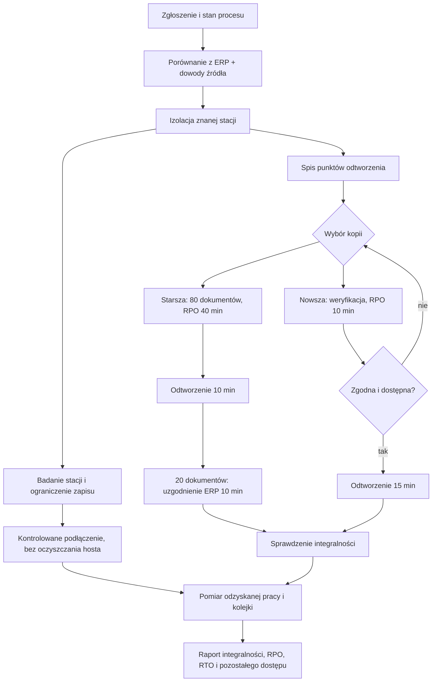

# Misja 02 — Ostatnia czysta kopia

Sprint 8 dodaje odrębną rodzinę integralności i odzyskiwania w tej samej NEXUS
Logistics. Nie jest czwartym wariantem incydentu VPN. Nie zmienia cen projektów,
budżetu, mapowania dawnych seedów ani wyników Misji 01.

## Wejście z centrali

Ukończ jeden dowolny incydent Misji 01, wróć do centrali i rozlicz następne
czterogodzinne okno. Karta **02 — Ostatnia czysta kopia** uruchamia komendę
`start-integrity-incident`. Dotychczasowe `start-incident` zachowuje wybór
`seed % 3`. Nowa definicja `nexus-last-clean-copy` jest poza `scenarioCatalog`.

Kampania zachowuje budżet, projekty, reguły, zmiany kont/usług i historię.
Misja dostaje świeże zadania, dokumenty, prywatnego aktora, zgłoszenie i wiedzę.
Po powrocie zapisuje także izolację i ograniczenie zapisu w opcjonalnym
`SecurityPosture.endpointOverrides`. Brak tego pola w starszych kampaniach
nie wymaga uzupełniania. Reguły lokalne przechodzą przez istniejące overrides.

## Podmiot lokalny, a nie tunel

`LocalEndpoint` opisuje `pakowanie-03`: podzasób logiczny agregatu
`workstations`, jedną z istniejących 94 stacji. Nie dodajemy dziesiątego
węzła ani 95. komputera. Inspektor agregatu pokazuje lokalny kontekst
`packing-local`, legalną funkcję (2 zamówienia wydajności), izolację i
ograniczenie zapisu. Prywatna kompromitacja jest wyłącznie w
`hidden.integrityThreat` i definicji ukrytej przed aktywnym UI.

`canUseLocalService` rozszerza istniejące predykaty dostępu: endpoint musi
działać, nie być izolowany, posiadać reprezentowane konto, rzeczywisty przepływ
sieciowy i uprawnienie do operacji read/modify w docelowej usłudze. Zapis musi
być dozwolony. Ocena sieci używa tego samego `networkAllows` co VPN.
Utrzymany kontekst lokalny nie wykonuje nowego logowania: zmiana hasła,
MFA VPN czy blokada nowych logowań nie unieważniają go automatycznie.

Lokalna droga to `workstations → FS-01 / SMB`, reguła `R-LOCAL-SMB`.
`VPN → FS-01` jest osobną drogą. Brak uprawnienia do modyfikacji lub izolacja
zatrzymują źródło. Nie ma alternatywnego wejścia, eskalacji domenowej ani
wykonywania prawdziwych poleceń SMB/malware.

## Dokumenty i harmonogram

Rejestr ERP oczekuje dokładnie **100 dokumentów**, `DOC-001…DOC-100`.
Każdy ma jeden aktualny stan: `correct`, `damaged`, `reconcile`. Trzeci stan
oznacza brak/nieaktualność po odtworzeniu, nie gotowy do użycia plik.
Suma aktualnych stanów zawsze wynosi 100. `everDamaged` i `recovered` to
osobne historyczne znaczniki, nie dodatkowe rozłączne części zbioru.

Referencja zawiera dozwoloną historyczną modyfikację 12 dokumentów o 13:55.
Jest rozstrzygana predykatem lokalnego dostępu na odziedziczonej konfiguracji,
więc skuteczna wcześniejsza izolacja lub odmowa lokalna rzeczywiście jej
zapobiega. Nie dopisujemy licznika uszkodzeń niezależnie od uprawnień.

Kolejne porcje są zapisane w danych misji: **20 dokumentów w turach
2, 4, 6, 8, 10, 12, 14, 16, 18**. Planer widzi własny indeks harmonogramu,
kompromitację i czas; resolver sprawdza bieżące możliwości. Wybiera rosnące ID
spośród nadal poprawnych dokumentów. Już uszkodzony dokument nie jest liczony
ponownie. Odtworzenie/uzgodnienie tworzy nową generację, która może znów zostać
uszkodzona. Brak nowych celów jest zapisywany jako brak kolejnych dokumentów,
bez fikcyjnej operacji modify w audycie. Odmowy nie tworzą innej drogi ataku.

100 dokumentów i porcje po 20 pozwalają prześledzić bilans bez tysięcy plików;
początkowe 12 daje realny problem do naprawienia nawet po szybkiej izolacji.
Parametry są stałe; nie dostosowujemy ich do decyzji ani jakości gry.

## Biznes i dostępność

Popyt pozostaje 20 zamówień na turę, 360 w całej misji. ERP, lokalne
operacje i poprawne dokumenty są odrębnymi zależnościami:

- 8 lokalnych zamówień wydajności wymaga drogi do ERP. W tym 2 wymagają
  legalnego read/HTTPS i read/SMB stacji pakowania. Jej izolacja odbiera te 2.
- Do 14 zamówień wymaga działającej zdalnej pracy w ERP oraz lokalnej drogi
  odczytu FS-01 dla agregatu pozostałych stanowisk (`warehouse-team`).
  Uprawnienie i reguła tej drogi muszą istnieć. Wkład wynosi
  `floor(14 × liczba poprawnych dokumentów / 100)`.
- Sprawna całość ma 22 wydajności. Izolacja jednej stacji nie wyłącza FS-01
  ani pozostałych 93 komputerów. Globalna odmowa lokalnego SMB ogranicza
  również inne modelowane stanowiska. Brak VPN nadal odbiera zdalny etap ERP.

Udział poprawnych dokumentów jest jawnym uproszczeniem przepływu zleceń,
nie symulacją indywidualnego dopasowywania każdego zamówienia do pliku.
Bilans kolejki pozostaje `przyjęte = obsłużone + zaległe`. Nie ma kary
punktowej za brak backupu. Czas ograniczenia danych w raporcie pochodzi z
przedziałów z niepoprawnym/niedostępnym zbiorem; sam brak VPN nie jest liczony
jako uszkodzenie lub niedostępność lokalnych dokumentów.

## Kopie i jawne odtwarzanie

| Kopia | Moment | Zakres | Weryfikacja początkowa | Odtworzenie | RPO względem 14:00 |
| --- | --- | --- | --- | --- | --- |
| FS-1320 | 13:20 | DOC-001…080 | zweryfikowana wcześniej | 10 min | 40 min |
| FS-1350 | 13:50 | DOC-001…100 | nieznana | 15 min | 10 min |

Dokumenty 81–100 powstały pomiędzy starszą a nowszą kopią. W referencji obie
kopie mają czystą zawartość, ale nowszej nie wolno uznać za poprawną bez
weryfikacji. Model i test wadliwej kopii rozróżniają rzeczywistą zawartość
od wyniku dotychczasowego badania. Niedostępna lub wykryta wadliwa kopia nie
daje dozwolonej operacji restore.

Odtworzenie jest przygotowywane obok działającej usługi; do ukończenia zadania
biznes korzysta z dotychczasowego zbioru. Dopiero na granicy tury następuje
przełączenie. FS-01 nie zostaje magicznie wyłączony ani naprawiony globalnie.
Starsza kopia daje 80 poprawnych dokumentów i 20 wymagających **osobnego,
czasowego uzgodnienia z ERP**. Nie przywracamy zmian spoza zakresu kopii.
Odtworzenie nie zmienia kompromitacji ani uprawnień źródła.

RPO w tej misji oznacza wiek wybranego punktu względem początku okna 14:00,
a nie liczbę plików. Faktyczny zakres brakujących zmian jest podany osobno.
RTO danych jest mierzone od 14:00 do pierwszej skutecznej kontroli pełnego
zbioru. To zmierzony czas danych, nie obietnica RTO całej firmy. Następna
szkodliwa modyfikacja unieważnia potwierdzenie; bez skutecznego badania raport
pokazuje „niepotwierdzone”. Kolejka i izolacja pozostają oddzielnymi skutkami.

## Działania i czas

| Działanie | Wykonawca | Czas | Warunki / rezultat |
| --- | --- | --- | --- |
| Porównanie dokumentów z ERP | analityk | 10 min | dostępne ERP i FS-01; migawka całego jawnego zakresu |
| Sprawdzenie kopii | analityk | 5 min | spis metadanych; nie potwierdza zawartości |
| Weryfikacja kopii | analityk | 10 min | znana, dostępna kopia; zgodna albo wadliwa |
| Odtworzenie | administrator | 10 lub 15 min | znana, dostępna i zweryfikowana kopia; FS-01/ERP dostępne |
| Uzgodnienie z ERP | analityk | 10 min | istnieją braki po kopii; dostępne oba źródła |
| Badanie endpointu | analityk | 10 min | znany endpoint; odczyt lokalnego dziennika przez obsługę konsoli, także przy izolacji |
| Izolacja endpointu | administrator | 5 min | znana stacja z włączoną komunikacją |
| Ograniczenie zapisu | administrator | 10 min | izolacja i ukończone badanie stacji |
| Kontrolowane podłączenie | administrator | 5 min | izolacja i zachowane ograniczenie zapisu |

Każdy pracownik ma istniejącą pojedynczą kolejkę. Zlecenie nie wykonuje pracy
od razu; zadanie musi zmieścić się w 18 turach. Restore i uzgodnienie tego
samego zbioru wzajemnie się wykluczają. Warunki fizyczne odtworzenia są także
sprawdzane przy ukończeniu. Bezpieczne podłączenie dotyczy modelowanego zapisu;
**nie jest potwierdzeniem usunięcia kompromitacji** ani pełnym EDR.

## Wiedza i audyt

Zgłoszenie o 13:55 jest relacją człowieka. Porównanie dokumentów podaje czas,
zakres 100 ID i agregaty zgodności, bez tożsamości sprawcy. Badanie endpointu
czyta lokalny dziennik żądań: konto, operację, zakres, czas i dopuszczenie/odmowę.
Nie odczytuje flagi kompromitacji. Korelacja obu źródeł jest decyzją gracza.

Projekt File Access Visibility daje ten sam sensor FS-01, jawnie rozszerzony o
modify w tej misji. Do sensorów trafiają tylko rzeczywiste żądania docierające
do usługi, także legalne read i odmowy uprawnień. Izolacja/sieć nie generują
fikcyjnego zdarzenia na serwerze. Pole sesji jest `null` dla operacji lokalnej;
`endpointId` i konto zastępują informację o tunelu. Zakres w logu jest zakresem
żądania, a nie automatyczną klasyfikacją uszkodzenia lub złośliwości.

Pokrycie zaczyna się o 14:00, retencja wynosi 120 min, dostarczenie zajmuje
5 min. Początkowej modyfikacji 13:55 nie dopisujemy wstecz do audytu serwera.
Przy braku projektu nie powstaje audyt plikowy; pozostają porównanie ERP i
wolniejsze badanie dziennika stacji. Aktywna projekcja nie zwraca prywatnych
dokumentów, zawartości kopii, planu ani flagi kompromitacji. Wyniki badań
zachowują czas i pozostają migawkami. Pełną prawdę ujawnia dopiero raport.

## Stany incydentu

## Proces odtwarzania

## Implementacja i granice

Typy są w `domain/integrity.ts`, parametry w `content/scenarios/integrity.ts`,
resolver/planer/efekty w `simulation/integrity.ts`. Nie ma drugiego zegara
ani drugiego silnika. Istniejące `engine`, `tasks`, `access`, `business` i
`fileAudit` korzystają z rozszerzeń tylko przy obecnej definicji tej rodziny.
Kolejność: rozliczenie starego przedziału → zakończenie zadań → aktorzy →
sensory → ukończone obserwacje → raport. Restore ukończone na tej samej
granicy co porcja ataku może więc zostać natychmiast ponownie naruszone.

Nie ma szyfrowania, ransomware, domenowej eskalacji, pełnego Windows token
model, nowej firmy, projektu zakupowego, EDR ani backendu. Jedna referencja
zna źródło i czyste kopie; nie jest generatorem losowych incydentów.
Planowanie przy znanym scenariuszu można zoptymalizować. Wyniki i uczciwa
ocena grywalności: [raport walidacji](mission-02-validation.md).
Zgodność i oryginały: [zapis V3](game-save-v3.md).
