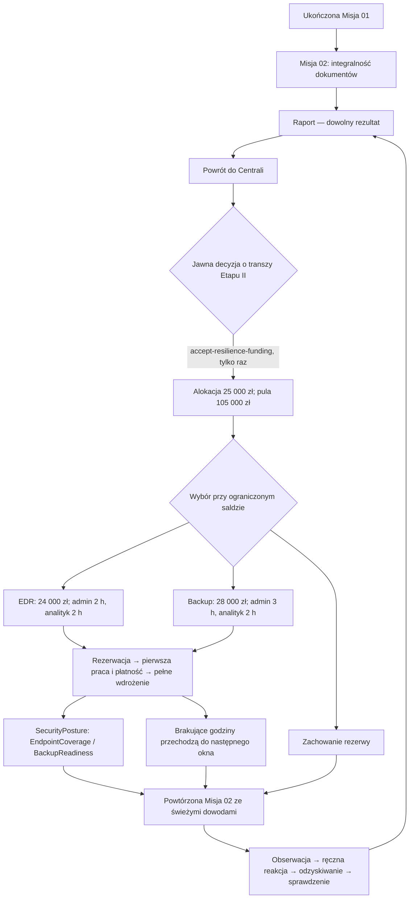

# Defense Investment Program — Sprint 9

Etap II rozwija istniejącą kampanię NEXUS Logistics. Nie dodaje misji ani
punktów bezpieczeństwa. Referencyjna Misja 02 pozostaje tym samym incydentem:
zmienia się przygotowanie organizacji i dostępne działania gracza.

## Pętla decyzji



Nie trzeba ponownie przechodzić Misji 01. Czterogodzinne okna i incydenty
pozostają istniejącą strukturą kampanii. Oba nowe projekty wymagają łącznie
5 h administratora i 4 h analityka, więc nie mieszczą się w jednym oknie.

## Rejestr finansowania

`CampaignState.funding` jest opcjonalnym, osobnym rejestrem alokacji:

```ts
{
  initialAllocation: 80000,
  allocations: [{
    id: 'board-resilience-ii',
    source: 'integrity-risk-review',
    amount: 25000,
    window: 3,
    reportNumber: 2
  }]
}
```

Komenda `accept-resilience-funding` działa tylko w centrali po przynajmniej
jednym raporcie `nexus-last-clean-copy`. Wynik misji nie jest warunkiem.
Druga próba jest odrzucana. Zwiększa `budget.total`, dodaje dwie dostępne
pozycje katalogu, lecz nie zmienia dotychczasowego ledgeru, rezerwacji,
płatności ani godzin. `ProjectId` identyfikuje wyłącznie inwestycje.

Bilans nadal liczy wydatki i rezerwacje przez `budgetBalance`. Historyczne
12 000 zł pilotażu pozostaje wydatkiem. Przy 60 000 zł wydatków po transzy
pozostaje 45 000 zł: wystarcza na D lub E, ale nie oba. Przy wydatkach tylko
12 000 zł można przeznaczyć 52 000 zł na oba i zachować 41 000 zł.

`createCampaign()` nadal tworzy dokładnie trzy historyczne projekty i pulę
80 000 zł. Import starej kampanii nie dodaje pieniędzy ani pozycji katalogu.
Nowe zdarzenie finansowania jest weryfikowane przez pełny replay V4.

## Kontrakt sensora EDR

Definicja `content/endpointCoverage.ts` opisuje pilotaż **pakowanie-03, 1 z 94
istniejących stacji**. Nie powstaje dodatkowy komputer. Dopiero pełne 2 h
administratora i 2 h analityka instalują `SecurityPosture.endpointCoverage`.
Rezerwacja, płatność i pojedynczy ukończony kanał pracy nie mają tego efektu.

Agent rejestruje faktyczne wywołania wspólnego resolvera lokalnego SMB,
włącznie z legalnym odczytem i odmową operacji. Zdarzenie zawiera ID,
źródło `fortress-endpoint-agent`, sensor, endpoint, konto, czas operacji i
przechwycenia, operację read/modify, cel FS-01/SMB, wynik oraz ID dokumentów.
To własny format gry, bez udawania Sysmon. Rekord kolektora dodaje ID kolektora,
czas dostarczenia i dostępności. Sekwencja ID nie resetuje się przy retencji.

| Parametr | Wartość / warunek |
| --- | --- |
| Zakres | Tylko pakowanie-03, operacje read/modify lokalnego resolvera SMB |
| Początek pokrycia | 13:55 w nowej Misji 02; wdrożenie nastąpiło przed incydentem |
| Agent | Musi być dostępny i mieć zasilany/online modelowany zasób workstations |
| Kanał zarządzający | Jawna abstrakcja agent → nazwany kolektor, niezależna od tunelu VPN |
| Dostarczenie | Działający agent, endpoint online i nieizolowany, dostępny kolektor |
| Opóźnienie | 5 min od dostarczenia do dostępności dla detekcji/badania |
| Retencja | 120 min od czasu zdarzenia, osobno bufor lokalny i rekordy kolektora |
| Badanie | Analityk, 1 tura / 5 min, dostępny kolektor i czas w oknie |

Pierwsza rzeczywista operacja 13:55 może zostać przechwycona i dostarczona o
13:55, a dostępna o 14:00. To zdarzenie inicjalizacji przy działającym agencie,
nie retrospektywny odczyt prywatnego pola kompromitacji. Bez instalacji nie
powstaje sensor ani takie rekordy.

Izolacja odcina nowe dostarczenia. Agent online może fizycznie zarejestrować
lokalną próbę z wynikiem odmowy. `inspect-edr-telemetry` czyta **wyłącznie
zdalny kolektor**, również po izolacji, jeżeli pozostały tam wcześniejsze
rekordy. Nie czyta nowego lokalnego bufora przez odciętą drogę. Po odzyskaniu
drogi niewygasłe zdarzenie otrzymuje nowy czas dostarczenia i kolejne 5 min
opóźnienia. Wygasłe zapisy nie odradzają się przy ponownym połączeniu.

Istniejące fizyczne badanie lokalnego dziennika (`examine-endpoint`, 10 min)
pozostaje dostępne bez EDR i przy izolacji. To inne źródło i inna operacja.

### Detekcja i decyzja

`detectEndpointAlerts` przyjmuje tylko rekordy, definicję reguły, czas i
poprzednie alerty. Nie przyjmuje `SimulationState`, pochodzenia aktora ani
prywatnego planu. Parametry reguły `endpoint-modify-burst`:

- jedna stacja i sensor;
- dopuszczona operacja modify;
- co najmniej 10 modyfikowanych dokumentów w ostatnich 10 min;
- wyłącznie dostępne, dostarczone i mieszczące się w retencji rekordy;
- powtórzone ID zdarzenia nie liczy się ponownie; różne rzeczywiste operacje
  na tym samym dokumencie mogą być kolejnymi modyfikacjami;
- jeden alert dla pary sensor/endpoint/reguła w incydencie, ze wskazaniem
  faktycznych ID zdarzeń i oceną `requires-investigation`.

Legalny burst również może spełnić próg. Alert nie dowodzi kompromitacji.
UI pokazuje alert i parametry, a szczegółowe rekordy dopiero po ukończonym
badaniu. Nie ujawnia lokalnego bufora, przyszłych operacji i prywatnego stanu.

Ręczna izolacja nadal trwa 5 min i nie wymaga produktu. Zakup nie izoluje,
nie naprawia plików, nie ogranicza zapisu i nie oczyszcza hosta. Kontrolowane
ograniczenie zapisu wymaga izolacji i pozyskanego dowodu ze stacji: badania
lokalnego lub rzeczywistych rekordów EDR. Puste badanie EDR tego warunku nie
spełnia. Kontrolowane podłączenie nadal wymaga ograniczenia zapisu.

## Kontrakt Backup Resilience

Dopiero ukończenie **3 h administratora i 2 h analityka** uruchamia modelowaną
weryfikację i próbę odtworzenia FS-1350. Test używa definicji rzeczywistej kopii
oraz dostępności FS-01 i ERP po odziedziczonych zmianach infrastruktury.

Procedura materializuje wyłącznie dokumenty snapshotu, sprawdza każdy z nich
pod kątem uszkodzeń i zapisuje wynik w `SecurityPosture.backupReadiness`:

- identyfikator kopii, okno i godzinę testu;
- tożsamość zawartości (ID kopii, czas, zakres i uszkodzenia; to porównanie
  skończonego modelu, **nie podpis kryptograficzny**);
- rzeczywiście sprawdzone ID dokumentów;
- clean/damaged/unavailable, wynik testu odtworzenia i zmierzony w modelu czas.

Niedostępna kopia/usługa nie ma sprawdzonych dokumentów i nie zalicza testu.
Uszkodzona kopia pozostaje uszkodzona. Przy kolejnym incydencie wynik pasuje
tylko do identycznego snapshotu i pełnego zgodnego zakresu. Zmiana zawartości
unieważnia wcześniejszą gotowość, nie naprawia kopii.

| Kopia | Bez programu | Po pasującym, zaliczonym teście |
| --- | --- | --- |
| FS-1320 | 80 dokumentów, clean, restore 10 min, RPO 40 min | Bez zmiany; pozostałe 20 wymaga uzgodnienia z ERP |
| FS-1350 | 100 dokumentów, unknown, weryfikacja 10 min, restore 15 min, RPO 10 min | clean w sprawdzonym zakresie, restore 10 min, RPO nadal 10 min |

Analityk nadal musi ustalić dostępne punkty (5 min), a administrator wykonać
restore przy dostępnej kopii, FS-01 i ERP. Sam test programu nie uruchamia
odtworzenia. Restore nie odbiera źródłu prawa zapisu i nie tworzy późniejszych
dokumentów. Podczas przełączania pozostaje poprzedni zbiór; istniejąca kolejność
tury i przeliczanie wydajności biznesowej są zachowane.

## Pamięć i raport

Do kolejnych misji przechodzą alokacja, saldo, praca, ukończone przygotowanie,
reguły, konta, dostępność, izolacja i ograniczenie zapisu. Incydent od nowa
inicjalizuje dokumenty, plan, zadania, alerty i obserwacje. Jeżeli poprzednia
reakcja odebrała endpointowi zapis, to ograniczenie pozostaje skuteczne w
następnej Misji 02. Nie cofamy go, aby sztucznie uzasadnić zakup narzędzia.

Raport po 18 turach pokazuje obecność agenta, liczbę przechwyconych operacji,
rekordy w retencji, czas alertu i faktyczne pozyskanie dowodu. Wskazuje liczbę
decyzji ograniczających podjętych po takim dowodzie; to związek czasowy,
nie automatyczny dowód przyczynowości. Czas badania 5 vs 10 min jest cechą
procedur; rzeczywisty rezultat zależy od harmonogramu. Zignorowany sensor nie
otrzymuje zasługi za sukces. Sekcja backup podaje wynik testu, użycie kopii,
faktyczny czas restore, RPO, RTO i dokumenty wymagające uzgodnienia. Nie ma ROI.

Wyniki pełnych przebiegów i ograniczenia: [walidacja](resilience-validation.md).
Zapisy i migracje: [FortressSaveV4](game-save-v4.md).
