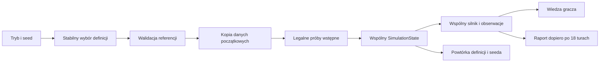

# Sprint 5 — konfiguracja wariantów

Trzy definicje danych korzystają ze wspólnego zegara, dostępu, biznesu, zadań,
telemetrii, detekcji, narracji i raportu. Nie ma osobnych silników wariantów.
Dokument ujawnia prawdę scenariuszy i jest przeznaczony dla programisty.



## Wybór i inicjalizacja

- `domain/scenario.ts`: definicja, tryb, seed i legalne zachowania.
- `content/scenarios/`: `reference.ts`, `legitimate.ts`, `stolenCredential.ts` oraz stabilny katalog.
- `application/createScenario.ts`: walidacja, kopiowanie i inicjalizacja jednego stanu.
- `application/scenarioSelectors.ts`: deterministyczny wybór i następny numer.
- `application/scenarioReducer.ts`: rozpoczęcie próby; reszta trafia do istniejącego reducera.
- `simulation/legitimateActors.ts`: ponowne uwierzytelnianie legalnych klientów.

```ts
createInitialSimulation();         // A, trening, seed 0 — kompatybilność
createScenarioRun('training', 12); // nadal A
createScenarioRun('unknown', 0);   // A
createScenarioRun('unknown', 1);   // B
createScenarioRun('unknown', 2);   // C
createScenarioRun('unknown', 3);   // ponownie A
createScenario(definition, { mode: 'unknown', seed: 7 }); // własna definicja
```

Wybór to `seed % 3`; trening zawsze wybiera A. Seed musi być nieujemną bezpieczną
liczbą całkowitą. UI rozpoczyna nieznany incydent od 1; kolejny przechodzi do
następnego numeru i wariantu. Przy granicy liczb numer zawija się w bezpiecznym
zakresie, zachowując kolejność katalogu. Nie ma losowania ani czasu systemowego.

`reset` odtwarza `hidden.scenario` z tym samym `run`. Nowa próba inicjalizuje świat,
konta, sesje, biznes, źródła, sensory, alerty, wiedzę, zadania, hipotezę, narrację
i prywatne historie od początku. Nie zachowuje nowych logowań lub dowodów.

## Kontrakt definicji

| Pole | Znaczenie |
| --- | --- |
| `id`, `name`, `kind`, `explanation` | Prywatna identyfikacja i wyjaśnienie po misji |
| `world`, `access` | Infrastruktura, konta, sesje, polityki i uprawnienia |
| `clock`, `process` | Czas, popyt, wydajność i legalne zależności |
| `telemetry` | Początkowa historia oraz konfiguracja sensorów, bez runtime'u |
| `initialSessionOrigins` | Prywatna prawda o tunelach |
| `authenticationPrelude` | Opcjonalne legalne próby sprzed lub z chwili startu |
| `legitimateBehaviors` | Legalni klienci, ich wiedza o poświadczeniu i opóźnienie ponowienia |
| `attacker` | Plan albo rzeczywiste `null` |
| `witnesses` | Relacje kont, świadków i czasu, którego dotyczą |
| `goals` | Pula rekordów, limit ujawnienia i zaległości oraz wymóg ograniczenia zagrożenia |
| `briefing` | Neutralny opis bez zdradzania typu incydentu |

Definicja jest głęboko kopiowana. `hidden.scenario` pozostaje początkową
konfiguracją do powtórki, niezależną od zmieniającego się dostępu i telemetrii.
Silnik nie nadpisuje jej po komendach. Testy sprawdzają niezależność kopii,
niezmienność konfiguracji i powtarzalność całych przebiegów.

`SimulationState.hidden.attacker` dopuszcza `null`. `ReferenceSimulationState`
zawęża wyłącznie typ referencyjnego wejścia i fixture'ów. Nie tworzy alternatywnego
świata; dotychczasowe testy zachowują swoje asercje.

## Walidacja

`validateScenario` zwraca błędy, a `createScenario` odrzuca definicję przed startem.
Sprawdza unikalność ID, strefy i właścicieli zasobów, końce relacji, tożsamości
kont, właścicieli/bramy/czasy/pochodzenie sesji, zasoby i protokoły polityk oraz
uprawnień. Waliduje również legalne zależności, ich wykonawców, świadków, źródła,
sensor, retencję/opóźnienie, plan przeciwnika i zgodność celów.

Próby wstępne muszą wskazywać zdefiniowanego legalnego aktora, być chronologiczne
i nie wykraczać poza początek gry. Zwykłe źródła nie mogą zawierać sukcesu
nieistniejącej sesji. Brak tunelu przeciwnika wymaga jawnego terminu logowania.
Nie naprawiamy błędnych danych przez dodawanie brakujących kont lub zasobów.
Jest to walidacja typowanych definicji projektu, nie parser niezaufanych JSON-ów.

## Trzy warianty

| Właściwość | A — referencyjny | B — legalna sesja | C — nowe logowanie |
| --- | --- | --- | --- |
| Prywatny przeciwnik | Obecny | **Brak (`null`)** | Obecny |
| `magazyn-07` na starcie | S-19 sprawcy | S-19 Marty | Brak tunelu |
| Błędy przed 14:00 | 52 | 52 z legalnego klienta | 52 historyczne odmowy |
| Sukces 13:58 | S-19 | S-19 | Brak |
| Pierwsze logowanie przeciwnika | Po utracie tunelu | Nie występuje | 14:15 |
| Legalna praca plikowa przez VPN | Brak osobnej części | `magazyn-07` | `file-team`, F-01 |
| Normalna wydajność | 8 + 14 = 22 | 8 + 8 + 6 = 22 | 8 + 8 + 6 = 22 |
| Po odmowie SMB | 22 | 16 | 16 |

**A:** `nexusSimulation`, `nexusAttack` i `nexusIncident` pozostają niezmienione.
Domyślne API i pięć strategii 4B dają te same wyniki. Dyspozytorzy zachowują
dotychczasową politykę dostarczania aktualnego poświadczenia (`managed-current`)
i brak opóźnienia nowego logowania po odzyskaniu dostępności bramy.

**B:** definicja zaczyna z pustymi sesjami i źródłami. Sekwencja wstępna wywołuje
`issueVpnSession`: 52 próby Marty ze starą wersją 0, następnie prawidłowa wersja 1
o 13:58; dyspozytorzy logują się o 14:00. Sesje i logi wynikają z usługi, nie z UI.
Test zmienia wersję jednej próby i potwierdza rzeczywistą zmianę jej wyniku.
Wersje to abstrakcja klienta, nie model konkretnego produktu VPN.

Sensor nie widzi wersji ani aktora. Początkowe logi i alert są identyczne jak w A.
Relację Marty należy zestawić z tunelem i udokumentowaną rolą w pracy na FS-01;
pozostaje ona relacją człowieka. Po utracie S-19 klient czeka jedną turę,
używa zapisanej wersji (`fixed`) i podlega blokadzie/resetowi. Nie poznaje
automatycznie nowego hasła. Nowe legalne tunele dostają własne ID i zwykłe logi.
Nie ma stanu ani akcji napastnika.

**C:** brak S-19 i sukcesu z 13:58. Są tylko legalne B-01 i F-01 oraz zgodne z nimi
sukcesy o 14:00. Historyczne odmowy nie dowodzą sposobu zdobycia hasła.
`initialSessionId: null` i `firstAuthenticationTurn: 3` rozpoczynają plan od
logowania o 14:15. Nie ma fikcyjnej utraty nieistniejącego tunelu. Blokada/reset
gotowe przed próbą powodują odmowę. Sukces tworzy S-20; kolejne tury realizują
rekonesans, start i porcje o 14:30/14:35/14:40. Każda sprawdza aktualny dostęp.

## Legalne SMB

`process.additionalWork` definiuje część o wydajności 6. Konto potrzebuje własnego
aktywnego tunelu i wszystkich usług: ERP/HTTPS oraz FS-01/SMB. Brak któregokolwiek
warunku odbiera tę część wydajności. To samo `canUseService` ocenia legalną pracę
i przeciwnika. Odebranie uprawnienia, tunelu, usługi lub protokołu działa tak samo
jak odmowa reguły. Nie ma kary za przycisk; bilans kolejki nie został zmieniony.

Osobne 8 zamówień przez HTTPS pozostaje dostępne. Dokumentacja zależności jest
w Operacjach, a panel reguły wskazuje legalne konto i zależną wydajność.

## Granice ujawnienia i raport

Widok dostaje tryb i numer próby, neutralny briefing, publiczne zależności oraz
uzyskane dowody. Nie otrzymuje ID/nazwy/typu wariantu, planu lub informacji
o obecności przeciwnika. Detektor nie dostaje metadanych scenariusza. Narracja
używa jawnych faktów; koszt FS-01 wymaga rzeczywistego raportu biznesowego.

Po 18 turach raport ujawnia wariant. Dla A/C ocenia poufność, biznes, możliwości,
limit prób i osobny cel ograniczenia aktualnego dostępu do FS-01. Stan konta jest
osobną informacją. Dla B `containment.applicable` jest fałszywe, `goalMet` to
`null`; brak historii przeciwnika i komunikatów o jego pokonaniu. Raport wyjaśnia
detekcję oraz pokazuje obniżoną wydajność i ograniczenia legalnych kont.
Nie sumuje osi do wyniku 0–100.

Granica wiedzy jest kontraktem interfejsu gry, nie zabezpieczeniem przed
inspekcją kodu aplikacji działającej w całości w przeglądarce.
